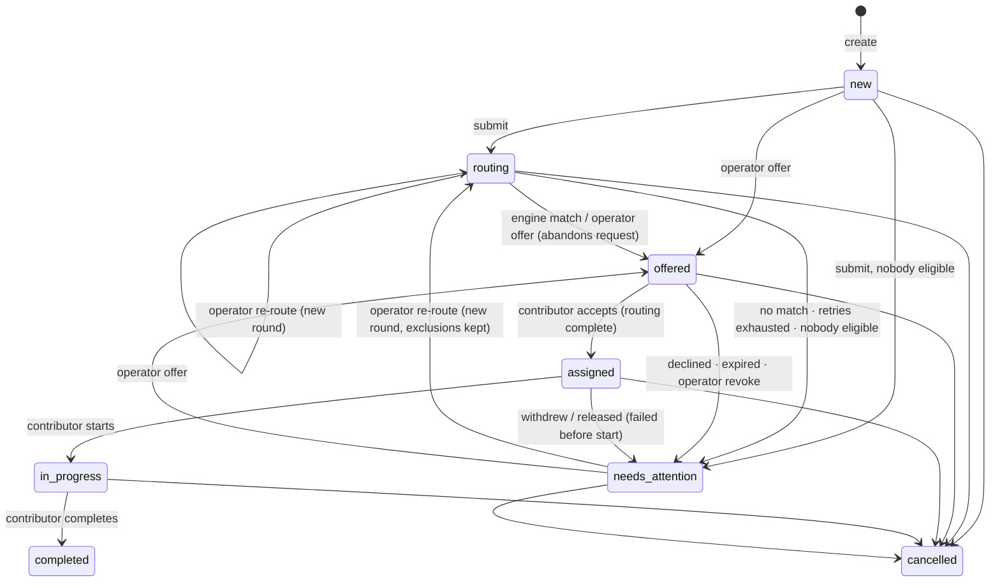

# Terac Routing Desk: PLAN (single source of truth)

**Status:** draft until the candidate signs off on §14 and commits `plan: frozen`.
**Inputs:** `docs/planning/01–05` are dimension plans generated by agents. This file supersedes them. `docs/planning/06-critiques.md` records every critic point and whether this plan adopted it. If this file disagrees with an input, this file wins.
**Clock:** T0 ≈ 11:10 (check against the first message of the planning transcript). Synthesis finishes around 12:10, which is T+1:00. The hard stop is T+5:00 ≈ 16:10. That leaves roughly **3h45 for build, docs and Loom**, and the scope below is cut to fit it.

---

## 0. TL;DR: the decisions that define the build

| # | Decision | One-line why |
|---|---|---|
| 1 | **The rows are the truth.** `events` is an append-only log written in the same transaction as each change. No event sourcing. | History can never disagree with state, and state stays queryable. |
| 2 | **Task status:** `new → routing → offered → assigned → in_progress → completed`, plus `needs_attention(reason)` and `cancelled`. | Task status always mirrors its active assignment, so one invariant can be checked. |
| 3 | **`needs_attention` means automation has stopped and waits for a person. "Overdue" means automation still owns the task and it's late.** Overdue is computed and never stored. | These are two different operator obligations and the UI must never blur them. |
| 4 | **Fencing.** An engine answer is applied only by a CAS that requires the attempt to be `pending`, to be the task's `current_attempt_id`, and the task to be `routing`. Any other answer is recorded on the attempt and emits `late_result_ignored`. | First terminal transition wins. Everything after it is recorded, not applied. |
| 5 | **Deadlines are columns, enforced by one `tick(now)`:** deliver the sim inbox (oldest first), time out due attempts, expire due offers. It runs every 500 ms, **before every command**, and once at boot before `listen()`. No `setTimeout` owns state. | Restarts lose nothing, and tests drive time with a FakeClock without fake timers. |
| 6 | **An engine answer counts if it reached the inbox strictly before `deadline_at`** (`available_at < deadline_at`), whenever we process it. Contributor actions count at processing time. | The outcome doesn't depend on when the ticker ran. Contributors need our API to be up, the engine's inbox doesn't. |
| 7 | **Pending policy:** neutral for 0–20 s, then **Overdue** with honest copy. At the per-priority deadline (high 30 s / normal 45 s / low 60 s) the request times out and is **retried automatically, 2 retries per round** (3 requests), then `needs_attention(routing_exhausted)`. The next automatic action is always shown as a countdown. | Nothing automatic happens without a countdown on screen first. |
| 8 | **Machines retry machine failures** (timeout, stale pick). **A person's "no" goes to a person** (decline, expiry, withdraw, release). The engine's "no match" goes straight to the operator with no retry. | A decline carries information the engine can't act on. Asking the same question twice gets the same "no match". |
| 9 | **An operator pick is an offer** on the same lifecycle as an engine pick, and only the contributor can accept. Exclusions bind the engine, not the operator, who can override after a confirm. | One code path. Contributors are people who must agree. |
| 10 | **Capacity:** each contributor has a `max_active`, and **offers count toward it**. It is re-checked when a result is applied. | It's the only coupling between tasks, so it carries the "several tasks at once" story. |
| 11 | **Restart model B:** the simulated engine is an external service with a durable inbox (`sim_jobs`). Each request's fate is decided at dispatch and stored where desk code can't read it. | Answers can arrive after a restart and go through the same fencing. The uncertainty is real, not a UI trick. |
| 12 | **Optimistic concurrency:** every operator command carries `expectedVersion` and `seenEventId`. A 409 returns the events the client hasn't seen. | If the world moved, we refuse and show what moved. |
| 13 | **Stack:** TypeScript end to end in one package. Node 26 + tsx + Express 5 + `node:sqlite` (raw SQL) + zod. React 19 + Vite + TanStack Query (1 s polling) + Tailwind v4. Vitest with FakeClock against real SQLite. | Familiar, no native builds, synchronous transactions. |

---

## 1. Product thesis

**What we optimise for, in order:** correct state under races and restarts, then honest copy, then the operator's time-to-act, then breadth of features.

**The story for the reviewer (Loom and README):**
> "This desk never pretends to know what it can't. A pending request shows elapsed time against the normal 5–20 s window, plus exactly what the system will do next and when. If an answer arrives after we've stopped waiting, it's written down and shown to you, never applied. Machines retry machine failures. People's decisions come back to a person, with enough context to act in one click. The database refuses the states we promised can't happen, and a fake clock replays every race in the brief."

---

## 2. Scope (MoSCoW against the 5-hour budget)

| Area | MUST | SHOULD | COULD | WON'T |
|---|---|---|---|---|
| **Domain** | Tables, CHECKs, 2 partial unique indexes, `tx()` helper; statuses and reasons in §3; commands: create, submit, offer, reroute, revoke_offer, release, cancel, accept, decline, start, withdraw, complete, applyEngineResult, timeout, expire; eligibility + exclusions + capacity; apply-time re-check | Replay seed with settled histories; append-only events trigger; `acknowledgeExclusion` confirm flow | Stop routing; force-assign ("already agreed"); one-click reassign; operator "mark complete"; triggers for I5/I9; idempotent create (`client_request_id`) | Multiple assignees; editing a task after create (incl. priority); un-cancel; clearing exclusions; failure handling after work starts (beyond cancel) |
| **Engine & time** | Port + persisted seeded sim; plan-at-dispatch; 20% never-return; no-match; rule-based pick; per-priority deadlines; 2 retries/round; `tick()` ordering; drain before commands; lazy deadline checks; `available_at` rule; stale-pick → retry | Slow tail (20–90 s) *(open decision §14)*; determinism test | Empirical "recent history" line in the Overdue card; "Keep waiting +30 s" | Hedged requests; calibrated per-request loss probability; time-scale/speed control; retry jitter; real HTTP engine |
| **Operator UX** | Desk: summary strip (filters) + triage queue (Age, Status+who, Next) + contributors list; drawer: hero, **What happens next**, actions/recovery panel, attempt list, history with ghost entries; create dialog; offer dialog with pending explanation; 409 banner; offline banner; policy panel | Mini attempt timeline; late-answer "Offer to X" button; URL state `?task=`; restart toast (bootId) | Activity feed; engine-health tile; high-priority alert line; row progress bars; keyboard shortcuts; per-task restart dividers | Mobile, dark mode, auth/identities, notifications, pagination, charts, i18n |
| **Simulation** | Engine presets per task; contributor presets per task; "Deliver answer now" for any unresolved request; "Respond as <name>" buttons; reset demo; availability toggle | — | Global probabilistic auto-respond; "Expire offer now"; editable sim knobs; "Route N tasks at once" | Restart button in UI; duplicate/invalid-answer presets |
| **Restart/refresh** | Boot catch-up before `listen()`; one `desk_restarted` event with counts; catch-up events tagged `catchUp`; server-time offset; stateless UI | bootId detection + toast | Graceful-stop heartbeat for exact downtime | Virtual-time replay of downtime; clock-jump handling |
| **API/infra** | health, snapshot, task detail, create, `/commands` union, sim endpoints, reset; error envelope; JSON logger; Node-version guard | `start:api` (no watch) script for the Loom | `/api/debug/invariants`, `npm run inspect`, CI workflow | ORM, SSE/WebSocket, migrations framework, Playwright, metrics stack |
| **Tests** | Harness + `checkInvariants` after every step; T1–T10, T13, T17, T18 (§9) | T11, T12, T14–T16 | Seeded random walk (300 steps); fast-check | Load tests; E2E browser suite |
| **Delivery** | CLAUDE.md, CORRECTIONS.md (logged live), SESSIONS.md map + time log, DECISIONS.md, AGENTIC_SETUP.md, README with omissions/assumptions, redacted exports, Loom | Q&A prep sheet; clarifying-questions email | Worktree UI session; `check:invariants` grep script (replaced by an architecture test) | Deployment |

**Global cut order if late** (from first to cut to last): seeded random walk → mini timeline → late-answer button → URL state → restart toast → T14–T16 → T11/T12 → replay seed (ship the raw seed) → policy panel *polish* (keep the text). **Never cut:** fencing, persisted deadlines, boot catch-up, the What-happens-next countdown, ghost entries, the recovery panel, the 409 banner, the policy panel text, the separation of simulation controls, or T1–T10/T13.

---

## 3. Domain model and state machines

### 3.1 Entities

| Entity | Purpose | Key fields |
|---|---|---|
| `expertise_areas` | Approachable areas | `id` (`finance`…), `label` |
| `contributors` (+ `contributor_expertise`) | People | `name`, `headline`, `availability` (`available`/`away`), `max_active` 1–5 |
| `tasks` | Unit of work, one expertise | `status`, `attention_reason`, `priority` (immutable), `round`, `current_attempt_id` (fencing pointer), `version` |
| `routing_attempts` | One engine request | `round`, `seq` (#n per task), `retry_index` (0–2), `status`, `abandon_reason`, frozen `candidates_json`/`excluded_json`, `dispatched_at`, `deadline_at`, `closed_at`, `result_kind`/`result_contributor_id`/`result_at` (written at most once, on time or late) |
| `assignments` | One contributor's involvement | `source` (`engine`/`operator`), `attempt_id` (iff engine), `status`, `offered_at`, `expires_at`, `responded_at`, `started_at`, `ended_at`, `note` |
| `events` | Append-only history | `at`, `type`, `actor`, `summary` (rendered at write time), `payload_json`, FKs |
| `meta` | Key/value | `schema_version`, `last_tick_at`, `boot_id`, `boot_count` |
| `sim_jobs`, `sim_task_scenarios` | **Simulation only** (the outside world) | Never read by desk code (§6.4) |

IDs are `INTEGER` autoincrement. Seeds start at 101. Display formats are `T-101` and `#2`. All times are epoch-ms integers from the injected `Clock`.

### 3.2 Canonical glossary (CLAUDE.md copies this verbatim)

| Kind | Values |
|---|---|
| Task status | `new` `routing` `offered` `assigned` `in_progress` `completed` `needs_attention` `cancelled` |
| Attention reason | `no_eligible_contributors` `no_match` `routing_exhausted` `declined` `offer_expired` `failed_before_start` `offer_revoked` (+ `routing_stopped` only if Stop routing is built) |
| Attempt status | `pending` `matched` `no_match` `invalid_result` `timed_out` `abandoned` |
| Abandon reason | `operator_offer` `operator_reroute` `task_cancelled` (+ `operator_stop`) |
| Assignment status | active: `offered` `accepted` `in_progress` · ended: `completed` `declined` `expired` `revoked` `withdrawn` `released` `cancelled` |
| Operator commands | `submit` `offer` `reroute` `revoke_offer` `release` `cancel` |
| Contributor actions | `accept` `decline` `start` `withdraw` `complete` |
| Actors | `operator` `engine` `system` `contributor` `simulator` |
| Event types | snake_case past tense, see §3.9 |
| UI labels | new→**Draft**, routing→**Routing** / **Overdue** (display only), offered→**Offered**, assigned→**Assigned**, in_progress→**In progress**, completed→**Done**, needs_attention→**Needs attention**, cancelled→**Cancelled** |

### 3.3 Task transitions (each row is one transaction; IDs become test names)

| ID | From | Trigger (actor) | Guards | To | Side effects |
|---|---|---|---|---|---|
| TT-01 | ∅ | `createTask` (op) | expertise exists; title 3–120 | `new` | `task_created` |
| TT-02 | `new` | `submit` (op) | ≥1 eligible | `routing` | round=1; dispatch attempt (retry 0); `task_submitted`, `attempt_dispatched` |
| TT-03 | `new` | `submit` (op) | 0 eligible | `needs_attention(no_eligible_contributors)` | round=1; **no attempt row, engine not called**; `routing_no_candidates` |
| TT-04 | `routing` | engine `match` (engine) | attempt live; `available_at < deadline_at`; contributor passes re-check | `offered` | attempt→`matched`; assignment(`engine`, `offered`, `expires_at=now+60s`); pointer cleared |
| TT-05 | `routing` | engine `match`, re-check fails | attempt live | `routing` or `needs_attention(routing_exhausted)` or `(no_eligible_contributors)` | attempt→`invalid_result`; `retryOrEscalate` |
| TT-06 | `routing` | engine `no_match` | attempt live | `needs_attention(no_match)` | attempt→`no_match` |
| TT-07 | `routing` | deadline reached (system) | retries left | `routing` | attempt→`timed_out` (`closed_at=deadline_at`); new attempt with fresh snapshot; **no version bump** |
| TT-08 | `routing` | deadline reached (system) | budget spent | `needs_attention(routing_exhausted)` | attempt→`timed_out` |
| TT-09 | `routing` | retry finds 0 eligible | — | `needs_attention(no_eligible_contributors)` | no attempt row |
| TT-10 | `routing`, `needs_attention` | `reroute` (op) | — | `routing` (or TT-09 outcome) | abandon pending (`operator_reroute`); round+1; fresh budget |
| TT-11 | `new`, `routing`, `needs_attention` | `offer(c)` (op) | c offerable (§3.6) | `offered` | abandon pending (`operator_offer`); assignment(`operator`, `offered`) |
| TT-12 | `offered` | `accept` (contrib) | assignment `offered`; `now < expires_at` | `assigned` | "Routing complete." |
| TT-13 | `offered` | `decline(reason?)` (contrib) | same | `needs_attention(declined)` | assignment→`declined` (excluded) |
| TT-14 | `offered` | `now ≥ expires_at` (system) | — | `needs_attention(offer_expired)` | assignment→`expired` (excluded) |
| TT-15 | `offered` | `revoke_offer(note?)` (op) | — | `needs_attention(offer_revoked)` | assignment→`revoked` (**not** excluded) |
| TT-16 | `assigned` | `start` (contrib) | assignment `accepted` | `in_progress` | `started_at` |
| TT-17 | `assigned` | `withdraw(reason?)` (contrib) | same | `needs_attention(failed_before_start)` | assignment→`withdrawn` (excluded) |
| TT-18 | `assigned` | `release(note)` (op) | note required | `needs_attention(failed_before_start)` | assignment→`released` (excluded) |
| TT-19 | `in_progress` | `complete` (contrib) | assignment `in_progress` | `completed` | `closed_at` |
| TT-20 | any non-final | `cancel(note?)` (op) | UI confirm if someone is offered/assigned/working | `cancelled` | abandon pending (`task_cancelled`); active assignment→`cancelled` |
| TT-21 | any | late engine result | attempt not live | unchanged | record `result_*` once; `late_result_ignored` |
| TT-22 | any | contributor action on an ended or wrong-state assignment | — | unchanged | `late_response_ignored`; HTTP 409 |
| TT-23 | `completed`, `cancelled` | any command | — | 409 | — |

**Version rule:** `version` bumps on every operator command and on any change to `status`, `attention_reason` or the active assignment. It does **not** bump on automatic retries (TT-07) or recorded late results (TT-21/22). *Why:* a background retry shouldn't cause a spurious 409 while the operator's intent is still valid.

### 3.4 Routing attempt transitions

| ID | From | Trigger | To |
|---|---|---|---|
| AT-01 | ∅ | dispatch (TT-02/07/10, TT-05 retry) | `pending`: snapshot frozen; `deadline_at = now + D[priority]`; sim job inserted **in the same tx** |
| AT-02 | `pending` | valid match before deadline | `matched` |
| AT-03 | `pending` | no match before deadline | `no_match` |
| AT-04 | `pending` | match fails re-check / not in snapshot / invalid payload | `invalid_result` (uses a retry) |
| AT-05 | `pending` | `deadline_at` reached | `timed_out` (uses a retry) |
| AT-06 | `pending` | operator offer / reroute / cancel | `abandoned(reason)` (round ends; no retry used) |
| AT-07 | not pending | answer arrives | status unchanged; `result_*` written once; `late_result_ignored` |
| AT-08 | any | duplicate delivery (`result_at` already set) | dropped; log line only, no event |

### 3.5 Assignment transitions

| ID | From | Trigger | To | Excludes contributor from engine routing for this task? |
|---|---|---|---|---|
| AS-01 | ∅ | engine match / operator offer | `offered` | — |
| AS-02 | `offered` | accept before `expires_at` | `accepted` | — |
| AS-03 | `offered` | decline | `declined` | **yes** |
| AS-04 | `offered` | expiry | `expired` | **yes** |
| AS-05 | `offered` | operator revoke | `revoked` | no (says nothing about the person) |
| AS-06 | active | task cancelled | `cancelled` | no |
| AS-07 | `accepted` | start | `in_progress` | — |
| AS-08 | `accepted` | contributor withdraw | `withdrawn` | **yes** |
| AS-09 | `accepted` | operator release | `released` | **yes** |
| AS-10 | `in_progress` | complete | `completed` | — |

### 3.6 Eligibility (checked in order; the first failing rule is the reason)

1. **Expertise:** the contributor has `task.expertise_id`. People who don't are never listed.
2. **Availability:** `available`, otherwise `away`.
3. **Not excluded for this task:** none of their assignments on this task ended `declined`/`expired`/`withdrawn`/`released`. Otherwise the reason is `declined_this_task` and so on. Exclusions are derived from rows and last for the life of the task.
4. **Capacity:** active load (offered + accepted + in_progress, across all tasks) is below `max_active`, otherwise `at_capacity` ("1/1").

- **Engine candidates** are the contributors who pass rules 1–4. Those who fail 2–4 are frozen into `excluded_json` for the history line.
- **Manual offer:** rule 1 → 422. Rules 2 and 4 → 409 (they depend on state). Rule 3 is **soft**: it returns 409 `exclusion_ack_required` unless the request carries `acknowledgeExclusion: true`.
- **Apply-time re-check** of an engine pick: rules 1–4 plus "was in this attempt's snapshot". Failure → `invalid_result` → retry.

### 3.7 Invariants and how each is enforced

| # | Invariant | Enforcement | Checker |
|---|---|---|---|
| I1 | ≤1 active assignment per task | **partial unique index** | ✓ |
| I2 | ≤1 pending attempt per task | **partial unique index** | ✓ |
| I3 | `status='routing'` ⇔ `current_attempt_id` non-null | **CHECK** | ✓ |
| I3b | the pointer refers to a pending attempt of this task, and every pending attempt is its task's pointer | code (set together) | ✓ |
| I4 | `needs_attention` ⇔ `attention_reason` non-null | **CHECK** | ✓ |
| I5 | never a pending attempt and an active assignment together | code | ✓ |
| I6 | task status mirrors the active assignment (`offered↔offered`, `assigned↔accepted`, `in_progress↔in_progress`; none otherwise) | code | ✓ |
| I7 | each contributor's active load ≤ `max_active` | check inside `BEGIN IMMEDIATE` | ✓ |
| I8 | each engine result is recorded once and applied at most once, only to the live attempt | CAS `WHERE result_at IS NULL` and `WHERE status='pending'`, plus pointer check | tests |
| I9 | final rows stay final | `WHERE status IN (allowed)` on every update | walk (COULD) |
| I10 | every state change commits with ≥1 event in the same tx | `emit()` asserts the `tx()` helper's own depth counter (don't depend on `db.isTransaction`, which only newer Node versions have); all writes go through commands | tests |
| I11 | events are append-only | BEFORE UPDATE/DELETE triggers (SHOULD) | — |
| I12 | `source='engine'` ⇔ `attempt_id` non-null; an offered assignment has `expires_at` | **CHECK** | ✓ |
| I13 | attempts per (task, round) ≤ 3 | code (`retryOrEscalate`) | ✓ |
| I14 | **no `await` inside a transaction**, and transactions never nest | `tx()` throws on a thenable or on nesting | — |
| I15 | desk code never reads `sim_*` tables | architecture test (grep) | test |

`checkInvariants(db): Violation[]` is a list of SQL queries. It runs after every harness step and at the end of the seed. In dev and test it also runs before every COMMIT, scoped to the touched tasks, so a bug rolls back as a 500 instead of corrupting state.

### 3.8 State diagram



### 3.9 Events (the core catalogue; summaries rendered on the server through `shared/event-copy.ts`)

`task_created`, `task_submitted`, `routing_restarted`, `attempt_dispatched` ("Request #2 sent (retry 1 of 2) with 3 candidates: …. Excluded: Priya Raman (declined this task). Times out after 30s."), `routing_no_candidates` ("Not sent to engine: no contributors have Regulatory affairs expertise."), `attempt_matched`, `attempt_no_match`, `attempt_invalid_result`, `attempt_timed_out` ("No answer to request #1 after 30s. Stopped waiting. It may be slow or lost; we can't tell. A late answer will be recorded, not applied."), `attempt_abandoned`, `late_result_ignored` ("Late answer to request #1 after 40.0s: Sofia Rossi. Not applied, because you had already offered the task to Diego Fernández."), `offer_created`, `offer_accepted` ("… Routing complete."), `offer_declined`, `offer_expired`, `offer_revoked`, `work_started`, `assignment_withdrawn`, `assignment_released`, `work_completed`, `late_response_ignored`, `attention_raised`, `task_cancelled`, `contributor_availability_changed`, `desk_restarted`, `engine_result_unknown_attempt`, `desk_reset`.

Every payload carries the structured fields (seq, contributorId, latencyMs, deadlineAt, …), plus `catchUp: true` during boot catch-up, `simulatedBy: 'preset'|'button'|'auto'` on contributor events, and `seeded: true` from the replay seed.

### 3.10 `nextAutomaticAction(task, attempt, assignment, policy)`: pure, in `shared/policy.ts`, unit-tested

| State | Value | Copy |
|---|---|---|
| routing, retries left | `{kind:'retry_routing', at: deadline_at, requestsLeft}` | "Retry in 0:24 (request 2 of 3)" |
| routing, last request | `{kind:'escalate_routing', at: deadline_at}` | "Comes to you in 0:24 if there's no answer" |
| offered | `{kind:'expire_offer', at: expires_at, contributorName}` | "Offer to Marcus Chen expires in 0:41" |
| anything else | `null` | needs_attention: "Nothing automatic. Waiting on you." · assigned/in_progress: "Routing complete · waiting on Diego Fernández." · new: "Nothing automatic. Route it when you're ready." |

`allowedCommands(task)` also lives in `shared/policy.ts`. The server enforces it and the UI renders only these actions.

---

## 4. Engine, timing, fencing, races, restart, contributor simulation

### 4.1 Ports (desk side) and the simulator (outside world)

```ts
// src/server/engine/port.ts — the desk depends only on these
export interface RoutingEngine {        // called INSIDE the dispatch transaction; sync; must not throw
  dispatch(req: { attemptId: number; taskId: number; seq: number; expertiseId: ExpertiseId;
                  priority: Priority; candidates: CandidateSnap[] }): void;
}
export interface ContributorChannel {   // called INSIDE the offer transaction ("notify the contributor")
  offerCreated(o: { assignmentId: number; taskId: number; contributorId: number; expiresAt: number }): void;
}
// Results come back only by calling the public commands:
//   applyEngineResult(attemptId, result, availableAt)   respond(assignmentId, action, opts)
```

- The sim implements both ports by writing `sim_jobs` rows. `tick()` calls `sim.pump(now)`, which delivers due jobs through the **same public commands** an external webhook would use.
- Tests use `SpyEngine`, which records requests and never answers. The seed uses `NullEngine`/`NullChannel`.
- **Zero candidates means no dispatch.**
- *Why dispatch inside the transaction:* the sim job is an INSERT into the same SQLite file, so there are no orphan attempts and no crash window. A real external engine would need a transactional outbox (README, "production path").

### 4.2 Fate decided at dispatch (stored only in `sim_jobs`)

```ts
const rng = mulberry32(fnv1a32(`${SEED}|${taskId}|${seq}`));   // per-attempt: independent of dispatch order
const uFate = rng(), uSlow = rng(), uLatency = rng(), uNoMatch = rng(), uTie = rng(); // always draw all, fixed order
// preset (§4.4) overrides; otherwise:
never      if uFate < 0.20                       -> sim_jobs.due_at = NULL
latency    = uSlow < 0.10 ? lerp(20s, 90s, uLatency) : lerp(5s, 20s, uLatency)   // slow tail: open decision §14
no_match   if uNoMatch < 0.10
match      = pick(candidates, uTie)              // §4.3
```

| Outcome | Share of requests | P(answer by deadline), 1 request | P(answer within 3 requests) |
|---|---|---|---|
| Never returns | 20% | high 73% · normal 75% · low 77% | ≈98% (about 2% escalate as `routing_exhausted`) |
| Normal answer 5–20 s | 72% | | |
| Slow answer 20–90 s | 8% | about 7% of high-priority requests answer *after* timing out, so late answers happen naturally | |

These numbers justify the policy. **They are never shown to the operator**, because that would mean reading the answer key.

### 4.3 Matching rule (simple and explainable)

The lowest load ratio `activeLoad / max_active` wins, with ties broken by seeded `uTie`. The reason string is stored on the job and shown in history: *"Lowest current load among 3 eligible Finance contributors (Marcus Chen: 0 of 2 active)."* The no-match string: *"Engine judged none of 3 eligible contributors a fit."* (Least-recently-offered tie-breaks: cut.)

### 4.4 Presets (chosen once in the violet section of the create form; stored in `sim_task_scenarios`)

| Engine preset | Request #1 | Requests #2+ | Demo use |
|---|---|---|---|
| `realistic` (default) | seeded random (§4.2) | seeded random | board texture |
| `quick_match` | match at 6 s | match at 6 s | routine; seeded T-104 recovery |
| `late_answer` | match at **40 s** | match at 6 s | intervention + late answer (normal: 40 < 45 so applied unless you intervene; high: times out at 30, #2 matches at 36 s, #1 lands late at 40 s) |
| `lost_once` | never | match at 6 s | timeout, then automatic recovery |
| `lost_always` | never | never | Overdue, retries, escalation at 90 s (high) |
| `no_match` | no match at 8 s | match at 6 s | no-match escalation |

| Contributor preset (first offer only; later offers are manual) | Behaviour |
|---|---|
| `manual` (default) | Waits for "Respond as" clicks, otherwise expires at 60 s |
| `accept` | Accepts after 4 s, then you click start/complete |
| `decline` | Declines after 4 s: "Conflict: I advise a competitor." |
| `ignore` | No response, so the offer expires at 60 s |
| `withdraw_after_accept` | Accepts at 4 s, withdraws at 10 s: "Travelling for two weeks." |

**Hiding the fate.** After creation the operator UI never shows which preset a task has. The drawer's sim box offers only "Deliver an answer now" and "Respond as". (COULD: a collapsed "Reveal demo script" toggle for debugging.)

### 4.5 Timing policy: what the operator sees

| Elapsed since dispatch | Display | Copy |
|---|---|---|
| 0–20 s | **Routing** (sky) | "Waiting for the engine (8s). It usually answers in 5–20s." |
| 20 s → deadline | **Overdue** (amber, every priority) | "**No answer for 27s.** The engine may be slow, or this request may never come back — we can't tell from here." |
| deadline, retries left | attempt `timed_out`, next request sent in the same tx | history: "No answer to request #1 after 30s. Stopped waiting… retrying (request 2 of 3)." |
| last deadline | **Needs attention**, `routing_exhausted` | "3 requests got no answer within 30s each. The engine may be degraded or this may be bad luck. Any late answers will appear here." |

The words *stuck*, *failed*, *lost* (as a verdict) and *hung* are never used. Use *no answer yet*, *stopped waiting*, *may still answer*. There is no spinner, because elapsed seconds are the honest indicator. Overdue starts at 20 s for every priority, because it is a fact about the engine's normal window. Priority changes only how long we keep waiting. High priority waits **less** because we're less willing to sit on a request that may be lost.

### 4.6 `tick(now)` and the command wrapper

```
tick(now):                                   // each item in its OWN transaction; a throwing item is logged and retried next tick
  1. sim.pump(now): sim_jobs WHERE delivered_at IS NULL AND due_at <= now ORDER BY due_at, id
       engine_result        -> applyEngineResult(attemptId, result, availableAt = due_at)
       contributor_response -> respond(assignmentId, action, {simulatedBy:'preset'|'auto'})
       mark delivered (also on a domain rejection; leave undelivered only on an unexpected error)
  2. attempts WHERE status='pending' AND deadline_at <= now  -> timeoutAttempt(id)   // may dispatch the retry
  3. offers   WHERE status='offered' AND expires_at  <= now  -> expireOffer(id)
  4. meta.last_tick_at = now
runCommand(name, fn):  now = clock.now(); tick(now); tx(() => fn(ctx(now)))   // drain first, then decide on a current world
setInterval(() => tick(clock.now()), 500)    // the ONLY timer in server code (main.ts)
```

- **Lazy enforcement:** `applyEngineResult` checks `availableAt >= deadline_at` itself. Contributor actions check `now >= expires_at` themselves. Correctness never depends on the ticker. The ticker only bounds how quickly the UI reflects a deadline.
- **Reads never mutate.** `GET` doesn't tick. The UI shows "Due now — applying…" for up to about 1 s and never shows a negative countdown.
- `tx()` uses `BEGIN IMMEDIATE` and keeps its own depth counter. It throws on nesting or if the callback returns a thenable. `clock.now()` is read once per command.

### 4.7 `applyEngineResult` (the fencing core)

```ts
export function applyEngineResult(attemptId: number, r: EngineResult, availableAt: number) {
  return tx(() => {
    const a = attempts.get(attemptId);
    if (!a) return emitSystem('engine_result_unknown_attempt', { attemptId });       // e.g. after reset
    if (!attempts.recordResultOnce(a.id, r, availableAt)) return log.warn('duplicate'); // WHERE result_at IS NULL
    if (a.status === 'pending' && availableAt >= a.deadlineAt) timeoutAttempt(a, now); // deadline decides, not the tick
    const cur = attempts.get(a.id), task = tasks.get(a.taskId);
    if (cur.status !== 'pending' || task.currentAttemptId !== a.id || task.status !== 'routing')
      return emit('late_result_ignored', explainLate(cur, r, task));                  // recorded, never applied
    if (r.kind === 'no_match') { attempts.close(a.id, 'no_match'); return toAttention(task, 'no_match'); }
    const why = recheck(r.contributorId, a);                                          // §3.6 + in snapshot
    if (why) { attempts.close(a.id, 'invalid_result'); emit('attempt_invalid_result', { why });
               return retryOrEscalate(task); }
    attempts.close(a.id, 'matched');                                                  // UPDATE … WHERE status='pending'
    const asg = assignments.insertOffer({ source: 'engine', attemptId: a.id, expiresAt: now + 60_000, … });
    tasks.cas(task.id, { status: 'routing', currentAttemptId: a.id }, { status: 'offered', currentAttemptId: null });
    channel.offerCreated(asg); emit('attempt_matched'); emit('offer_created');
  });
}
```

A CAS that matches 0 rows **after** a passing guard is a bug. It throws `InvariantError`, rolls back, and returns a 500.

### 4.8 Races and how each is resolved

| # | Race | Resolution | What the operator sees |
|---|---|---|---|
| R1 | Engine answer vs operator **Offer** while pending | Drain, then commit order. If the answer was available first, it's applied, the task becomes `offered`, and the operator gets a 409. Otherwise the attempt is `abandoned` and the answer later becomes `late_result_ignored`. | A ghost entry, or a 409 reading "Engine offered it to Marcus Chen 1s ago" |
| R2 | Engine answer vs **Route again** | Same as R1 | Ghost: "…you had re-routed the task" |
| R3 | Engine answer vs **Cancel** | Same as R1 | Ghost: "…the task was cancelled" |
| R4 | Engine answer vs **deadline** | `available_at < deadline_at` decides, whatever the tick phase | Deterministic. An answer due at 29.9 s is applied even if processed at 31 s, and one at exactly 30.0 s is late. |
| R5 | Two tasks' answers pick the same contributor (`max_active` 1) | Re-check inside the tx, serialized by the single writer. The second gets `invalid_result` and is retried with a fresh snapshot. | "Engine picked Lena Fischer, but she's now at capacity (1/1). Not applied; retrying (request 2 of 3)." |
| R6 | **Accept vs offer expiry** | Processing time. `now < expires_at` wins. At or after it, the offer is expired first and the accept rejected. | Ghost: "Marcus Chen tried to accept 2s after the offer expired." |
| R7 | Contributor response vs operator **revoke/release** | Commit order. Contributor first → the operator gets 409 "Diego accepted 3s ago". Operator first → the response is rejected and recorded. | 409 banner or ghost |
| R8 | Two tabs, or a double click | `expectedVersion` → 409 plus the unseen events. Buttons are disabled while a request is in flight. | "This task changed while you were looking: …" |
| R9 | Offer to someone away or at capacity | 409 with the reason. The picker shows them disabled with a tooltip. | Inline |
| R10 | A "Respond as" click vs a scheduled preset job | The sim endpoint cancels pending sim jobs for that assignment before calling `respond` | — |
| R11 | Boot catch-up vs HTTP | Catch-up runs synchronously before `listen()` | Restart event |
| R12 | Reconciler vs a command | Single thread with synchronous transactions, so they're serialized. Guards see the latest state. | — |
| R13 | Many tasks routing at once | Attempts are independent. RNG is per attempt. Only capacity couples tasks (R5). | Independent rows |
| R14 | Request #1 answers while #2 is pending | **Strict fencing:** #1's answer is recorded, not applied. It's shown as advice ("Engine later picked …") and #2 continues. | Ghost + optional "Offer to …" button |

### 4.9 Restart and refresh

**Boot order (MUST):** open the DB (WAL) and migrate → read `meta.last_tick_at` → `report = tick(now)`, with the catch-up events tagged `catchUp: true` → write one `desk_restarted` event ("Desk restarted after ~1m 10s offline. Caught up: 1 engine answer applied, 1 request timed out (retrying), 1 offer expired.") → write a new `boot_id` → start the ticker → `listen()`.

| Thing | Lives in | After a refresh | After a server restart |
|---|---|---|---|
| Tasks, attempts, assignments, events | SQLite | unchanged | unchanged |
| Deadlines and expiries | columns | the countdown resumes (server offset) | enforced at boot, before listening |
| Engine answers that arrived while we were down | `sim_jobs` (the inbox) | — | delivered first and judged by `available_at`; applied if they beat the deadline |
| Engine requests still in flight | `sim_jobs` | — | they may still answer, through the same fencing |
| Contributor responses due during the downtime | `sim_jobs` | — | processed at boot **with event time = now**. If the offer has already expired, they're rejected ("…tried to accept after the offer expired (desk was offline)") |
| New side effects | — | — | measured from boot: a retry's deadline and a new offer's 60 s start then |
| UI selection | URL `?task=` (SHOULD) | kept | kept |

History shows a timeout that was enforced late as: "Timed out at 14:02:31 (enforced at startup 14:04:12)". The UI derives this when `event.at - payload.deadlineAt > 2s`. **Client:** `offset = serverNow - (sentAt + receivedAt)/2`, taken from the latest response. Ages and countdowns use `Date.now() + offset` and re-render every 250 ms. When polls fail: a banner appears, ages keep counting, countdowns switch to absolute "due at 14:31:32 — enforced when the server is back", and actions are disabled.

### 4.10 Contributor simulation

- **MUST:** the per-task contributor presets (§4.4), delivered through `sim_jobs`, and the **"Respond as <name>" buttons** in the drawer sim box, which call `POST /api/sim/assignments/:id/respond`. Each click cancels any scheduled sim jobs for that assignment.
- **COULD:** a global probabilistic auto-respond mode: accept 70 / decline 20 / no reply 10, with a U(3 s, 15 s) delay, 5% withdraw before start, start U(5, 15 s) after accepting, complete U(30, 60 s) after starting. Off by default.
- Contributors act only through the domain's `respond` command, so the sim can't do anything a real contributor couldn't.

### 4.11 Default parameters (all in `src/shared/policy.ts`. The policy panel, form helper text, server and tests read them from there.)

| Parameter | Value | Notes |
|---|---|---|
| Expected window | 5–20 s | from the brief |
| Overdue threshold | 20 s, every priority | display only |
| Request deadline | high 30 s · normal 45 s · low 60 s | fixed at dispatch |
| Retry budget | 2 per round (3 requests) | a round starts on submit or Route again |
| Retry backoff | 0 s (same tx) | jitter is WON'T |
| Offer TTL | 60 s, every priority | demo-scaled; hours in production |
| Tick | 500 ms + before every command + at boot | |
| Client poll | 1 s; countdowns re-render every 250 ms | |
| Offline detection | 3 failed polls, or >3 s without a success | |
| Never-return | 20% | |
| Latency | U(5, 20) s; slow tail 10% of answers U(20, 90) s | slow tail: open decision |
| No-match | 10% of answers | |
| Preset timings | quick 6 s · late 40 s · no-match 8 s · contributor 4 s · withdraw 10 s | |
| SEED | 42 (env `SEED`, logged at boot) | |

---

## 5. Operator UX

### 5.1 Screen map

One screen, **the desk**:
- A top bar with the live indicator, "How this desk behaves" and "+ New task".
- A **summary strip** whose tiles also act as filters.
- A **triage queue** on the left, with a **contributors** list on the right.
- A **non-modal drawer** (560 px) for the selected task, with no backdrop.
- Dialogs: create, offer, confirm-with-note.
- A violet **Simulation** dock pinned to the bottom.

The URL holds `?task=T-104` (SHOULD).

```
┌ TERAC ROUTING DESK   ● Live · up since 14:40 (restarted 6m ago)            [? How this desk behaves] [+ New task] ┐
├──────────────────┬──────────────────┬──────────────────┬───────────────┬───────────────────────────────────────────┤
│ NEEDS ATTENTION 3│ ROUTING 2        │ OFFERED 1        │ WORKING 3     │ DONE 2                                    │
│  ▲ 1 high        │  1 overdue       │  next 0:41       │               │                                           │
├──────────────────┴──────────────────┴──────────────────┴───────────────┴───────┬───────────────────────────────────┤
│ NEEDS ATTENTION · 3                                                            │ CONTRIBUTORS · 8                  │
│ ▲ Oncology pharmacist interview  NEEDS ATTENTION  Waiting on you        35m    │ Priya Raman     ● Available  0/2  │
│   T-105 · Healthcare             Engine didn't answer (3 requests)             │   Healthcare · Data analysis      │
│ – Clean & summarise claims data  NEEDS ATTENTION  Waiting on you        50m    │ Marcus Chen     ● Available  0/2  │
│   T-104 · Data analysis          Priya Raman declined                          │   Finance                         │
│ IN FLIGHT · 3                                                                  │ Lena Fischer    ● Available  1/1  │
│ ▲ Clinician panel: RPM           OVERDUE          Retry in 0:06         24s    │   Data analysis          (full)   │
│   T-110 · Healthcare             No answer 24s · request 1 of 3                │ Kenji Watanabe  ○ Away       0/2  │
│ – Clinic staffing model          ROUTING          Overdue in 0:12        8s    │   Operations                      │
│   T-112 · Operations             Waiting 8s · request 1 of 3                   │ …                                 │
│ – Hedge accounting expert call   OFFERED          Expires in 0:41       31s    │                                   │
│   T-109 · Finance                Offered to Marcus Chen (engine #1)            │                                   │
│ WORKING · 3 ▸     DRAFTS · 1 ▸     SETTLED · 3 ▸                                │                                   │
├────────────────────────────────────────────────────────────────────────────────┴───────────────────────────────────┤
│ ▨▨ SIMULATION — stands in for the engine and contributors. Not operator controls.              [Reset demo] [▴] ▨▨ │
└────────────────────────────────────────────────────────────────────────────────────────────────────────────────────┘
```

- **Queue groups:** Needs attention (always shown, even when empty: "Nothing needs you right now."), In flight (routing + offered), Working (assigned + in progress), Drafts, Settled (collapsed).
- **Sort within each group:**
  - Needs attention: priority, then time since entering the group.
  - In flight: overdue first, then soonest offer expiry, then soonest to become overdue.
  - All other groups: priority, then newest.
  - Rows move only when they change band. They never re-sort on every tick.
- **Columns:**
  - Pri: ▲ high, – normal, ▽ low. Glyph only, never colour.
  - Task: title plus `T-n · Area`.
  - Status: badge plus a who/what line.
  - Next: the automatic action with its countdown, or "Waiting on you", or —.
  - Age: time since created.

### 5.2 Drawer: routing, overdue (high priority, request 1 of 3)

```
┌ T-110 · Clinician panel: remote patient-monitoring reimbursement ────────── [×] ┐
│ ▲ High · Healthcare · created 1m 12s ago (14:31:02)                             │
│ [OVERDUE]                                                  request 1 of 3       │
│ No answer for 27s. The engine may be slow, or this request may never come back  │
│ — we can't tell from here.                                                      │
│ ┌ What happens next ──────────────────────────────────────────────────────────┐ │
│ │ Retry in 0:03 (at 14:31:32). If request #1 hasn't answered, we send #2 of 3. │ │
│ │ You don't have to wait — you can offer it to someone or route again now.     │ │
│ └──────────────────────────────────────────────────────────────────────────────┘ │
│ [Offer to someone…]  [Route again]  [Cancel task]                                │
│ REQUESTS  #1 · sent 14:31:02 to 3 candidates · no answer yet (27s) · times out 14:31:32
│ HISTORY                                                                          │
│ 14:31:02 Operator  Created · Healthcare · High priority                          │
│ 14:31:02 Operator  Submitted for routing                                         │
│ 14:31:02 System    Request #1 sent to engine with 3 candidates: Priya Raman,     │
│                    Amara Okafor, Sofia Rossi. Times out after 30s.               │
│ ╭┄ SIMULATION ┄┄┄┄┄┄┄┄┄┄┄┄┄┄┄┄┄┄┄┄┄┄┄┄┄┄┄┄┄┄┄┄┄┄┄┄┄┄┄┄┄┄┄┄┄┄┄┄┄┄┄┄┄┄┄┄┄┄┄┄┄┄┄┄┄╮│
│ ┆ Deliver an answer for request #1 now: [Priya Raman ▾] [Deliver match] [No match]┆│
│ ╰┄┄┄┄┄┄┄┄┄┄┄┄┄┄┄┄┄┄┄┄┄┄┄┄┄┄┄┄┄┄┄┄┄┄┄┄┄┄┄┄┄┄┄┄┄┄┄┄┄┄┄┄┄┄┄┄┄┄┄┄┄┄┄┄┄┄┄┄┄┄┄┄┄┄┄┄┄┄┄╯│
└──────────────────────────────────────────────────────────────────────────────────┘
```

Drawer sections, top to bottom:
1. Header
2. Status hero
3. **What happens next**
4. 409 banner (only after a conflict)
5. Recovery panel, *or* the action bar
6. Requests list (SHOULD: mini timeline)
7. History, oldest first, auto-scrolled
8. Sim box

### 5.3 Status vocabulary and colours

| Internal | Badge | Colour | Queue detail line | Hero sentence |
|---|---|---|---|---|
| `new` | DRAFT | zinc | `Not submitted · 3 eligible` | "Not routed yet. Nothing happens until you route it." |
| `routing` ≤20 s | ROUTING | sky | `Waiting 8s · request 1 of 3` | "Waiting for the engine (8s). It usually answers in 5–20s." |
| `routing` >20 s | OVERDUE | amber | `No answer 27s · request 1 of 3` | see §4.5 |
| `offered` | OFFERED | teal | `Offered to Marcus Chen (engine #1)` / `(by operator)` | "Offered to Marcus Chen 18s ago, chosen by request #1. Waiting for a reply." |
| `assigned` | ASSIGNED | emerald | `Marcus Chen accepted · not started` | "Marcus Chen accepted 1m ago. Routing is complete. Work hasn't started." |
| `in_progress` | IN PROGRESS | emerald, solid | `Marcus Chen · working 3m` | "Marcus Chen started work 3m ago." |
| `completed` | DONE | zinc ✓ | `Completed by Marcus Chen` | — |
| `needs_attention` | NEEDS ATTENTION | **rose** (the only red) | reason short line (§5.5) | reason title |
| `cancelled` | CANCELLED | zinc muted | `Cancelled · "Client paused"` | — |
| history: ignored | IGNORED | dashed zinc border, italic | — | — |
| simulation | SIM | **violet** (used only for simulation) | — | — |

Colour means status and nothing else. Priority uses glyph and weight. Rose means "needs you". Operator events render as **"Operator"**, not "You", so multi-tab history stays honest with no identity system.

### 5.4 "What happens next" copy (always present)

| Situation | Copy |
|---|---|
| Draft | "Nothing automatic. Route it when you're ready." |
| Routing, retries left | "**Retry in 0:24** (at 14:31:32). If request #1 hasn't answered by then, we send request #2 of 3." + "You don't have to wait — offer it or route again now." |
| Routing, last request | "**Comes to you in 0:24** (at 14:32:32). This is request 3 of 3; if it doesn't answer, we stop retrying." |
| Offered | "**Offer expires in 0:41** (at 14:42:30). If Marcus Chen doesn't reply by then, the task comes to you." |
| Assigned / in progress | "Nothing automatic. Routing is complete — waiting on Marcus Chen." |
| Needs attention | "**Nothing automatic. This task waits for you.** We don't re-route after a person says no — their reason might change what you do next. (Engine timeouts are different: those we retry.)" |
| Countdown at 0 | "Due now — applying…" (never negative) |
| Offline | "Due at 14:31:32 — enforced as soon as the server is back." |

### 5.5 Needs-attention reasons

| Reason | Queue line | Drawer title / body | Recommended action |
|---|---|---|---|
| `no_eligible_contributors` | `No one covers Regulatory` | "No one can take this right now" / "0 contributors have Regulatory affairs expertise." or "3 have Healthcare: 1 away, 2 at capacity. The engine was not called." | Cancel (Route again once someone frees up) |
| `no_match` | `Engine found no match` | "The engine reviewed 3 candidates and didn't pick anyone. We don't retry a definite 'no match'." | **Offer to someone…** |
| `routing_exhausted` | `Engine didn't answer (3 requests)` | "3 requests got no answer within 30s each … late answers will appear here." (+ late-answer advice) | **Offer to someone…** (least-loaded preselected) |
| `declined` | `Priya Raman declined` | "'Conflict — I advise a competitor.' Priya is excluded from engine routing for this task. 1 eligible contributor remains." | **Route again (excludes Priya)** |
| `offer_expired` | `Marcus Chen didn't reply` | "No reply within 60s. Marcus is excluded from engine routing for this task; you can still offer it to him after a confirm." | **Route again** |
| `failed_before_start` | `Fell through before start` | "Kenji Watanabe accepted 20m ago, then withdrew: 'Travelling…'." / "Operator released Diego Fernández: 'No-show for kickoff.'" + "Routing had completed; reopening it is your call." | **Route again (new round)** |
| `offer_revoked` | `Offer revoked (by operator)` | "You revoked the offer to Marcus Chen. He's not excluded." | **Offer to someone…** |

If everyone eligible is excluded, the panel says: "Nobody left: everyone with Finance has declined, let an offer expire, or is away/full. Offer to an excluded contributor anyway, or cancel."

### 5.6 History rendering

- Each entry shows an actor icon (Operator, Engine, System, contributor name, Simulation in violet), the time, and the server-written `summary`.
- `late_result_ignored` and `late_response_ignored` render as **ghost entries**: a dashed left border, zinc-400 italic text, and an `Ignored` chip. They're visible, but don't look like something happened to the task. They never toast, re-sort the queue, or change status.
- Events caused by simulation buttons or presets get a violet `SIM` chip.
- Catch-up events show both times. A `desk_restarted` event renders as a full-width divider in the drawer.

### 5.7 Intervention matrix (only valid actions are shown; `allowedCommands()` is the source)

| State | Route | Offer to… | Route again | Revoke offer | Release… | Cancel |
|---|---|---|---|---|---|---|
| new | ● primary | ● | — | — | — | ● |
| routing | — | ● (abandons request) | ● (new round) | — | — | ● (confirm) |
| offered | — | — (revoke first) | — | ● (confirm) | — | ● (confirm + note) |
| assigned | — | — | — | — | ● (note required) | ● (confirm + note) |
| in_progress | — | — | — | — | — | ● (confirm + note) |
| needs_attention | — | ● | ● | — | — | ● |
| completed/cancelled | — | — | — | — | — | — |

- Every action takes an optional note (≤280 chars), stored on the event.
- Two-step inline confirm (5 s) for revoke and for cancel from new, routing or needs_attention.
- A dialog with a required note for release and for cancel while someone is engaged.
- Buttons are disabled while their request is in flight.
- The client never retries automatically after a 409.

### 5.8 Recovery panel (replaces the action bar in needs_attention)

```
│ [NEEDS ATTENTION]  Declined                                                   │
│ Priya Raman declined                                                          │
│ Offered by engine request #1 at 14:36:06; declined 34s later:                 │
│ "Conflict — I advise a competitor of this insurer."                           │
│ ┌ What happens next ─────────────────────────────────────────────────────────┐│
│ │ Nothing automatic. This task waits for you. We don't re-route after a      ││
│ │ person declines. (Engine timeouts are different: those we retry.)          ││
│ └────────────────────────────────────────────────────────────────────────────┘│
│ PATH SO FAR  Submitted 14:35:58 → request #1 answered 8s → offered Priya → declined
│ EXCLUDED FROM ENGINE ROUTING  (Priya Raman · declined 14:36:40)  ⓘ you can still offer│
│ STILL ELIGIBLE                         load     availability                  │
│  ● Fatima Al-Sayed  Finance · Data     1/3      Available        [Offer]      │
│  ○ Lena Fischer     Data analysis      1/1      Full — not eligible           │
│ LATE ENGINE ANSWERS (SHOULD)  Request #1 later picked … [Offer to …]          │
│ [Route again (excludes Priya)]   Offer to someone…   Cancel task              │
│ Note (optional) [______________________________________________]              │
```

### 5.9 Create dialog

| Field | Control / validation |
|---|---|
| Title * | 3–120 chars, autofocus |
| Expertise * | select, each option showing a count, e.g. `Healthcare (3 available)`. Live line: "✓ 3 contributors cover Finance — all available now", or the amber warning "No available contributor covers Regulatory affairs. If you route it, it goes straight to Needs attention — the engine won't be called." |
| Priority | segmented High / **Normal** / Low, with a helper from policy: "High: retry if no engine answer in 30s (2 retries)" |
| Brief | optional, ≤1000 |
| Simulation (violet, collapsed) | Engine preset (§4.4) · Contributor preset |
| Buttons | **Create & route** (primary, ⌘↵) · Save as draft |

After a submit, the drawer opens on the new task. The route runs `createTask → sim.setScenario → submit` as three transactions. If a failure happens after create, a visible draft is left behind, which is harmless.

### 5.10 Offer dialog

- Lists eligible contributors with their load and availability. Away or full contributors are disabled with a tooltip. Excluded contributors appear under "Excluded earlier on this task". Picking one shows an amber line with the earlier reason and a required "☐ Offer anyway" checkbox.
- **If a request is pending:** "Request #1 is still pending (22s). If you send this offer, we stop waiting for it. If it answers later, we'll show what it suggested in the history, but we won't apply it."
- Footer: "Diego will have 60s to reply. Routing is complete only when Diego accepts."

### 5.11 Simulation dock and drawer sim box (violet, striped header, label "SIMULATION — stands in for the engine and contributors. Not operator controls.")

- **Dock (MUST):** Reset demo (confirm: "Delete all tasks and history and reload the seed?") · availability toggles per contributor · (COULD) global auto-respond and never-return rate.
- **Drawer box (MUST):**
  - For an unresolved request (pending, timed out or abandoned, with no result yet): "Deliver an answer for request #n now: [contributor ▾] [Deliver match] [No match]".
  - For an offer: "Respond as Marcus Chen: [Accept] [Decline…]".
  - For an accepted task: [Start work] [Withdraw before starting…].
  - For one in progress: [Complete].
  - It never shows a scheduled fate.

### 5.12 "How this desk behaves" (slide-over; every number comes from `snapshot.policy`)

> **Routing.** When you route a task, we send the engine the task and every contributor who has the expertise, is available, has spare capacity, and hasn't already declined, let an offer expire, or dropped out of this task. If that's nobody, we don't call the engine; the task comes straight to you.
> **Waiting.** Most answers arrive in **5–20s**; a few come later, and some never come. Nothing tells us which. After **20s** we mark a request **Overdue** — a label, not a verdict.
> **Retrying.** If there's still no answer at **30s (High) / 45s (Normal) / 60s (Low)**, we stop waiting and send a fresh request — up to **2 retries**. Then the task comes to you. You always see the countdown first.
> **You can step in at any time.** Offer, route again, revoke, release or cancel. Your action wins.
> **Late answers.** If the engine answers a request we've stopped waiting for, we record what it suggested and show it — **we never apply it**.
> **People, not timeouts, need you.** When a contributor declines, doesn't reply within **60s** (compressed for this demo), or drops out before starting, we **don't** re-route automatically. That person is excluded from engine routing for this task; you can still offer it to them.
> **One assignee.** A task has at most one active offer or assignee. Once someone accepts, routing is done; reopening it is your decision.
> **Restarts.** Every deadline is saved. Anything that came due while the server was down is enforced the moment it starts, and the history says so.
> **Conflicts.** If a task changes while you're deciding, your action isn't applied; we show you what changed.

### 5.13 Conflict, offline and restart copy

- **409 banner** (inline in the drawer or dialog, never a toast): "**This task changed while you were looking:** 14:41:30 Engine answered request #1: Marcus Chen · 14:41:30 Offered to Marcus Chen. **Your offer to Fatima Al-Sayed was not sent.** [Review latest]". Built from `unseen` events.
- **Offline banner:** "**Can't reach the desk server since 14:39:54 (18s).** Showing the last known state. Deadlines are stored on the server and enforced as soon as it's running again. Actions are paused until we reconnect."
- **Restart toast (SHOULD):** shown when `bootId` changes, using the `desk_restarted` summary. "Requests sent before the restart may still answer; if one answers a request we've moved past, it's recorded, not applied."

### 5.14 Visual direction

- **Calm, dense, honest.**
  - Base `zinc-50` page with white panels and 1 px zinc-200 borders.
  - Type is 13 px base with `tabular-nums` on every number. IDs and times are mono.
  - Buttons are monochrome. Destructive actions are rose text.
- **Motion:** only the drawer slide (150 ms). Nothing pulses.
- **Components:** Tailwind v4 plus about 8 hand-rolled components (`StatusBadge`, `Countdown`, `Button`, `Drawer`, `Dialog` on native `<dialog>`, `EventRow`, `RequestList`, `SimBox`) and `lucide-react` icons.
- **Accessibility:**
  - Badges always have text.
  - The queue is a `<table>`.
  - `aria-live` is used only for status changes.
  - `prefers-reduced-motion` is respected.
- **Width:** desktop ≥1280 px, tested at 1024 px.

---

## 6. Architecture

### 6.1 Stack decisions

| Choice | Alternative rejected | Why |
|---|---|---|
| Node 26.5 + `tsx` (no server build) | bun; native type stripping | Familiar. tsx handles ESM, watch mode, and extensionless imports. |
| Express 5 | Fastify, Hono | About 12 routes. Async errors propagate natively. supertest works out of the box. |
| `node:sqlite` `DatabaseSync` (verified: SQLite 3.53.4, partial indexes, `RAISE(ABORT)`, `isTransaction`) | better-sqlite3 (native build risk on Node 26) | Synchronous with no native build. Fallback is better-sqlite3 behind a 3-method wrapper. |
| Raw SQL in `store/repo.ts` | Drizzle, Kysely, Prisma | The fencing rules are the WHERE clauses, and they stay visible. |
| One package with `src/{server,client,shared}`, relative imports | npm workspaces | Fewest moving parts. |
| React 19 + Vite + TanStack Query v5 + Tailwind v4, no component kit | shadcn, Mantine | One dense screen, and every line is explainable. |
| 1 s polling of `GET /api/snapshot` | SSE, WebSocket | Survives restarts with no reconnection logic. A resync would be a snapshot fetch anyway. |
| zod v4 schemas in `src/shared/schemas.ts` | — | One contract for both sides. The client parses responses in dev only. |
| Vitest + FakeClock + real SQLite | Fake timers, DB mocks | Deterministic. The suite runs in about 2 s. |

### 6.2 Runtime model

```
Browser (poll 1s) ──► Express routes ──► runCommand: tick(now) → tx(BEGIN IMMEDIATE … guards … events … COMMIT) ──► SQLite (WAL)
                                             ▲                          │ inside tx: engine.dispatch / channel.offerCreated
   setInterval(500ms) → tick(now) ───────────┘                          ▼            (sim writes sim_jobs rows)
     1 sim.pump → public commands   2 timeouts   3 expiries   4 heartbeat
```

Single-process serialization means there are no lock waits. **Correctness comes from the guards** (`expectedVersion`, the pointer, `status='pending'`), and those carry over to Postgres unchanged (§12 README "production path").

### 6.3 Directory tree

```
/ (repo = ~/Documents/terac)
├─ package.json  tsconfig.json  vite.config.ts  vitest.config.ts  .nvmrc  .gitignore
├─ CLAUDE.md  PLAN.md  README.md
├─ docs/  planning/01–06  DECISIONS.md  SESSIONS.md  CORRECTIONS.md  AGENTIC_SETUP.md
├─ agent-sessions/  raw/  readable/  REDACTIONS.md
├─ data/                         # gitignored: desk.sqlite (+ -wal, -shm)
├─ scripts/  reset.ts  redact-sessions.mjs
├─ src/
│  ├─ shared/        schemas.ts (zod contract) · policy.ts (POLICY, nextAutomaticAction, allowedCommands, isOverdue)
│  │                 event-copy.ts (summary renderers) · format.ts (durations)
│  ├─ server/
│  │  ├─ main.ts     composition root: SystemClock, SEED, open(DESK_DB), boot(), setInterval, listen
│  │  ├─ app.ts      createApp(deps) → { http, commands, tick, boot } (no side effects on import)
│  │  ├─ infra/      db.ts (open, migrate, tx, resetAll) · schema.sql · clock.ts · rng.ts · log.ts · node-guard.ts
│  │  ├─ domain/     eligibility.ts (pure) · errors.ts (DomainError)
│  │  ├─ store/      repo.ts (ALL desk-table SQL; CAS updates return changes)
│  │  ├─ commands/   run.ts · task.ts · operator.ts · engine-result.ts · contributor.ts · system.ts · routing.ts (dispatch, retryOrEscalate, toAttention)
│  │  ├─ engine/     port.ts (RoutingEngine, ContributorChannel, EngineResult zod)
│  │  ├─ scheduler/  tick.ts · boot.ts
│  │  ├─ sim/        engine-sim.ts · contributor-sim.ts · pump.ts · presets.ts · routes.ts   ← SIMULATION ONLY
│  │  ├─ seed/       seed.ts (raw: MUST; replay: SHOULD)
│  │  └─ http/       routes.ts · views.ts (rows → DTOs) · errors.ts
│  └─ client/        index.html · main.tsx · App.tsx · api.ts · hooks/(useSnapshot, useTask, useNow, useCommand) · components/
└─ test/  helpers/harness.ts · helpers/invariants.ts · unit/ · scenarios/ · restart.test.ts · api.test.ts · architecture.test.ts
```

### 6.4 Module boundaries

- `shared/` imports only `zod`.
- `domain/` imports only `shared/`.
- `commands/` imports `domain/`, `store/`, `infra/`, `engine/port.ts`.
- `sim/` imports `engine/port.ts`, the public `commands`, and `infra/`.
- **Nothing outside `sim/` mentions `sim_`.** Desk code never sees a fate. `architecture.test.ts` greps for this and also checks:
  - no `Date.now(` outside `clock.ts`, `client/` and `log.ts`
  - no `Math.random(` in `server/`
  - no `setInterval`/`setTimeout` in `server/` except `main.ts`
- Only `store/repo.ts`, `sim/*` (sim tables only) and `infra/db.ts` contain SQL writes.

### 6.5 API catalogue (base `/api`, JSON, epoch-ms times, integer ids; error envelope `{ error: { code, message, ...details } }`)

| Method & path | Body | Success | Tag |
|---|---|---|---|
| `GET /health` | — | `{ ok, serverNow, bootId, lastTickAt, seed }` | MUST |
| `GET /snapshot` | — | `Snapshot` (below), polled every 1 s | MUST |
| `GET /tasks/:id` | — | `TaskDetail` (polled while the drawer is open) | MUST |
| `POST /tasks` | `{ title, brief?, requestedBy?, expertiseId, priority, submit, sim?: { engine, contributor } }` | `201 TaskDetail` | MUST |
| `POST /tasks/:id/commands` | zod discriminated union: `submit` · `offer {contributorId, acknowledgeExclusion?}` · `reroute` · `revoke_offer` · `release {note}` · `cancel` — all with `expectedVersion`, `seenEventId`, `note?` | `200 { task: TaskDetail }` | MUST |
| `POST /sim/assignments/:id/respond` | `{ action: accept\|decline\|start\|withdraw\|complete, note? }` | `200 { task }` · `409 assignment_not_active` (plus a recorded ghost event) | MUST |
| `POST /sim/attempts/:id/deliver` | `{ outcome: 'match'\|'no_match', contributorId? }` | `{ applied: boolean, reason? }`. Marks any matching sim job delivered. | MUST |
| `PATCH /sim/contributors/:id` | `{ availability }` | `200` (+ `contributor_availability_changed`) | MUST |
| `POST /sim/reset` | — | `200` (drop, migrate, seed, new bootId, `desk_reset`) | MUST |
| `POST /sim/offers/:id/expire` | — | forces expiry now | COULD |
| `GET /debug/invariants` | — | `{ violations }` | COULD |

**Errors:**

| HTTP | code | When |
|---|---|---|
| 400 | `validation_failed` (+ `issues`) | zod failure |
| 404 | `not_found` | unknown task, attempt or assignment |
| 409 | `version_conflict` (+ `task`, `unseen: Event[]`) | stale `expectedVersion` (checked first) |
| 409 | `invalid_transition` (+ `allowed[]`) | command not valid in the current status (a client bug) |
| 409 | `contributor_unavailable` (+ `reason: away\|at_capacity`) | offer to someone away or full |
| 409 | `exclusion_ack_required` (+ prior exclusion) | offer to an excluded contributor without the ack |
| 409 | `assignment_not_active` | late contributor action (also recorded) |
| 422 | `contributor_ineligible` (`no_expertise`) | offer outside the expertise |
| 500 | `internal` / `invariant_violation` (+ `errorId`) | a bug; tx rolled back. UI: "Something went wrong (ref 3f2a). Nothing was changed." |

**Snapshot sketch:**

```ts
type Snapshot = { serverNow; bootId; lastBoot: { at; offlineMs: number|null; summary } | null;
  policy: Policy;   // from shared/policy.ts
  counts: { attention; attentionHigh; routing; overdue; offered; nextOfferExpiry: number|null; working; done };
  tasks: TaskRow[]; contributors: { id; name; expertise; availability; load; maxActive }[] };
type TaskRow = { id; title; expertiseId; priority; status; attentionReason; version; createdAt; statusChangedAt;
  currentAttempt: { id; seq; retryIndex; dispatchedAt; deadlineAt; candidateCount } | null;
  activeAssignment: { id; contributorId; contributorName; status; source; expiresAt } | null;
  nextAutomaticAction; allowedCommands; detailLine: string };
type TaskDetail = TaskRow & { brief; attempts: Attempt[]; assignments: Assignment[]; events: Event[];
  candidates: { contributorId; name; offerable: boolean; reason?; load; maxActive }[];
  lateAnswers: { attemptSeq; contributorId|null; name|null; at; offerableNow; whyNot? }[] };
```

**Logging:** JSON lines (pretty in a TTY) with `boot`, `command` (cmd, task, from→to, version, outcome, durMs), `engine.dispatch`, `engine.result` (applied/ignored/duplicate), `reconciler` (only when it acts). `sim.fate` logs only at `LOG_LEVEL=debug`, which keeps the secret out of the default logs.

---

## 7. Data model (`src/server/infra/schema.sql`)

```sql
PRAGMA journal_mode = WAL; PRAGMA foreign_keys = ON; PRAGMA busy_timeout = 5000; PRAGMA synchronous = NORMAL;

CREATE TABLE IF NOT EXISTS meta (key TEXT PRIMARY KEY, value TEXT NOT NULL);   -- schema_version, last_tick_at, boot_id, boot_count

CREATE TABLE IF NOT EXISTS expertise_areas (id TEXT PRIMARY KEY, label TEXT NOT NULL);

CREATE TABLE IF NOT EXISTS contributors (
  id INTEGER PRIMARY KEY, name TEXT NOT NULL, headline TEXT NOT NULL DEFAULT '',
  availability TEXT NOT NULL DEFAULT 'available' CHECK (availability IN ('available','away')),
  max_active INTEGER NOT NULL DEFAULT 2 CHECK (max_active BETWEEN 1 AND 5),
  created_at INTEGER NOT NULL
);
CREATE TABLE IF NOT EXISTS contributor_expertise (
  contributor_id INTEGER NOT NULL REFERENCES contributors(id),
  expertise_id TEXT NOT NULL REFERENCES expertise_areas(id),
  PRIMARY KEY (contributor_id, expertise_id)
);
CREATE INDEX IF NOT EXISTS ix_expertise_area ON contributor_expertise(expertise_id);

CREATE TABLE IF NOT EXISTS tasks (
  id INTEGER PRIMARY KEY,                                   -- T-101
  title TEXT NOT NULL CHECK (length(title) BETWEEN 3 AND 120),
  brief TEXT NOT NULL DEFAULT '', requested_by TEXT NOT NULL DEFAULT '',
  expertise_id TEXT NOT NULL REFERENCES expertise_areas(id),
  priority TEXT NOT NULL CHECK (priority IN ('high','normal','low')),
  status TEXT NOT NULL CHECK (status IN ('new','routing','offered','assigned','in_progress',
                                         'completed','needs_attention','cancelled')),
  attention_reason TEXT CHECK (attention_reason IN ('no_eligible_contributors','no_match','routing_exhausted',
                     'declined','offer_expired','failed_before_start','offer_revoked','routing_stopped')),
  round INTEGER NOT NULL DEFAULT 0,
  current_attempt_id INTEGER REFERENCES routing_attempts(id),          -- fencing pointer (circular FK is fine in SQLite)
  version INTEGER NOT NULL DEFAULT 1,
  created_at INTEGER NOT NULL, submitted_at INTEGER, status_changed_at INTEGER NOT NULL, closed_at INTEGER,
  CHECK ((status = 'needs_attention') = (attention_reason IS NOT NULL)),          -- I4
  CHECK ((status = 'routing') = (current_attempt_id IS NOT NULL)),                -- I3
  CHECK ((status IN ('completed','cancelled')) = (closed_at IS NOT NULL))
);
CREATE INDEX IF NOT EXISTS ix_tasks_status ON tasks(status, priority, created_at);

CREATE TABLE IF NOT EXISTS routing_attempts (
  id INTEGER PRIMARY KEY,
  task_id INTEGER NOT NULL REFERENCES tasks(id),
  round INTEGER NOT NULL, seq INTEGER NOT NULL, retry_index INTEGER NOT NULL CHECK (retry_index BETWEEN 0 AND 2),
  status TEXT NOT NULL CHECK (status IN ('pending','matched','no_match','invalid_result','timed_out','abandoned')),
  abandon_reason TEXT CHECK (abandon_reason IN ('operator_offer','operator_reroute','task_cancelled','operator_stop')),
  candidates_json TEXT NOT NULL, excluded_json TEXT NOT NULL DEFAULT '[]',
  dispatched_at INTEGER NOT NULL, deadline_at INTEGER NOT NULL, closed_at INTEGER,   -- closed_at = effective time
  result_kind TEXT CHECK (result_kind IN ('match','no_match')),
  result_contributor_id INTEGER REFERENCES contributors(id),
  result_at INTEGER,                                         -- when the answer reached the inbox (on time or late)
  result_reason TEXT,
  invalid_reason TEXT,                                       -- e.g. 'at_capacity', 'not_in_snapshot'
  UNIQUE (task_id, seq),
  CHECK ((status = 'pending') = (closed_at IS NULL)),
  CHECK ((status = 'abandoned') = (abandon_reason IS NOT NULL))
);
CREATE UNIQUE INDEX IF NOT EXISTS ux_one_pending_attempt ON routing_attempts(task_id) WHERE status = 'pending';  -- I2
CREATE INDEX IF NOT EXISTS ix_attempts_due ON routing_attempts(deadline_at) WHERE status = 'pending';

CREATE TABLE IF NOT EXISTS assignments (
  id INTEGER PRIMARY KEY,
  task_id INTEGER NOT NULL REFERENCES tasks(id),
  contributor_id INTEGER NOT NULL REFERENCES contributors(id),
  source TEXT NOT NULL CHECK (source IN ('engine','operator')),
  attempt_id INTEGER REFERENCES routing_attempts(id),
  status TEXT NOT NULL CHECK (status IN ('offered','accepted','in_progress','completed','declined',
                                         'expired','revoked','withdrawn','released','cancelled')),
  offered_at INTEGER NOT NULL, expires_at INTEGER NOT NULL,
  responded_at INTEGER, started_at INTEGER, ended_at INTEGER, note TEXT,
  CHECK ((source = 'engine') = (attempt_id IS NOT NULL)),                                   -- I12
  CHECK ((status IN ('offered','accepted','in_progress')) = (ended_at IS NULL))
);
CREATE UNIQUE INDEX IF NOT EXISTS ux_one_active_assignment ON assignments(task_id)
  WHERE status IN ('offered','accepted','in_progress');                                     -- I1
CREATE INDEX IF NOT EXISTS ix_active_by_contributor ON assignments(contributor_id)
  WHERE status IN ('offered','accepted','in_progress');                                     -- load / I7
CREATE INDEX IF NOT EXISTS ix_offers_due ON assignments(expires_at) WHERE status = 'offered';
CREATE INDEX IF NOT EXISTS ix_assignments_task ON assignments(task_id, status);             -- exclusions

CREATE TABLE IF NOT EXISTS events (
  id INTEGER PRIMARY KEY,                                   -- monotonic; ordering is by id, never by `at`
  at INTEGER NOT NULL, task_id INTEGER REFERENCES tasks(id),
  attempt_id INTEGER, assignment_id INTEGER, contributor_id INTEGER,
  type TEXT NOT NULL,
  actor TEXT NOT NULL CHECK (actor IN ('operator','engine','system','contributor','simulator')),
  summary TEXT NOT NULL, payload_json TEXT NOT NULL DEFAULT '{}'
);
CREATE INDEX IF NOT EXISTS ix_events_task ON events(task_id, id);
CREATE TRIGGER IF NOT EXISTS events_no_update BEFORE UPDATE ON events BEGIN SELECT RAISE(ABORT,'events are append-only'); END;  -- I11 (SHOULD)
CREATE TRIGGER IF NOT EXISTS events_no_delete BEFORE DELETE ON events BEGIN SELECT RAISE(ABORT,'events are append-only'); END;

-- ── SIMULATION: the outside world. Only src/server/sim/** touches these. ──
CREATE TABLE IF NOT EXISTS sim_jobs (
  id INTEGER PRIMARY KEY,
  kind TEXT NOT NULL CHECK (kind IN ('engine_result','contributor_response')),
  ref_id INTEGER NOT NULL,                                  -- attempt id or assignment id
  due_at INTEGER,                                           -- NULL = never delivered (the 20%)
  payload_json TEXT NOT NULL,                               -- {"kind":"match","contributorId":2,"reason":"…"} | {"action":"decline","note":"…"}
  created_at INTEGER NOT NULL, delivered_at INTEGER, cancelled_at INTEGER
);
CREATE INDEX IF NOT EXISTS ix_sim_due ON sim_jobs(due_at) WHERE delivered_at IS NULL AND cancelled_at IS NULL AND due_at IS NOT NULL;
CREATE TABLE IF NOT EXISTS sim_task_scenarios (
  task_id INTEGER PRIMARY KEY, engine TEXT NOT NULL DEFAULT 'realistic', contributor TEXT NOT NULL DEFAULT 'manual'
);
```

**Reset:**
1. `PRAGMA foreign_keys=OFF` (outside any tx; verified necessary because the FKs are circular).
2. DROP every table. DROP doesn't fire the append-only triggers (verified).
3. `PRAGMA foreign_keys=ON`.
4. Migrate.
5. Seed.
6. `checkInvariants`. If there are any violations, throw loudly.

`npm run reset` refuses if `meta.last_tick_at` is less than 3 s old ("The server looks like it's running. Use Reset in the Simulation dock, or stop the server first."). There are no migrations: a schema change means `npm run reset`.

---

## 8. Seed data

**Expertise areas:** `finance` Finance · `healthcare` Healthcare · `data_analysis` Data analysis · `operations` Operations · `regulatory` Regulatory affairs (**nobody has this**, for the no-eligible demo).

| id | Contributor | Headline | Expertise | Avail. | max_active |
|---|---|---|---|---|---|
| 1 | Priya Raman | Former revenue-cycle director, 400-bed hospital system | healthcare, data_analysis | available | 2 |
| 2 | Marcus Chen | Ex-sell-side analyst, software & fintech | finance | available | 2 |
| 3 | Amara Okafor | Clinical pharmacist, oncology | healthcare | available | 1 |
| 4 | Diego Fernández | Former supply-chain finance lead, consumer goods | operations, finance | available | 2 |
| 5 | Lena Fischer | Biostatistician, clinical trials | data_analysis | available | 1 |
| 6 | Kenji Watanabe | Warehouse automation consultant | operations | **away** | 2 |
| 7 | Fatima Al-Sayed | Credit-risk modeller, SME lending | finance, data_analysis | available | 3 |
| 8 | Sofia Rossi | Hospital operations manager | healthcare, operations | available | 2 |

**Raw seed (MUST, built in S2):** the 5 areas, the 8 contributors, and the 3 drafts below, inserted directly with fixed IDs. The next created task is T-112.

| Task | Title | Area · Priority | Requested by | State |
|---|---|---|---|---|
| T-109 | Expert call: hedge accounting at a mid-cap airline | Finance · Normal | Northgate Lending · Credit | new |
| T-110 | Clinician panel: remote patient-monitoring reimbursement | Healthcare · High | Meridian Bio · Market access | new |
| T-111 | EU MDR pathway for a glucose-monitoring wearable | Regulatory affairs · Normal | Halcyon Capital · Medtech | new (no-eligible demo) |

**Replay seed (SHOULD, added when commands exist):**
- It runs the real commands under a FakeClock backdated from `N = now`, with `NullEngine`/`NullChannel`, and explicit `applyEngineResult` / `respond` / `tick` calls at scripted times. Steps are sorted by time.
- Only settled states are produced. The seed asserts that no task is left `routing` or `offered`, then runs `checkInvariants`.
- Events carry `seeded: true`. T-104 is given the `quick_match` preset so a live "Route again" resolves in 6 s.

| Task | Title | Area · Pri | Final state | Scripted history (relative to N) |
|---|---|---|---|---|
| T-101 | Expert call: revenue-cycle software adoption in mid-size hospitals | Healthcare · Normal | completed (Priya) | N−3h10m submit → #1 picks Priya (9.2s) → accepted → started → completed |
| T-102 | Review the feature set of an SME credit-default model | Finance · High | in_progress (Fatima) | #1 timed out at 30s → #2 picks Fatima (11.3s) → accepted → started; **late answer to #1 at 47s: Marcus, ignored** |
| T-103 | Map last-mile delivery operations for a regional grocer | Operations · Normal | assigned (Diego) | #1 picks Diego (7.8s) → accepted |
| T-104 | Clean and summarise a 40k-row insurance claims extract | Data analysis · Normal | **needs_attention(declined)** | #1 picks Priya → declined: "Conflict — I advise a competitor of this insurer." Eligible now: Fatima (Lena full) |
| T-105 | Oncology pharmacist interview: biosimilar switching | Healthcare · High | **needs_attention(routing_exhausted)** | #1–#3 time out at 30s; **late answer to #3 at 52s: Amara** (advice) |
| T-106 | Benchmark warehouse-automation vendors for a 3PL | Operations · Low | **needs_attention(failed_before_start)** | #1 picks Kenji → accepted → withdrew: "Travelling for two weeks." → Kenji marked away |
| T-107 | Statistical review of a phase II trial readout | Data analysis · High | in_progress (Lena) | #1 picks Lena (6.1s) → accepted → started (this puts Lena at 1/1) |
| T-108 | EU payments pricing survey (10 interviews) | Finance · Low | cancelled | #1 picks Marcus → offered → operator cancels: "Client paused the project." |

Loads after seeding: Diego 1/2, Lena 1/1, Fatima 1/3, everyone else 0. **Tests use their own small fixtures** (Ana/Ben finance with cap 1, Chen healthcare with cap 2), never the demo seed.

---

## 9. Testing and verification

### 9.1 Harness (MUST)

```ts
const h = createTestApp({ seed: 42, startAt: T0, contributors, engine: 'sim' | 'spy' });
h.cmd.*            // direct command calls        h.http             // supertest
h.advance(ms)      // FakeClock in 500ms steps, tick() + checkInvariants() each step (throws with a readable diff)
h.jump(ms)         // one jump + one tick (catch-up)    h.restart({ at })  // close; reopen SAME temp-file DB; boot()
h.preset(taskId, engine, contributor)   h.deliver(attemptId, result)   h.respond(assignmentId, action)
h.script(attemptId, { dueAt, result })   // test-only override of a planned sim job (exact timings for T6/T13)
h.spy.requests     h.task(id)   h.events(id).map(e => e.type)
```

### 9.2 Named tests (given / when / then)

| # | Tag | Test |
|---|---|---|
| T1 | MUST | **Routine:** finance task, `quick_match` → at 6 s offered to the lowest-load contributor (`expires_at = +60s`) → accept → `assigned` ("Routing complete") → start → complete. The exact event type list matches. |
| T2 | MUST | **Timeout → retry → match:** high, `lost_once` → still `routing` at 29.5 s and overdue → at 30 s #1 is `timed_out`, #2 is `pending` (retry 1), version unchanged → at 36 s offered. |
| T3 | MUST | **Exhausted:** high, `lost_always` → at 90 s three attempts `timed_out` and `needs_attention(routing_exhausted)`, `nextAutomaticAction=null` → advance 60 s → event count unchanged (the reconciler is idempotent). |
| T4 | MUST | **Intervention + late answer:** normal, `late_answer` → at 22 s the operator offers to B → #1 `abandoned(operator_offer)`, offered to B → at 40 s #1 gets `result_*` recorded and `late_result_ignored`, while task status, version and assignments are unchanged and there's no offer for the engine's pick. |
| T5 | MUST | **Late after timeout while #2 is pending (strict fencing):** high, `late_answer` → #1 times out at 30 s → #2 matches at 36 s → #1's answer at 40 s is recorded, not applied, and the offer from #2 is intact. |
| T6 | MUST | **Deadline by timestamp** (`h.script` + `h.jump`): an answer with `available_at` 29.9 s that is first processed by a tick at 31 s is applied. An answer at exactly 30.0 s is late (timeout first, then recorded). |
| T7 | MUST | **Decline → recovery → reroute excludes:** spy engine. Offer to A → A declines → `needs_attention(declined)`, `nextAutomaticAction=null`, detail shows A `declined_this_task` → reroute → `spy.requests[1].candidates` equals `[B]`, round 2, retry 0. |
| T8 | MUST | **Stale version:** routing at v → the engine matches (v+1) → operator `reroute{expectedVersion:v, seenEventId}` → 409 `version_conflict` whose `unseen` includes `attempt_matched` and `offer_created`. The DB is unchanged. |
| T9 | MUST | **No eligible:** a regulatory task is submitted → `needs_attention(no_eligible_contributors)`. No attempt row, `spy.requests.length === 0`, and no `sim_jobs` row. |
| T10 | MUST | **Capacity race (concurrency):** A is the only finance contributor (cap 1). T1 and T2 (`quick_match`) are submitted 1 s apart, so both snapshots contain A and they answer at 6 s and 7 s → T1 is offered to A → T2's #1 becomes `invalid_result(at_capacity)` → the retry snapshot is empty → T2 lands in `needs_attention(no_eligible_contributors)`. A's load stays 1 throughout. Three unrelated tasks routed at the same time resolve independently. |
| T11 | SHOULD | **Accept vs expiry:** an accept at TTL−1 ms is accepted. An accept at TTL gets `offer_expired`, then a 409 and `late_response_ignored`. |
| T12 | SHOULD | **Failed before start:** withdraw, and separately release(note) → `needs_attention(failed_before_start)`, contributor excluded, load freed, **no automatic reroute**. A later `start` → 409. |
| T13 | MUST | **Restart catch-up** (temp file): at 0 s submit TC (`quick_match` + contributor `ignore`), offered at 6 s and expiring at 66 s. At 8 s submit TA (`lost_always`, normal, deadline 53 s) and TB (`quick_match`, answer due at 14 s). Stop the app at 10 s, jump to 120 s, restart. Before boot the rows are identical. After boot: TB is applied (inbox before deadlines; `available_at` 14 < 53; offer expiry = boot + 60 s); TA #1 `timed_out` (`closed_at = 53 s`), #2 dispatched from boot; TC `offer_expired`; exactly one `desk_restarted` event with counts; invariants hold. Booting a second time changes nothing except a second restart event. |
| T14 | SHOULD | **Duplicate delivery:** a second delivery for an attempt is dropped. One assignment, no new event. |
| T15 | SHOULD | **Determinism:** the same SEED gives identical plans. Changing the no-match rate leaves every latency unchanged. A preset overrides the RNG. |
| T16 | SHOULD | **Architecture:** grep shows no `sim_` outside `sim/`, no `Date.now(` outside the clock, no `Math.random(` in the server, and no timers outside `main.ts`. |
| T17 | MUST | **Pure tables:** `allowedCommands(status)` matches §5.7, `nextAutomaticAction` gives the right value per state, `eligibility` covers expertise, away, excluded, capacity and the empty case, and a few `event-copy` summaries render correctly. |
| T18 | MUST | **API:** an empty title → 400 with `issues[0].path=['title']`. A 409 body parses with the shared `ApiError` schema. `GET /snapshot` parses with the shared `Snapshot` schema (contract test). |

**Seeded random walk (COULD; timebox 25 min; build first if ahead):** 300 steps from a seeded RNG mixing create, operator commands (with stale versions), responds, delivers (including stale and ineligible ones), and advances of {0, 0.5, 5, 20, 31, 61 s}. After **every** step check:
1. I1–I7 and I12–I13 via `checkInvariants`.
2. **Liveness after a tick:** no pending attempt has `deadline_at ≤ now`, no offer has `expires_at ≤ now`, and no undelivered job has `due_at ≤ now`.
3. **Rejected means unchanged** (apart from an appended ghost event).
4. A **late result is never applied:** status, version and assignments are unchanged after a deliver to a non-current attempt.
5. **Terminal states are absorbing.**
6. **Version never decreases.**

### 9.3 Verification habits (recorded in transcripts)

- After every agent change: `npm run check` (`typecheck && test`), with the output pasted into the transcript.
- **Mutation spot-check once per core session:** delete `AND status = 'pending'` from the fencing CAS, watch T4/T5 go red, revert.
- Read `schema.sql`, `engine-result.ts`, `tick.ts` and `routing.ts` yourself rather than relying on summaries.

### 9.4 Manual pre-Loom checklist (run on `npm run reset`, then `npm run start:api` + `npm run dev:web` in separate terminals)

1. The board loads. Ages tick. Contributors show load. Lena shows full.
2. Create a finance task with `quick_match` + `manual` → Routing → offered to Marcus at about 6 s → Respond as Marcus: accept → start → complete. The history reads well.
3. Create a healthcare high-priority task with `lost_always` → Overdue at 20 s with the honest copy → timeout and request 2 of 3 at 30 s → Needs attention at 90 s.
4. Create an operations normal-priority task with `late_answer` → at about 22 s, offer to Diego (the dialog explains the pending request) → at 40 s the ghost entry reads "Late answer … Sofia Rossi. Not applied …". Status unchanged, no toast.
5. T-104: Route again → the history shows Priya excluded and Lena full → offered to Fatima at 6 s.
6. Two tabs on the same task: act in both. The second shows "This task changed while you were looking".
7. Restart: with a task routing, Ctrl-C the API. The UI shows the offline banner and absolute due times. Wait 35 s, start the API again. The `desk_restarted` divider appears with catch-up counts, and the timeout shows both times.
8. Submit T-111 (Regulatory) → Needs attention, "The engine was not called."
9. Check at 1024 px width that nothing overlaps.
10. `npm run check` is green. Paste it into the transcript.

---

## 10. Build order (rebased on the real clock; 4 agent sessions)

| Block | T+ (≈ local) | Session | Steps | Gate / verify at the end |
|---|---|---|---|---|
| Plan freeze | 1:00–1:15 (12:10–12:25) | **S1** (this one) | Candidate reads §0, §2 and §14, decides the open items, writes 8–10 decisions **in their own words** into `docs/DECISIONS.md`. Then: `git init`, write CLAUDE.md from §11, create CORRECTIONS.md (log C-1 if this scope cut counts), commit `plan: frozen`. | Can explain fencing, the deadline rule and the retry policy without notes. |
| Backend A | 1:15–1:30 | **S2** | Scaffold: package.json and scripts (`engines: node >=22.13`, `.nvmrc` 26), tsconfig, Express `/api/health`, Vitest opening `node:sqlite` `:memory:`, `tx()`, Node guard (readable error if `node:sqlite` can't load). | **T+1:30 gate:** `npm test` runs, health responds. Otherwise switch to better-sqlite3 or `server.deps.external` (10 min max). |
| Backend B | 1:30–2:15 | S2 | `schema.sql`, clock and RNG, `repo.ts`, eligibility, commands (create, submit, offer, reroute, revoke, release, cancel, respond, applyEngineResult, timeout, expire), `routing.ts`, `event-copy`, `policy.ts`, harness and `checkInvariants`. **PAUSE: list test names** → T1 (spy + `h.deliver`), T4 (spy + deliver), T7, T8, T9, T17. Raw seed. | **T+2:15 gate:** those tests green. Mutation spot-check. Read the CAS code. Commit `cp1-domain`. |
| Backend C | 2:15–2:45 | S2 (or S2b, fresh context with a handoff note, if context is above 50%) | Sim engine and presets, contributor sim, pump, `tick`, boot, `desk_restarted`, sim endpoints, snapshot and detail views, `shared/schemas.ts` **frozen**. Tests T2, T3, T5, T6, T10, T13, T18. | **T+2:45 gate:** suite green; T16 grep; watch one real routing in the logs. Commit `cp2-engine`. |
| UI A | 2:45–3:15 | **S3** | Shell, `useSnapshot` with offset, `StatusBadge`, `Countdown`, summary strip, grouped queue, contributors list, drawer (hero, What happens next, requests, history with ghosts). **PAUSE** when it renders real data. | Board and drawer show live data correctly. |
| UI B | 3:15–3:50 | S3 | Action bar from `allowedCommands`, offer dialog, recovery panel, 409 banner, offline banner, create dialog with presets, sim dock and drawer box, policy panel. | **T+3:30 gate:** all 4 use cases clickable end to end (§9.4 steps 2–5). **T+3:50: feature freeze.** Commit `cp3-ui`. |
| Review & ship | 3:50–4:35 | **S4** (fresh) | `/code-review high` plus a read-only adversarial subagent ("break I1–I8: cite a test or give a sequence"). Triage table → the human accepts or rejects → fixes, test first (15 min max). Fresh-clone check: `git clone … /private/tmp/x && npm ci && npm run reset && npm run check`. Full §9.4 click-through. README, SESSIONS map, AGENTIC_SETUP (drafted by the human during S2/S3 waits; the agent fills code references). | **T+4:15: code freeze.** Commit `v1-submitted`. Export and redact the S1–S4 transcripts last. |
| Loom | 4:35–5:00 | none | One rehearsal, one take. | Under 10 min, link in the README. |

**Cut lines (decided now):**

| At | If this isn't true | Cut, in this order |
|---|---|---|
| T+1:30 | tests run on `node:sqlite` | switch the driver (better-sqlite3), drop Tailwind for one CSS file if Vite misbehaves |
| T+2:15 | domain tests green | revoke/release UI polish → replay seed → `acknowledgeExclusion` (hard-block excluded instead). **Never** fencing, indexes, or same-tx events. |
| T+2:45 | engine and restart tests green | contributor presets other than `manual`/`decline` → the `no_match` and `lost_once` presets → the slow tail → the restart toast (keep the event) |
| T+3:30 | 4 use cases clickable | mini timeline, URL state, late-answer button, policy-panel styling (keep the text), contributor detail |
| T+3:50 | feature freeze | anything unfinished is removed or hidden and listed in Omissions |
| T+4:15 | code freeze | only click-through bug fixes and docs from here |
| T+4:35 | docs freeze | start the Loom. Anything unwritten becomes a "What's next" bullet. |

While an agent runs, the human drafts docs (S2: DECISIONS; S3: README assumptions and omissions; S4: rehearse the Loom).

---

## 11. Agentic process

### 11.1 Rules for every session

1. Start Claude Code from the repo root. The first message begins `[Session N: Title]`.
2. Plan mode first. For invariant work, the agent lists test names and stops until the human approves.
3. Definition of done is `npm run check` green, with the output pasted.
4. Inspect diffs, not summaries. Read the core files in full and skim the UI.
5. The session ends with a handoff note appended to `docs/SESSIONS.md` (changes, deviations, open issues, test count). The human commits and runs `/export agent-sessions/readable/0N-<slug>.txt`.
6. Write a `docs/CORRECTIONS.md` entry **at the moment** of any redirect. Never reconstruct one later, and never stage one.
7. One writer at a time. Read-only subagents are allowed (review, adversarial invariant hunting, docs drafting).
8. **Settings, permissions and MCP configuration are the candidate's own decisions** (§14). Agents don't edit `.claude/settings*.json` or MCP config, and never use attached integrations that aren't part of the project.

### 11.2 `CLAUDE.md` (full text, written at plan freeze)

```markdown
# Terac Routing Desk

A small full-stack system that routes research tasks to contributors. Each task needs one expertise area; each
contributor has one or more. A simulated routing engine picks a contributor (usually 5–20 s; sometimes "no match";
20% of requests never return and say nothing). An operator watches, intervenes and recovers.
Take-home with a hard 5-hour budget: a smaller correct product beats a bigger fragile one.
Plan of record: PLAN.md (wins over docs/planning/*). Decisions: docs/DECISIONS.md.

## Commands
npm install
npm run dev            # API :3001 (tsx watch) + web :5173 (Vite proxies /api)
npm run dev:api | dev:web | start:api   # start:api = API without watch (use for the Loom/restart demo)
npm test               # vitest run — FakeClock + real SQLite, no sleeps
npm run typecheck      # tsc --noEmit
npm run check          # typecheck && test  ← definition of done
npm run reset          # drop + migrate + seed (SEED=42); refuses if the server is running

## Layout
src/shared/   schemas.ts (zod API contract) · policy.ts (POLICY numbers, nextAutomaticAction, allowedCommands)
              event-copy.ts (event summaries) · format.ts
src/server/   main.ts · app.ts · infra/(db.ts tx helper, schema.sql, clock.ts, rng.ts, log.ts)
              domain/(eligibility.ts pure) · store/repo.ts (ALL desk SQL) · commands/ (the only writers)
              engine/port.ts · scheduler/(tick.ts, boot.ts) · sim/ (SIMULATION ONLY) · seed/ · http/
src/client/   React 19 + Vite + TanStack Query (1 s polling) + Tailwind v4
test/         helpers/(harness, invariants) · unit · scenarios · restart · api · architecture

Write path: HTTP | sim pump | tick → runCommand: tick(now) → tx { guard (CAS) → mutate → emit event(s) } → COMMIT.
Engine dispatch and contributor notification are port calls INSIDE the tx (the sim inserts sim_jobs rows).

## Glossary (use these exact names)
Task status: new routing offered assigned in_progress completed needs_attention cancelled
Attention reason: no_eligible_contributors no_match routing_exhausted declined offer_expired failed_before_start offer_revoked
Attempt status: pending matched no_match invalid_result timed_out abandoned (abandon_reason: operator_offer operator_reroute task_cancelled)
Assignment status: offered accepted in_progress | completed declined expired revoked withdrawn released cancelled
Operator commands: submit offer reroute revoke_offer release cancel. Contributor: accept decline start withdraw complete
Actors: operator engine system contributor simulator. Event types: snake_case past tense (attempt_timed_out, late_result_ignored…)
IDs: INTEGER autoincrement (seeds from 101); display T-101 and request #2. Times: INTEGER epoch ms from the injected Clock.

## Rules R1–R12 (each has a named test; never weaken one to make a test pass)
(Data invariants I1–I15 are in PLAN.md §3.7 and checked by test/helpers/invariants.ts after every test step.)
R1 ≤1 active assignment (offered|accepted|in_progress) per task — partial unique index.
R2 ≤1 pending routing attempt per task — partial unique index.
R3 Fencing: an engine result is applied only if attempt.status='pending' AND attempt.id = task.current_attempt_id AND
   task.status='routing', in the same tx. Otherwise result_* is recorded once and late_result_ignored is emitted. Never applied.
R4 An engine answer counts only if available_at < deadline_at (strict). Contributor actions are judged at processing time.
R5 Every state change emits ≥1 event in the same tx. Events are append-only.
R6 No business state is owned by an in-memory timer. Deadlines are columns; tick(now) enforces them every 500 ms,
   before every command, and at boot before listen().
R7 Machine failures (timeout, invalid/stale pick) auto-retry within 2 retries per round. Human outcomes (decline, expiry,
   withdraw, release) and no_match go to needs_attention — never auto-rerouted.
R8 Contributors who declined/expired/withdrew/were released on a task are excluded from engine routing for that task.
R9 Active load (offers count) ≤ max_active, re-checked at the moment of commitment.
R10 Accepted ⇒ routing complete: no pending attempt can coexist with an active assignment.
R11 Operator commands carry expectedVersion + seenEventId; mismatch → 409 with unseen events. version does NOT bump on
    automatic retries or late results.
R12 Desk code never reads sim_* tables; the operator must not be able to learn a request's fate.

## Conventions
- clock.now() read once per command and passed down. No Date.now()/new Date() in server code except infra/clock.ts and log.ts.
- Randomness only via the seeded RNG (fnv1a(SEED|taskId|seq) → mulberry32). No Math.random() in src/server.
- tx(): BEGIN IMMEDIATE; throws on nesting or if the callback returns a Promise. No await inside a tx.
- Errors: throw DomainError(code, status, details); the HTTP layer maps it. Unexpected → 500 with errorId. Never swallow.
- Copy: never say "stuck", "failed" or "lost" about a pending request. Past 20 s: "No answer for Ns. The engine may be slow,
  or this request may never come back — we can't tell from here." Simulation controls live only in violet SIMULATION panels.
- Policy numbers come only from src/shared/policy.ts. UI renders only allowedCommands.
- Tests: FakeClock + real SQLite; harness runs checkInvariants after every step; no sleeps, no DB mocks, no .only/.skip.

## Never do
- Never let setTimeout/setInterval own business state (the only timer is the tick interval in main.ts).
- Never apply an engine result from a non-current or non-pending attempt, or to a task that isn't routing.
- Never write desk tables outside src/server/store/repo.ts (called from commands). Never UPDATE/DELETE events.
- Never make the simulated engine report an error for the never-return case.
- Never auto-retry a human outcome; never auto-route to an excluded contributor.
- Never weaken, skip or delete a failing test to get green — report it.
- Never change src/shared/schemas.ts after the S2 freeze or schema.sql without saying so and updating seed/tests/PLAN.md.
- Never add a dependency without stating why; never add auth, websockets or features outside PLAN.md MUST/SHOULD.
- Never edit .claude settings, permissions or MCP config; never use integrations unrelated to this project.

## Working agreement
- Plan before code for anything touching >1 file. For invariant work: list test names and wait.
- If PLAN.md looks wrong, stop and say so. Don't diverge silently.
- When the human redirects you, draft a docs/CORRECTIONS.md entry quoting them.
- End each session by appending a handoff note to docs/SESSIONS.md.
- Express 5: async errors propagate; wildcard routes use `/*splat`. Tailwind v4: @tailwindcss/vite + `@import "tailwindcss";`.
```

### 11.3 Corrections log (`docs/CORRECTIONS.md`)

```markdown
# Corrections log — written when they happen, never reconstructed
## C-<n>: <title>
- When: T+h:mm, Session N (transcript: agent-sessions/raw/<file>.jsonl, near "<first words>")
- What the agent did/proposed:
- How I noticed: test | diff review | click-through | code-review | mutation check
- Correction (my words, quoted):
- Why it matters (invariant / use case):
- Resolution + proof: commit <sha>, test <name>
- Importance: low | medium | high
```

For the session map's "most important correction", prefer one that protected R3, R4 or R6 (CLAUDE.md numbering), was caught by a check we built, and has a test proving the fix. **Candidate C-1 already exists:** the planning-stage scope cut and the restart-model choice, if the candidate agrees with them. If the only real corrections turn out to be small, say so plainly.

### 11.4 Session map template (`docs/SESSIONS.md`)

```markdown
# Agent sessions
T0: <time> · Hard stop: <T0+5h> · Actual finish: <time> · Total: <h:mm>
| # | Session | Time (T+) | Raw | Readable | Outcome |
|---|---|---|---|---|---|
| 1 | Planning & decomposition (lead baseline → 5 dimension planners → 2 critics → synthesis) | 0:00–1:15 | raw/01-planning.jsonl (+ subagents/, workflows/) | readable/01-planning.txt | PLAN.md frozen |
| 2 | Backend core: domain, engine sim, tick, restart, tests | | | | cp1, cp2 · N tests |
| 3 | Operator UI | | | | cp3 |
| 4 | Review, verification, docs | | | | v1-submitted |
## The three moments
**Initial planning / decomposition** — S1: baseline at <msg>; dimension plans docs/planning/01–05; critiques 06; synthesis PLAN.md; my edits: <…>.
**Most important correction** — C-<n>: <2–3 sentences>, how caught, proving test.
**Final testing & verification** — S4 from "<quote>": fresh clone, `npm run check` (N tests), click-through of 4 use cases + restart.
## Handoff notes
### Session N — changed / deviations / open issues / tests
```

### 11.5 Export and redaction

1. Transcripts live at `~/.claude/projects/-Users-anupreet-Documents-terac/<id>.jsonl`, with a sibling `<id>/subagents/` and `workflows/`. Map sessions with `grep -l "\[Session 3" …`.
2. **Copy, never move**, into `agent-sessions/raw/NN-<slug>.jsonl` (+ folders). Run `/export` for readable copies.
3. `scripts/redact-sessions.mjs` parses each JSONL line, walks the strings, applies the rules, and re-serialises. Then validate that every line parses and that line counts match.
4. **Rules:**
   - the home directory → `~`
   - the email address and any other email → `<redacted-email>`
   - tool lists, instructions and calls from integrations unrelated to the project (an email-outreach MCP server, a docs connector) → `[redacted: unrelated integration]`
   - secrets → `<redacted-secret>` (expected: none)
   - **Nothing else is touched.** Reasoning and mistakes stay.
5. Grep check (must be empty or reviewed): `grep -rniE "anupreet|@gmail|/Users/|api[_-]?key|sk-[a-z0-9]|bearer " agent-sessions/`.
6. `agent-sessions/REDACTIONS.md` lists the rules, counts per file, and the statement that no conversational content was removed.
7. The candidate reads the redacted S1 transcript before sharing it.

---

## 12. Docs and submission

### 12.1 README outline

1. **Pitch** (one paragraph) plus the single principle: "First terminal transition wins; everything after is recorded, not applied."
2. **Reviewer's guide (2 min):**
   - `nvm use && npm install && npm run reset && npm run dev` → http://localhost:5173 (Node ≥ 22.13; tested on 26.5)
   - Loom link
   - Five files to read: `schema.sql`, `commands/engine-result.ts`, `scheduler/tick.ts`, `sim/engine-sim.ts`, `test/scenarios/intervention.test.ts`
   - Agent work: `docs/SESSIONS.md`, `docs/CORRECTIONS.md`, `agent-sessions/`
3. **Brief → where it lives** (a short version of Appendix A).
4. **Demo recipes**, one per use case plus restart: preset → clicks → what you should see.
5. **How it works:** architecture sketch, state diagram, data model, write path and fencing, time model.
6. **Decisions table:** decision → file:line → proving test, linking to DECISIONS.md.
7. **Assumptions** (§12.6) · **Intentional omissions** (§12.5) · **Testing and verification** · **Production path** (Postgres `FOR UPDATE` / `SKIP LOCKED` reconciler, transactional outbox, signed engine webhooks with `attemptId` as the idempotency key, SSE pings, auth) · **What's next.**

### 12.2 `docs/DECISIONS.md` (ADR-lite: Context → Decision → Alternatives → Consequences → One-liner). Seed list:

1. TypeScript end to end, single process, `node:sqlite`, raw SQL.
2. Rows are truth plus a same-tx append-only event log (not event sourcing).
3. Fencing pointer + CAS: first terminal transition wins, late results are recorded and never applied, with strict fencing within a round.
4. Deadlines as columns plus `tick()`: drain before commands, catch-up before `listen()`.
5. The `available_at` rule for engine answers, processing time for contributors.
6. Pending policy: 20 s Overdue for every priority, per-priority give-up deadline (*why does high priority wait less*), 2 retries per round.
7. Machine failures retry; human outcomes and no-match escalate.
8. An operator pick is an offer; exclusions bind the engine, not the operator.
9. Capacity counts offers; it is re-checked at commitment.
10. Restart model B: an engine with a durable inbox, the fate hidden from desk code.
11. Optimistic concurrency: the version-bump rule plus `seenEventId`.
12. Polling over SSE; server-time offset.
13. Simulation quarantine: presets hidden after creation, violet-only controls.

### 12.3 `docs/AGENTIC_SETUP.md` skeleton

- Tool: Claude Code CLI `<version>`, model `<name>`. No other AI tools.
- Structure: 4 project-specific sessions. Planning used a workflow: a lead baseline, 5 parallel dimension planners, 2 critics, and a synthesizer. The human froze the plan after editing it.
- Context handoff: CLAUDE.md (glossary, invariants, never-do list) + PLAN.md + handoff notes.
- Control points: plan mode, a test-name gate, diff review of core files, one mutation check per core session, human click-through.
- Guardrails: typecheck, Vitest (FakeClock + real SQLite, invariant checks after every step), architecture test.
- Review: a fresh session running `/code-review` plus an adversarial read-only subagent, with a human triage table.
- Corrections logged as they happened. Integrations and permissions: `<what the candidate chose>`.
- What worked / what I'd change: 2–3 honest bullets.

### 12.4 Loom script (target 9:30)

**Setup:**
- `npm run reset`.
- `npm run start:api` and `npm run dev:web` in two terminals.
- Zoom at 125%, Do Not Disturb on, laptop kept awake (sleep behaves like downtime), editor open at `engine-result.ts`.
- **Before recording, create the "unresolved" task**: a Healthcare High task titled "Adverse event signal review" with `lost_always`, so it is already overdue when you come back to it.

| Time | Segment | On screen | Key lines |
|---|---|---|---|
| 0:00–0:30 | Framing | The board: 3 red rows, one already overdue | "A routing desk: an engine proposes contributors, sometimes slowly, sometimes never; an operator stays in control. One rule runs through it: first terminal transition wins; anything later is recorded, not applied." |
| 0:30–2:00 | **Core flow** | Create "Q3 revenue variance review" (Finance, Normal, `quick_match`, contributor manual) → "Waiting 4s of the usual 5–20s" plus the countdown → offered to Marcus (lowest load) → Respond as Marcus: accept → start → complete. Show the history. | "Age and the next automatic action are always visible. Violet means simulation — it stands in for the engine and contributors. Every line here was written in the same transaction as the change it describes." |
| 2:00–2:45 | **Unresolved** (the pre-created task) | Overdue copy, "Request 2 of 3 · comes to you in 0:14", the policy panel | "Past 20 seconds we genuinely don't know if it's slow or gone — and the sim makes that true: the fate lives in a table the desk can't read. High priority waits less before retrying, because we're less willing to sit on a request that may be lost." |
| 2:45–5:00 | **Non-happy path: intervention + late answer** | Create "Clinic staffing model" (Operations, Normal, `late_answer`). At 20 s Overdue. At about 22 s, **Offer to someone… → Diego** ("Client asked for Diego"); the dialog explains the pending request. History: "Request #1 abandoned…". At 40 s the ghost entry: "Late answer to request #1 after 40.0s: Sofia Rossi. Not applied — you had already offered the task to Diego Fernández." Status unchanged. Back to the unresolved task: it's now Needs attention with a late-answer note and a recovery panel. | "The fence is three conditions in one WHERE clause — the request is pending, it's the one the task is waiting on, and the task is still routing. The late answer can't overwrite a human decision, but you still get to see what it said." |
| 5:00–7:15 | **Design decisions** | (1) `applyEngineResult` and the T4 test name. (2) **Restart:** Ctrl-C the API while a task routes → offline banner → restart after about 35 s → `desk_restarted` with catch-up counts, the timeout shown with both times. (3) T-104 (seeded decline): recovery panel → Route again excludes Priya, Lena is full → Fatima offered in 6 s. (4) The partial unique indexes and the capacity race test. | "No timer owns state; deadlines are rows, enforced at boot before we accept a single request. Machines retry machine failures; a person's 'no' goes to a person. The database itself rejects two active assignments." |
| 7:15–8:15 | **Verification and agents** | `npm run check` output; the SESSIONS map; the real CORRECTIONS entry | "Fake clock, real SQLite, invariants checked after every step. Four sessions, one writer at a time; this correction was logged when it happened." |
| 8:15–9:15 | **What's next** | README | "Adopt a valid late answer while the same round is still routing; hedged requests for high priority; Postgres with SKIP LOCKED and an outbox; push updates; operator identity; metrics to tune deadlines from real latency." |
| 9:15–9:30 | Close | Board | "Small, coherent, and honest where the system genuinely can't know." |

If you pass 7:15 running long, skip the T-104 beat. Never skip the non-happy path or "what's next". Allow one retake at most.

### 12.5 Intentional omissions

- Auth, roles and operator identity. Operator actions read as "Operator".
- A real matching algorithm: the lowest load wins, with a seeded tie-break.
- A contributor-facing app: contributors are simulated in a labelled panel.
- Push updates (1 s polling instead).
- Multi-process deployment and horizontal scale.
- Changing priority or editing a task after creation.
- Multiple assignees.
- Failure handling after work has started (beyond cancel).
- Hedged requests.
- A calibrated "probability it's lost" figure.
- Time acceleration.
- Clock-jump handling.
- Retry backoff.
- Pagination and search.
- E2E browser tests (replaced by a scripted manual click-through).
- Deployment, i18n, mobile, dark mode.
- Notifications.
- A migration framework.

### 12.6 Assumptions (also shown in the policy panel where relevant)

- The engine receives only contributors who are **eligible now** (have the expertise, are available, are under capacity, and aren't excluded for this task). This deliberately narrows "contributors whose expertise matches".
- "Normally takes 5–20 s" allows a small slow tail (10% of answers take 20–90 s). Otherwise "overdue" would be a certainty and not an uncertainty. *(Pending the candidate's decision.)*
- An unanswered offer (60 s, demo-scaled) counts as a failure before work begins. So does a contributor who withdraws, or is released, after accepting.
- Contributors have a capacity (1–3) and outstanding offers count toward it.
- The server clock is the source of truth.
- One expertise per task. Priority affects deadlines and ordering, not matching.

### 12.7 Clarifying questions for Terac (the candidate sends them personally from their own mail client; never wait for replies)

1. Does an offer the contributor never answers count as "failed before work begins"? *Assumption: yes (60 s expiry, escalates to the operator).*
2. When the operator has intervened and the original request answers later, should that answer ever be used? *Assumption: never automatically; it's recorded and shown as one-click advice.*
3. Do contributors have capacity limits? *Assumption: yes, 1–3 active, with offers counting.*

### 12.8 Final submission checklist

| # | Deliverable | Done when |
|---|---|---|
| 1 | Repo link | Pushed. README reviewer's guide at the top. `.nvmrc` and `engines` set. No `data/`, `node_modules` or `.env` committed. Tagged `v1-submitted`. |
| 2 | Loom (≤10 min) | Plays, audio OK, under 10:00. Linked in the README and the email. |
| 3 | Agent-session exports | raw + readable + REDACTIONS.md. Every line parses. Grep is clean. SESSIONS map names the 3 moments. Time log included. |
| 4 | Agentic setup | `docs/AGENTIC_SETUP.md` (one page or less), with a 3-line summary in the email |
| 5 | Omissions | README section, with a short version in the email |

**Q&A prep (one line each):**
- Why ignore a valid late answer while the round is still routing? Determinism and a single winner; it's shown as advice, and adopting it is next step #1.
- Why not auto-reroute declines? The reason the person gave matters.
- Why does high priority wait less? To cut losses sooner.
- Why SQLite? It ports to Postgres via `FOR UPDATE` and `SKIP LOCKED`.
- Why polling? It survives restarts.
- Why is a manual pick an offer? Consent, and one lifecycle.

---

## 13. Risks and mitigations (top 10)

| # | Risk | Mitigation |
|---|---|---|
| 1 | **Scope overrun.** Planning ran about 1 h, and the MUSTs are still substantial. | Pre-cut list (§2), clock-based gates (§10), feature freeze at T+3:50, honest time log. |
| 2 | **Spec drift into the agent.** Old section docs disagree with each other. | CLAUDE.md is regenerated from this plan, with a glossary. Section docs are labelled "superseded". Any drift becomes a review finding. |
| 3 | **Deadline-ordering bugs** (four enforcement paths). | One rule (§0 #6). The same `timeoutAttempt` code runs in every path. T2, T3, T5, T6, T13 plus invariant checks after every step. |
| 4 | **Leaking the answer key.** | Fate only in `sim_jobs`. T16 grep test. Presets hidden after creation. `sim.fate` logged at debug level only. |
| 5 | **Spurious 409s, or 409s that hide changes.** | The version-bump rule plus `seenEventId`. T8 tests both sides. |
| 6 | **Tooling:** `node:sqlite` under Vitest, Express 5 and Tailwind v4 APIs. | T+1:30 spike gate. better-sqlite3 fallback behind the wrapper. Version notes in CLAUDE.md. |
| 7 | **The UI takes longer than 65 min.** | Board and drawer first, with a pause. SHOULD items pre-cut. Text request list instead of the timeline. Copy from §5 pasted verbatim. |
| 8 | **Loom pacing or live failure.** | Presets, a pre-created unresolved task, force-deliver as backup, `start:api` without watch, a rehearsal, one take. |
| 9 | **Explainability:** "the agents decided". | The candidate writes the decisions in their own words before freezing. Q&A prep. The mutation check on camera-ready code. |
| 10 | **Transcript privacy and fidelity.** | A JSONL-safe redaction script with minimal rules. Line-count and parse validation. Candidate reads the result. |

---

## 14. Open decisions for the candidate (decide before `plan: frozen`)

| # | Question | Options | Recommendation |
|---|---|---|---|
| 1 | Contributor capacity (offers count) | keep · drop | **Keep.** It's the only real cross-task concurrency story, it costs about 20 min, and it's documented as an assumption. |
| 2 | Slow tail beyond 20 s (10% of answers take 20–90 s) | yes · strictly 5–20 s | **Yes**, stated openly. Without it, "Overdue" is provably "lost" in our own sim. You'll defend it on camera. |
| 3 | Retry budget per round | 1 · **2** | **2** (4 of 5 planners agree; ≈2% escalate). Demo length is handled by presets. |
| 4 | Restart model | A in-memory · **B** durable inbox | **B.** Same cost under `tick()`, no fake timers, and restarts exercise fencing. |
| 5 | Loom centrepiece | intervention + late answer · restart · decline recovery | **Intervention + late answer**, with restart (45 s) and decline (30 s) as supporting beats. |
| 6 | Late answer within the same round | strict (record + advice) · adopt if still valid | **Strict** for this build. Adoption is next step #1. |
| 7 | Contributor simulation default | presets + buttons · global probabilistic auto | **Presets + buttons** (deterministic). Global auto is COULD. |
| 8 | Seed | raw (contributors + drafts) · replay (settled histories incl. needs_attention) | Raw in S2 (MUST). **Upgrade to replay** in S2C or S4 if on time. |
| 9 | Stop routing action | keep · cut | **Cut to COULD.** Offer, Route again and Cancel cover the brief. |
| 10 | Clarifying email | send 3 questions · skip | **Send 3**, yourself, from your own mail client. Document the assumptions either way. |
| 11 | Exports location and redaction depth | public repo `agent-sessions/` · private repo · separate link | **Private repo with access granted**, or a public repo after you've read the redacted output. Minimal redaction (§11.5). |
| 12 | Config changes proposed in planning section 05 (a project `.claude/settings.json` permissions allowlist via the fewer-permission-prompts skill; disabling unrelated MCP servers or `--strict-mcp-config`). *The workflow harness flagged this text as instruction-shaped.* | apply some yourself · leave as is | **Your call, applied by you, not by any agent.** Disabling unrelated MCP servers for project sessions keeps the transcripts project-specific. The allowlist is optional. Record the choice in AGENTIC_SETUP.md. |
| 13 | Rebased schedule | §10 as written · cut more now | **§10 as written**, with the cut lines enforced by the clock, and the real T0 recorded in SESSIONS.md. |

---

## Appendix A: brief → plan traceability

| Brief requirement | Where in this plan | Tag |
|---|---|---|
| Tasks need one expertise; contributors have one or more | §3.1, §7 (`contributor_expertise`), §8 | MUST |
| See tasks with time since created | §5.1 Age column; §4.9 server offset | MUST |
| See contributors | §5.1 contributors list (availability, load) | MUST |
| See the current state of the operation | §5.1 summary strip + Next column; §3.10 `nextAutomaticAction`; §5.4 | MUST |
| Create a task and submit it for assignment | TT-01/02/03; §5.9; `POST /tasks` | MUST |
| Intervene in an assignment whenever they want | §5.7 matrix: offer (also while pending), route again, revoke, release, cancel; TT-10/11/15/18/20 | MUST |
| Recover from a failed or declined assignment | §5.8 recovery panel; TT-13/14/17/18 → TT-10/11; exclusions §3.6 | MUST |
| Inspect enough history | §3.9 same-tx events with summaries; §5.6 ghost entries; requests list | MUST |
| Seed tasks and contributors with approachable areas | §8 (raw MUST, replay SHOULD) | MUST |
| At most one active assignee | I1 partial unique index | MUST |
| Accepting completes routing | I10; TT-12; reopening is operator-only (TT-10) | MUST |
| Submitting starts a background routing request | TT-02; §4.1 dispatch inside tx + sim job | MUST |
| Engine receives the task + matching contributors | §3.6, §4.1 (eligible-now filter, documented in §12.6) | MUST |
| 5–20 s latency | §4.2 (+ slow tail, open decision 2) | MUST |
| Returns a selection or no match | §4.2–4.3; TT-04/06 | MUST |
| 20% never return, silently | §4.2 (`due_at NULL`); CLAUDE.md never-do | MUST |
| Operator can't know slow vs lost | §4.5 copy; §6.4 boundary; T16; §4.4 presets hidden | MUST |
| Simulation with controls / deterministic scenarios | §4.4 presets; deliver-now; seeded per-attempt RNG; T15 | MUST |
| Several tasks routed concurrently | R5/R13; capacity; T10 | MUST |
| Intervene while routing is pending | TT-10/11/20; R1–R3; §5.10; T4 | MUST |
| Refresh while work is active | §4.9 stateless UI + offset (+ URL state SHOULD) | MUST |
| Restart while work is active | §4.9 boot catch-up, model B; T13 | MUST |
| Make important choices visible | §5.12 policy panel; §5.4 countdowns; DECISIONS.md | MUST |
| Use case: routine assignment | T1; §9.4 #2; Loom 0:30 | MUST |
| Use case: unresolved high-priority routing | T2/T3; §4.5; Loom 2:00 | MUST |
| Use case: intervention + the request returns afterwards | T4/T5; Loom 2:45 | MUST |
| Use case: recovery after decline / failure before start | T7/T12; §5.8; Loom 5:00 | MUST |
| ≤5 hours | §10 schedule, gates, cut lines | MUST |
| Document assumptions, tradeoffs, omissions | §12.1, §12.2, §12.5, §12.6 | MUST |
| Agent session exports + session map (planning / correction / verification) | §11.3–11.5 | MUST |
| Repo link, Loom ≤10 min, setup description, omissions | §12.4, §12.8 | MUST |
| Deployment optional | WON'T | — |
| Ask if unclear | §12.7 | SHOULD |

---

## 15. Amendments (2026-10-08, adopted before build; these override earlier sections)

| # | Change | Replaces |
|---|---|---|
| A1 | **Operator-initiated exits go back to `new`** (shown as **Not routed**), not to `needs_attention`. `revoke_offer` (offered → new) and a new **`stop_routing`** (routing → new, attempt `abandoned(operator_stop)`) both land there. `needs_attention` is reserved for things that *happened to* the task (no match, exhausted, declined, expired, failed before start). The `offer_revoked` attention reason is removed. | TT-15, §5.5 row `offer_revoked`, §14 #9 |
| A2 | **Late-answer advice is MUST**: a late engine pick appears in the drawer with an "Offer to X" button (an ordinary `offer` command, so it goes through the same guards). | §2 SHOULD |
| A3 | **Replay seed is MUST**, built from the real commands under a backdated FakeClock, so seeded history is exactly what the system writes. After seeding, the server also starts **2 live tasks** (one high-priority `lost_always`, one `quick_match`) so the board is moving on first load. | §8 raw-only MUST |
| A4 | **New MUST tests**: a slow pending request and a never-returning one produce identical API output (only the derived overdue flag can differ); duplicate engine delivery changes nothing (T14 promoted); sim fate distribution (≈20% never, answers in window); an attempt's candidate snapshot is frozen at dispatch. Use-case tests are named after the brief. | §9.2 |
| A5 | **The client never chains two commands for one user action.** Every user action is one server command in one transaction. | CLAUDE.md never-do list |
| A6 | Final verification includes reading README against the repo (commands, paths, claims), and the README states the concurrency claim precisely: one process, serialized synchronous transactions, guards that would carry over to Postgres. | §10 S4 |
| A7 | (2026-10-09, after the API bug bash, C-8) **Boot catch-up is time-ordered**: before each due answer or reply is delivered, every deadline at or before its arrival time is enforced first. "Inbox before deadlines" let an offer that had already expired still count as load when a later pick was re-checked, so a restart could change an outcome. T13's expected results are unchanged. | §6 boot order "inbox before deadlines", T13 wording |
| A8 | (2026-10-09, C-8) **Cancelling a task with someone engaged needs a reason, in the domain** (it was a UI-only rule). The process claims its port and a per-database lock **before** touching the database, so a second copy exits without writing. | §5 cancel, §6 boot order |
