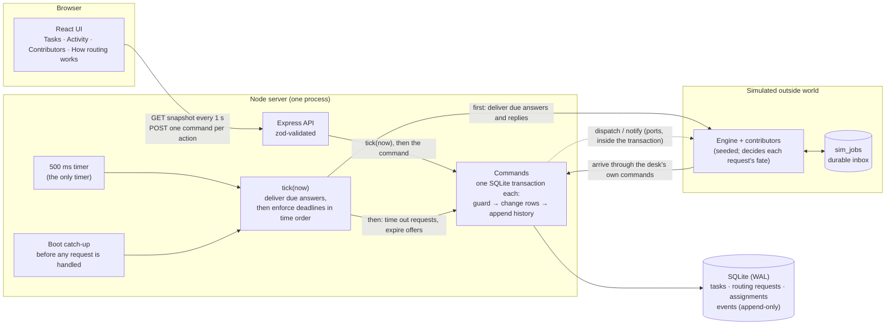
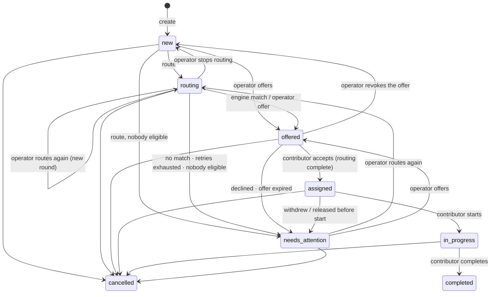

# Terac Routing Desk

An operator desk for routing research tasks to contributors with the right expertise. A simulated routing engine
proposes contributors — usually within 5–20 seconds, sometimes later, and for 1 in 5 requests never at all, without
saying so. The operator sees everything that is happening, can step in at any moment, and recovers tasks when a person
declines or drops out.

One rule runs through the whole system: **the first terminal transition wins; anything that arrives later is recorded
and shown, never applied.**

**Live demo:** https://terac-routing-desk.fly.dev — one shared instance; please create tasks, not cancel the seed. Reset: `curl -X POST https://terac-routing-desk.fly.dev/api/sim/reset`.


---

## Quick start

```bash
nvm use            # Node ≥ 22.13 (uses the built-in node:sqlite); developed on Node 26.5
npm install
npm run dev        # API on :3001 + UI on :5173
```

Open **http://localhost:5173**. The first start seeds demo data (8 contributors, 13 tasks in every state, two of them
already routing live).

| Command | What it does |
|---|---|
| `npm run dev` | API (tsx watch) and UI (Vite) together |
| `npm run start:api` + `npm run dev:web` | The same, in two terminals, without watch mode — use this to demo a restart (Ctrl-C the API, start it again) |
| `npm run check` | Typecheck + the unit and integration suite (1,157 cases, ~2 s) |
| `npm run test:e2e` | Browser end-to-end suite (16 tests, ~1.5 min): builds the app, starts it on a throwaway database, drives Chrome |
| `npm run reset` | Delete the local database (refuses while the server runs); the next start reseeds. Or use **Reset demo** in *Simulation controls* (sidebar) |
| `npm start` | Build the UI and serve everything from http://localhost:3001 |

No Docker, no external services, no environment variables. Data lives in `data/desk.sqlite` (gitignored).

**The screen.** Terac's ultramarine on warm paper, set in Geist. The sidebar holds Tasks, Activity, Contributors and How
routing works, plus a hatched violet *Simulation controls* entry under "Outside world". The Tasks page opens with a
sentence that says what needs you ("Good evening. 3 tasks are waiting on you."), a **Needs you** card with the task IDs,
a **pipeline** where every task is one block coloured by stage, and a **routing engine** strip (median and p90 answer
time, answered in time, no answer by the deadline, waiting now). Below that: tabs with counts, search, and the table
(expertise icon, status with a one-line reason, contributor, priority, the next automatic action as a countdown that
drains, time since created). Clicking a row opens the task panel without blocking the table, so you can move from task to
task: a header in the status colour with a lifecycle stepper (the step where automation stopped is a red ✕ with the
reason), the status, *What happens next* with the actions allowed right now, *Your decision* once automation has
stopped, a hatched *Simulation* card, then *Activity*, *Engine requests* and *Offers*. On a phone the table becomes a list.

---

## Brief coverage

Every requirement in the brief, where it lives in the product, and what proves it.

| The brief asks for | In the product | Proved by |
|---|---|---|
| See tasks with their **time since created** | *Created* column ("12m ago", exact time on hover); task panel header | `e2e/desk.spec.ts` (board) |
| …their **contributors** | Contributor column with avatar and offer state; *Contributors* page (expertise, availability, load, active tasks) | `e2e/desk.spec.ts` (pages) |
| …and **the current state of the operation** | Headline (what needs you, next deadline), *Needs you* card, pipeline (one block per task), *Routing engine* health (median and p90 answer time, answered in time, no answer by deadline, waiting now), live indicator, tab title count | `test/operations.test.ts`, `e2e/desk.spec.ts` |
| **Create a task and submit it** for assignment | *New task* (`N`): *Create and route* or *Save without routing*, with live eligibility for the chosen area | `e2e/use-cases.spec.ts` (routine), `e2e/desk.spec.ts` (validation, save then route) |
| **Intervene whenever they want** | Offer to someone, route again, stop routing, revoke offer, release, cancel; only the actions valid now are shown; each is one server command | `test/scenarios/command-matrix.test.ts`, `e2e/use-cases.spec.ts` (human intervention) |
| **Recover** a task from an assignment that failed or was declined | *Needs attention* with the reason; *Your decision* card: who is skipped and why, who can take it now, late suggestions, route again / offer / cancel | `test/scenarios/recovery.test.ts`, `e2e/use-cases.spec.ts` (recovery) |
| **Inspect enough history** to understand what happened | Per task: *Activity*, *Engine requests* (candidates, timing, outcome), *Offers*. Desk-wide: *Activity* page with filters | `test/operations.test.ts`, `e2e/desk.spec.ts` |
| **Seed** tasks and contributors; finance, healthcare, data analysis, operations | 8 contributors, 13 tasks in every state, plus Regulatory affairs (nobody covers it) | `test/seed.test.ts` |
| **At most one active assignee**; accepted ⇒ routing complete | Partial unique index; no pending request can coexist with an active assignment (R1, R10) | `test/random-walk.test.ts`, invariants after every step |
| Engine receives the task and **matching contributors** | Candidates frozen at dispatch (eligible subset; see *Assumptions*) | `test/scenarios/fencing.test.ts` |
| Normally **5–20 s**; selects a contributor **or reports no match** | Seeded simulator; *No match* goes to the operator, never auto-retried | `test/unit/fate.test.ts`, `test/scenarios/presets.test.ts` |
| **20% never return**, silently; the operator **cannot know** which | The desk can't read the simulator's tables; slow and never-returning requests produce identical API output | `test/architecture.test.ts`, `test/api.test.ts` |
| **Controls or deterministic scenarios** | Engine and contributor presets at creation; *Deliver match / No match now*; *Respond as*; availability; reset | `test/scenarios/presets.test.ts` |
| **Several tasks routed at the same time** | Serialized transactions, capacity re-checked when a pick is applied | `test/scenarios/concurrency.test.ts` |
| Operator **intervenes while routing is pending** | The operator's action wins; the pending request is abandoned; its late answer is recorded and shown, never applied | `test/scenarios/fencing.test.ts`, `e2e/use-cases.spec.ts` |
| App **refreshed or restarted while work is active** | Open task lives in the URL; deadlines live in the database and are enforced at boot before serving; a toast says what was caught up | `test/scenarios/restart.test.ts`, `e2e/desk.spec.ts` (refresh) |
| **Make the important choices visible** | *What happens next* on every task, with countdowns; *How routing works* page, every number read from the server's policy | `e2e/desk.spec.ts` |
| Use cases: routine · unresolved · intervention · recovery | Demo recipes 1–4 below | `test/scenarios/use-cases.test.ts`, `e2e/use-cases.spec.ts` |
| Document **assumptions, tradeoffs, omissions** | *Key decisions*, *Assumptions*, *Intentional omissions* below; `docs/DECISIONS.md` | — |

---

## Two-minute tour

The seed is produced by **replaying the real commands** under a backdated clock, so every seeded history line is exactly
what the system itself writes.

| Task | What it shows |
|---|---|
| T-101 Revenue-cycle software expert call | The routine path, completed: routed → offered → accepted → started → completed |
| T-102 SME credit-default model review | Request #1 got no answer within 30 s; the automatic retry matched; #1's late answer arrived afterwards and was **recorded, not applied** |
| T-103 Last-mile delivery mapping | Accepted, work not started |
| T-104 Insurance claims extract | **Declined** → needs attention. *Your decision* shows Priya skipped (with her reason), Lena full, Fatima free |
| T-105 Oncology pharmacist interview | High priority; three requests got no answer → needs attention, with a late answer offered as a suggestion |
| T-106 Warehouse-automation benchmark | Accepted, then **withdrew before starting** → needs attention |
| T-107 Phase II trial readout review | In progress (puts Lena at capacity) |
| T-108 EU payments pricing survey | Offered, then cancelled by the operator |
| T-109 – T-111 | Not routed yet. T-111 is Regulatory affairs, which nobody covers |
| T-112, T-113 | Started live at seed time: one never gets an answer, one gets a quick match |

---

## Demo recipes

Violet controls are **simulation**: they stand in for the routing engine and the contributors, not the operator. The
create form's *Simulation* section lets you decide in advance how the pretend engine and the first contributor behave;
after creation the desk never reveals it.

1. **Routine assignment.** *New task* → Finance → Simulation: engine *Quick match* → *Create and route*. The task panel
   shows the wait against the 5–20 s window; at 6 s it's offered to the least-loaded contributor. In the violet
   *Simulation* card, click *accepts* → *starts work* → *completes*. Read the *Activity* tab.
2. **Unresolved routing (high priority).** New task, Healthcare, **High**, engine *Lost always*. At 20 s it turns
   **Overdue** ("may be slow, or may never come back — we can't tell"). The *What happens next* box counts down to the
   30 s retry; requests 2 and 3 follow; at 90 s it comes to you.
3. **Human intervention, then a late answer.** New task, Operations, engine *Late answer* (request #1 answers at 40 s).
   At ~22 s click *Offer to someone…* — the dialog warns that the pending request will be abandoned. Pick Diego. At 40 s
   the activity shows an **Ignored** entry: *"Late answer to request #1 after 40.0s: Sofia Rossi. Not applied: the
   operator had already offered the task to Diego Fernández."*
4. **Recovery.** Open T-104. The *Your decision* card explains what happened, who is skipped and who can take it.
   *Route again (skips Priya)* → the new request goes only to Fatima.
5. **Restart while work is active.** Run `npm run start:api` and `npm run dev:web` in two terminals. Start a *Lost
   always* High task, Ctrl-C the API: the UI shows an offline banner and switches countdowns to absolute times. Wait
   past 30 s and start the API again: a toast says what was caught up, the activity marks the timeout *"due hh:mm:ss,
   enforced at startup"*, and request #2 was sent.
6. **Two operators, one task.** Open the same task in two tabs and act in both: the second action is refused with
   *"This task changed while you were looking"* and the list of what changed.

---

## How it works



The desk never reads the simulator's inbox (an architecture test enforces it), so it genuinely can't tell a slow
request from one that will never return. Boot runs the same `tick(now)` before the server handles a request.

- **Rows are the truth; events are the history.** Every state change writes its history line in the same transaction,
  so history can never disagree with state. Events are append-only (enforced by triggers).
- **Fencing.** Each routing task points at its one pending request (`current_attempt_id`). An engine answer is applied
  only if that request is still pending, is the current one, and the task is still routing — in the same transaction.
  Anything else is written onto the request once and shown as an *Ignored* history entry, plus a one-click suggestion
  when it's still useful.
- **Time.** No in-memory timer owns state. Deadlines are columns (`deadline_at`, `expires_at`). One `tick(now)` enforces
  them every 500 ms, before every command, and at boot before the server accepts requests. An engine answer counts if it
  **reached the inbox** before the deadline (`available_at < deadline_at`), so the outcome never depends on when the
  ticker happened to run.
- **The engine is an outside service.** The simulator implements the desk's `RoutingEngine` / `ContributorChannel` ports
  and keeps its own durable inbox (`sim_jobs`). It decides each request's fate at dispatch from a seeded RNG — but the
  desk code never reads those tables (an architecture test enforces this), so the operator genuinely cannot know.
- **Concurrency, stated precisely.** One Node process; every command is a synchronous `BEGIN IMMEDIATE` transaction, so
  commands are serialized. Correctness comes from the guards (version checks, the fencing pointer, `status = 'pending'`
  in `WHERE` clauses) and two partial unique indexes — the same guards would carry over to Postgres. There is no
  multi-process deployment.



`needs_attention` means *something happened to the task and automation has stopped*; operator-initiated exits (stop
routing, revoke an offer) go back to **Not routed** instead, so the red queue only holds things that need a decision.

---

## Key decisions

| Decision | Why | Where | Proved by |
|---|---|---|---|
| Fencing pointer + compare-and-set; late answers recorded, never applied | One winner, deterministic; the operator still sees what the engine said | `src/server/commands/desk.ts` (`applyEngineResultInner`) | `test/scenarios/use-cases.test.ts` (use case 3), `fencing.test.ts` |
| Deadlines as columns + `tick()`; catch-up before `listen()` | Restarts lose nothing; tests drive time without fake timers | `scheduler/tick.ts`, `scheduler/boot.ts`, `main.ts` | `test/scenarios/restart.test.ts` |
| Deadline judged by arrival (`available_at`), not processing time | Outcome independent of ticker timing | `desk.ts` | `fencing.test.ts` ("judged by when the answer arrived", "exactly at the deadline") |
| Overdue at 20 s for every priority; give up at 30/45/60 s; 2 retries per round | Overdue is a fact about the engine's normal window; priority only changes how long we keep waiting — high waits *less* | `src/shared/policy.ts` | `use-cases.test.ts` (use case 2), `unit/rules.test.ts` |
| Machines retry machine failures; a person's "no" goes to a person | A decline carries information the engine can't use; "no match" would repeat | `commands/routing.ts` (`retryOrEscalate`) | use cases 2 and 4 |
| An operator pick is an offer on the same lifecycle | Contributors must agree; one code path | `routing.ts` (`createOffer`) | use case 3 |
| Contributor capacity, offers count, re-checked when a pick is applied | The one real cross-task coupling | `domain/eligibility.ts`, `recheckPick` | `concurrency.test.ts` (contention) |
| Simulated engine with a durable inbox the desk can't read | Answers can arrive after a restart; the uncertainty is real, not a UI trick | `src/server/sim/` | `api.test.ts` ("a slow request and a never-returning one look identical"), `architecture.test.ts` |
| Optimistic concurrency (`expectedVersion` + `seenEventId`) | If the world moved, refuse and show what moved | `desk.ts`, `http/routes.ts` | `concurrency.test.ts` |
| 1 s polling, server-time offset on the client | Survives restarts with no reconnection logic; skewed laptop clocks don't matter | `src/client/hooks/data.ts`, `lib/clock.ts` | manual |
| `node:sqlite`, raw SQL, one package | No native builds; the fencing rules stay visible in the `WHERE` clauses | `src/server/store/repo.ts` | — |

More detail: `docs/DECISIONS.md` and `PLAN.md`.

## Assumptions

- The engine receives only contributors who are **eligible now** (have the expertise, are available, have spare
  capacity, and haven't declined, let an offer expire, withdrawn or been released on this task). This deliberately
  narrows "contributors whose expertise matches".
- "Normally takes 5–20 s" allows a small slow tail: in the realistic simulation 1 in 10 answers arrives in 20–90 s.
  Without it, "overdue" would mean "certainly lost" in our own simulation.
- An unanswered offer (60 s, compressed for the demo) and a withdrawal or release after accepting both count as an
  assignment that "failed before work began".
- Accepting completes routing; reopening it after a fall-through is always the operator's decision.
- A contributor's reply is judged when it's processed; an engine answer by when it reached the inbox (it has a
  timestamp the desk can trust). A reply that can't be applied is still recorded as *Ignored* with the reason.
- Contributors have a capacity (1–3 active); outstanding offers count toward it.
- One expertise area per task. Priority changes deadlines and ordering, not matching. The server clock is the source of truth.

## Intentional omissions

Each of these is a scope decision for a five-hour exercise, and the design leaves a clear place for it.

- **Authentication and operator identity.** One trusted operator role; history says "Operator". Every event already
  records an actor, so identity is a column, not a redesign.
- **A contributor-facing app and notifications.** Contributors are played by the labelled simulation through the
  `ContributorChannel` port; a real channel (email, Slack, an app) implements the same port.
- **A real matching algorithm.** Lowest current load wins, with a seeded tie-break. The brief says matching isn't the
  focus; the engine sits behind the `RoutingEngine` port.
- **Push updates and multi-process deployment.** One Node process serializes commands and the UI polls every second,
  which survives restarts with no reconnection logic. The guards (compare-and-set, partial unique indexes) carry over
  to Postgres; see *Path to production*.
- **Editing a task after creation, multiple assignees, and failure handling after work has started** (beyond cancel).
  The brief scopes routing up to acceptance with one active assignee.
- **Hedged requests, a "probability it's lost", retry backoff.** The operator can't know whether a request will
  answer, so the desk doesn't pretend to; retries are bounded, visible and counted down instead.
- **Pagination and server-side filtering, a migration framework, dark mode, hosted deployment.** Sized for a desk of
  tens of tasks (search and filters run in the browser); a schema change means `npm run reset`; deployment is optional
  per the brief.

---

## Testing and verification

Two gates, both run in CI (`.github/workflows/ci.yml`) on every push and pull request:

- **`npm run check`**: typecheck, then **1,157 test cases** (many table-driven) in about 2 s.
  Tests use a fake clock against a real SQLite database; the harness checks every invariant
  (`src/server/infra/invariants.ts`) after every 500 ms of simulated time.
- **`npm run test:e2e`**: **25 browser and process tests** in real time against a production build on a fresh database.

| Suite | What it pins down |
|---|---|
| `test/scenarios/use-cases.test.ts` | The brief's four use cases, named after them |
| `test/scenarios/command-matrix.test.ts` | Every task state × every operator command, directly and over HTTP: allowed ones land in the documented state with the right events; refused ones change nothing (row, version, history). Every assignment state × every contributor action. The version rule |
| `test/scenarios/recovery.test.ts` | Decline, expiry, withdrawal, release, no match, retries used up, nobody eligible: the reason, who is excluded, the acknowledgement needed to offer to an excluded person, late suggestions |
| `test/scenarios/presets.test.ts` | Every simulation preset does exactly what its on-screen hint says, including the numbers |
| `test/scenarios/fencing.test.ts` | Late, duplicate, stale and ineligible answers; deadline judged by arrival; accept vs expiry |
| `test/scenarios/concurrency.test.ts`, `races-and-restarts.test.ts` | Stale versions, answer vs operator at the same instant, contention for one contributor, a restart in every state with catch-up applied exactly once |
| `test/api.test.ts`, `api.more.test.ts`, `operations.test.ts` | Every endpoint: contract parsing, 400/404/409/413 paths, conflict bodies, engine health, the activity feed and its paging, and a scan proving no response reveals a request's planned fate |
| `test/unit/*` | Policy numbers and allowed commands, the zod contract, formatting, every status sentence in the UI (and the rule that a pending request is never called stuck, failed or lost), URL parsing |
| `test/random-walk.test.ts` | 5 × 400 seeded random interleavings with invariants, "rejected means unchanged", "late is never applied" and "final stays final" after every step |
| `test/scenarios/bug-bash.test.ts` | One block per finding of the adversarial bug bash: the single-instance lock, an atomic reset, a half-seeded database, cross-site writes, the seed never leaving the server, time-ordered restart catch-up, hostile text, a clock that moved back, bounded refusal history, honest health, production static caching |
| `test/architecture.test.ts` | No `sim_` access outside the simulator, no wall clock, no unseeded randomness, no timers outside `main.ts`, SQL writes only in the repository |
| `e2e/use-cases.spec.ts` | The four use cases through the real UI: create → match → accept → start → complete; Overdue then an automatic retry; an offer while pending and the late answer shown as Ignored; recovery that skips the person who declined |
| `e2e/desk.spec.ts`, `mobile.spec.ts`, `scale.spec.ts` | Filters and search, refresh keeps the open task, switching tasks with the panel open, validation, save then route, stop routing with a note, cancel, two operators on one task, a decision in a dialog that went stale while it was open, double-clicks, hostile text, a missing task link, every page, simulation availability, phone layout, 120 extra tasks without overflow |
| `e2e/process.spec.ts` | Real processes: a second desk on the same port, or on the same database, exits with a clear message and writes nothing; a bad `PORT` fails before the database is opened |

The suite has found real bugs, which were fixed rather than tested around (`docs/CORRECTIONS.md` C-7). Before
submission, two agents spent about half an hour each trying to break their own copies of the app: one through the UI
in a real browser, one through the API and the process (concurrency bursts, `kill -9` under load, clock jumps, hostile
input). No invariant broke. Of their 31 findings (12 server, 19 UI), 29 are fixed with a test each; the other two are
noted in C-8. A mutation check
confirmed the core tests bite: removing the fencing condition fails 12 tests; judging deadlines by processing time fails
the exact-deadline test; skipping the pick re-check fails 7.

## Path to production

Postgres with `SELECT … FOR UPDATE` (or `SKIP LOCKED` for the reconciler) in place of the single writer; a transactional
outbox for engine dispatch; a real engine behind signed webhooks with the attempt id as the idempotency key; push
updates; operator identity and audit; metrics on engine latency to tune the overdue threshold and deadlines from data.

## Production notes

Hardened, each with a test: one process per database (the port and a lock file are claimed before the database is
opened); reset and the first seed can't leave a half-built database; writes from another site are refused; security
headers and a strict CSP on the built UI; control and invisible characters refused in user text; every client error is a
4xx, never a 500; `/api/health` is 503 when deadlines stop being enforced; graceful shutdown with a final heartbeat;
fingerprinted assets cached for a year.

Known limits, by decision for this exercise:
- **The snapshot returns every task.** Measured: 11 ms / 250 KB at 500 tasks, 39 ms / 1 MB at 2,000. Past a few
  thousand, closed tasks need paging (server-side) and the 1 s poll wants compression or a "changed since" query.
- **No retention.** Events and the simulator's inbox grow forever; at demo scale that's kilobytes a day.
- **SQLite in WAL with `synchronous=NORMAL`:** a process crash loses nothing; a power cut can lose the last commits.
- **No authentication, so no Host allow-list.** Run it on localhost or behind an authenticating proxy. The simulation
  endpoints stay on in production builds because the simulation is the demo.
- If the server is killed *during* boot catch-up, the next restart line under-counts what that interrupted boot did
  (the history itself is complete).

## What's next

1. Adopt a still-valid late answer automatically while the same round is still routing (today it's one click).
2. Hedged requests for high priority (a second request before giving up on the first).
3. Alerts on engine health (answer rate and latency drifting from the 5–20 s norm), and deadlines tuned from that data.
4. Operator identity and assignment of tasks to operators; notifications.

---

## Repository layout

```
src/shared/    API contract (zod), policy numbers and rules, formatting
src/server/    commands (the only writers), store/repo.ts (all desk SQL), scheduler (tick, boot), sim (outside world), http, seed
src/client/    React UI on shadcn/ui (Radix + Tailwind v4): pages/ (Tasks, Activity, Contributors, How routing works),
               components/task/ (task panel), components/dialogs/, components/ui/ (generated shadcn primitives)
e2e/           Playwright browser suite (use cases, desk, phone)
test/          harness + unit, scenario (incl. the state × command matrix), API, seed, random-walk and architecture tests
PLAN.md        the plan of record (§15: amendments adopted before the build)
docs/          planning inputs, decisions, session map, corrections log, agentic setup
```
