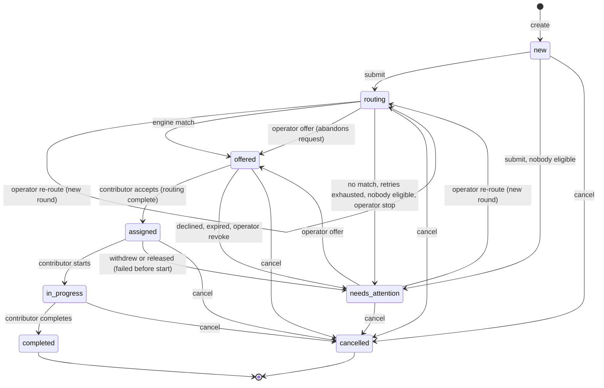

# 01 · Domain & State

> **SUPERSEDED — input only.** This is a pre-synthesis dimension draft. Where it disagrees with `PLAN.md` (statuses, restart model, API shapes, numbers, CLAUDE.md text), `PLAN.md` wins. Do not implement from this file.

> Dimension owner: **Domain & State**: domain model, state machines, invariants, persistence, seed data.
> Interacts with: **Engine, Time & Concurrency** (dispatch, results, reconciler, sim), **Operator UX** (copy, actions, panels), **Architecture & Verification** (tx helper, tests, invariant checker), **Delivery & Agentic Process** (decision log, Loom beats).
> Tags: **MUST / SHOULD / COULD / WON'T** against the 5-hour total budget. MUST is kept small on purpose.

---

## 0. The model on one page

1. **Rows hold the truth, and events are an append-only audit log written in the same transaction.** We don't use event sourcing. The truth lives in five tables: `tasks`, `routing_attempts`, `assignments`, `contributors` (+ `contributor_expertise`) and `events`, with `settings` and `meta` alongside.
2. **Task status** runs `new → routing → offered → assigned → in_progress → completed`. Two more statuses sit beside that path: `needs_attention` (always with a reason) and `cancelled`.
3. **`needs_attention` means "nothing will happen to this task until a person acts."** "Overdue" means "automation still owns it, it's just late." Overdue is computed when needed and never stored.
4. **Each engine answer is recorded once.** It changes the task at most once, and only if it belongs to the attempt we're still waiting on. Every other answer is recorded, not applied, and shown to the operator as advice.
5. **Machine failures are retried automatically, within a budget per round.** That covers timeouts and picks that have gone stale. **A person's "no" goes to a person**: declines, expired offers and withdrawals all wait for the operator.
6. **When an operator picks someone, that's still an offer**, on the same path as an engine pick. Only the contributor can say yes. The one exception is a COULD: the operator records that the contributor already agreed out-of-band.
7. **Acceptance ends routing for good.** If the work then falls through before it starts, only the operator can open a new routing **round**. Automation never does.

### Divergences from the lead planner's baseline (for the synthesizer)

| # | Baseline | This section | Why | Stakes |
|---|---|---|---|---|
| X1 | Task status `awaiting_response` | Renamed to **`offered`** | The task status then always matches its active assignment's status (`offered↔offered`, `assigned↔accepted`, `in_progress↔in_progress`), which makes one invariant easy to check | Cosmetic |
| X2 | Reason `invalid_engine_result` | **Dropped as a reason.** A stale or invalid pick is a *system* failure. It uses up one retry, and when the budget runs out it lands as `routing_exhausted` | Retrying fixes it most of the time, because a fresh candidate snapshot drops the stale person | Low |
| X3 | Reasons list | **Added `offer_revoked`.** `failed_before_start` covers both a contributor withdrawing and an operator releasing them (the assignment status tells the two apart) | Every way into `needs_attention` needs its own label | Low |
| X4 | `task.version` bumps on every change | **The version bumps only when the operator's decision inputs change**: status, attention reason or active assignment. An automatic retry inside `routing` doesn't bump it | Otherwise every background retry causes a spurious 409 | Medium |
| X5 | Reconciler enforces deadlines | **Deadlines are hard lines, checked by every command.** The reconciler only covers the case where no command arrives. A result that arrives at or after `deadline_at` is late, even if the reconciler hasn't run yet | Behavior doesn't depend on when the reconciler happens to tick, so tests are deterministic | Medium |
| X6 | Late results only recorded | Recorded, **and shown as one-click advice** ("Engine later picked Marcus Chen · Offer to Marcus"). Still never applied automatically | We keep the information without letting a race make the decision | Low, and a nice touch |
| X7 | Open question A/B (restart model) | **Recommend B, built as a single `sim_jobs` table** that holds both engine results and contributor auto-responses. "The outside world persists; our process doesn't." The domain itself works the same either way | Lets us demo a late answer arriving after a restart, which exercises fencing. It's also simpler than setTimeout | Medium (decision belongs to Engine, Time & Concurrency) |
| X8 | Seed data | **Seed by replaying real domain commands under a fake clock**, settled states only, wrapped in one transaction and checked against the invariants | Seeded histories can't be inconsistent, and the seed doubles as a smoke test | Medium |
| X9 | Retry budget | Applies **per routing round**. A round is opened by `submit` or by an operator re-route. Exclusions carry over between rounds | Makes "routing is complete once accepted" concrete | Low |
| X10 | Capacity | **A pending offer counts toward a contributor's load**, the same as an accepted or in-progress assignment | Stops two simultaneous engine answers from double-booking the same person | Low |

---

## 1. Vocabulary and five rules

- **Task**: a unit of research work that needs one expertise area.
- **Routing attempt**: one request to the engine, with its own deadline and a frozen candidate snapshot. An attempt is *live* while `status = 'pending'`.
- **Round**: the attempts between one operator "go route this" and the end of that routing cycle. The retry budget resets each round.
- **Assignment**: one contributor's involvement with one task, from offer through to an end state. `source` is `engine` or `operator`.
- **Active assignment**: an assignment in `offered`, `accepted` or `in_progress`. A task has at most one.
- **Event**: an immutable history line, with an actor and a pre-rendered human summary.

**Rules** (these go in the README "How this desk behaves" panel):
1. **First terminal transition wins.** Anything that arrives afterward is recorded, not applied.
2. **A deadline is a hard line, not "whenever the timer gets to it."**
3. **Machine failures are retried automatically. A person's "no" goes to a person.**
4. **Once a contributor accepts, automation stops.** Only an operator can reopen routing.
5. **Every state change and its history line commit together, or not at all.**

---

## 2. Entities

All timestamps are `INTEGER` epoch milliseconds from the injected `Clock`. The server clock is authoritative. IDs are `INTEGER`, and tasks display as `T-101`, attempts as `#2`.

### 2.1 Types (shared zod/TS; Architecture & Verification owns where they live)

```ts
export type Priority = 'high' | 'normal' | 'low';
export type ExpertiseId = 'finance' | 'healthcare' | 'data_analysis' | 'operations' | 'regulatory';

export type TaskStatus =
  | 'new' | 'routing' | 'offered' | 'assigned' | 'in_progress' | 'completed'
  | 'needs_attention' | 'cancelled';

export type AttentionReason =
  // automation gave up
  | 'no_eligible_contributors' | 'no_match' | 'routing_exhausted'
  // a person said no / didn't show
  | 'declined' | 'offer_expired' | 'failed_before_start'
  // operator put it on hold
  | 'routing_stopped' | 'offer_revoked';

export type AttemptStatus = 'pending' | 'matched' | 'no_match' | 'invalid_result' | 'timed_out' | 'abandoned';
export type AbandonReason = 'operator_offer' | 'operator_reroute' | 'operator_stop' | 'operator_force_assign' | 'task_cancelled';

export type AssignmentStatus =
  | 'offered' | 'accepted' | 'in_progress'            // active
  | 'completed' | 'declined' | 'expired' | 'revoked'  // ended
  | 'withdrawn' | 'released' | 'cancelled';

export type Actor = 'system' | 'engine' | 'operator' | 'contributor' | 'simulator';

export interface ExpertiseArea { id: ExpertiseId; label: string; blurb: string }

export interface Contributor {
  id: number; name: string; headline: string;
  availability: 'available' | 'away';
  maxActive: number;               // 1..5; offers count toward it
  expertise: ExpertiseId[];        // from contributor_expertise
  simProfile: string;              // read ONLY by the simulator
  createdAt: number;
}

export interface Task {
  id: number; title: string; brief: string; requestedBy: string;
  expertiseId: ExpertiseId; priority: Priority;
  status: TaskStatus; attentionReason: AttentionReason | null;
  round: number;                   // 0 while new; 1 after submit; +1 per operator re-route
  currentAttemptId: number | null; // fencing pointer; non-null iff status = 'routing'
  version: number;                 // optimistic concurrency for operator commands (see D7)
  createdAt: number; submittedAt: number | null; statusChangedAt: number; closedAt: number | null;
}

export interface CandidateSnap { id: number; name: string; load: number; maxActive: number }
export interface ExcludedSnap  { id: number; name: string; reason: IneligibleReason; detail?: string }
export type IneligibleReason = 'away' | 'at_capacity' | 'declined_this_task' | 'expired_this_task'
                             | 'withdrew_this_task' | 'released_this_task';

export interface RoutingAttempt {
  id: number; taskId: number; round: number;
  seq: number;                     // 1..n per task, across rounds (display "#3")
  retryIndex: number;              // 0 = first request in the round
  status: AttemptStatus; abandonReason: AbandonReason | null;
  priorityAtDispatch: Priority;
  candidates: CandidateSnap[]; excluded: ExcludedSnap[];   // frozen at dispatch
  dispatchedAt: number; deadlineAt: number; closedAt: number | null;
  // what the engine said, whenever it said it (on time OR late). Written at most once.
  resultKind: 'match' | 'no_match' | null;
  resultContributorId: number | null;
  resultReceivedAt: number | null;
  // derived: isLate = resultKind != null && status in ('timed_out','abandoned')
}

export interface Assignment {
  id: number; taskId: number; contributorId: number;
  source: 'engine' | 'operator';
  attemptId: number | null;        // non-null iff source = 'engine'
  status: AssignmentStatus;
  offeredAt: number; expiresAt: number | null;   // expiresAt non-null for offers (kept after, for history)
  respondedAt: number | null; startedAt: number | null; endedAt: number | null;
  note: string | null;             // decline reason, withdraw reason, operator note
  confirmedOutOfBand: boolean;     // COULD: operator force-assign
}

export interface DomainEvent {
  id: number;                      // monotonic; clients poll ?afterEventId=
  at: number; taskId: number | null; attemptId: number | null;
  assignmentId: number | null; contributorId: number | null;
  type: EventType; actor: Actor;
  summary: string;                 // rendered at write time, names snapshotted
  payload: Record<string, unknown>;
}
```

### 2.2 Settings (single row, zod-validated JSON; MUST as code constants, SHOULD persisted)

| Key | Default | Meaning |
|---|---|---|
| `expectedLatencyMs` | `{ min: 5000, max: 20000 }` | The "usually 5–20s" window. Past `max`, an attempt shows as **Overdue** (computed, not stored) |
| `routingDeadlineMs` | `{ high: 30000, normal: 45000, low: 60000 }` | When we stop waiting on one request |
| `retryBudget` | `2` | Retries per round after the first request, so at most **3 requests per round** |
| `offerExpiryMs` | `{ high: 60000, normal: 90000, low: 120000 }` | How long a contributor has to answer an offer. Demo-scaled; in production this would be hours |
| `reconcileIntervalMs` | `1000` | Reconciler tick (owned by Engine, Time & Concurrency) |
| `sim.*` | owned by Engine, Time & Concurrency | never-return rate 0.2, no-match rate, auto-respond on/off, etc. |

### 2.3 Meta (SHOULD)

The `meta` table is a key/value store holding `schema_version`, `boot_count` and `last_tick_at`. The reconciler writes `last_tick_at` every tick. At boot, that value lets us say "the desk was offline for ~47s."

### 2.4 Read model: `TaskView` (what `GET /api/board` returns per task)

```ts
interface TaskView extends Task {
  expertiseLabel: string;
  currentAttempt: null | { id: number; seq: number; retryIndex: number; of: number;     // "Request 2 of 3"
                           dispatchedAt: number; deadlineAt: number; candidateCount: number };
  activeAssignment: null | { id: number; contributorId: number; contributorName: string;
                             status: 'offered' | 'accepted' | 'in_progress'; source: 'engine' | 'operator';
                             expiresAt: number | null };
  nextAutomaticAction: null
    | { kind: 'retry_routing'; at: number; requestsLeft: number }
    | { kind: 'escalate_routing'; at: number }            // last request in the round
    | { kind: 'expire_offer'; at: number; contributorName: string };
  excluded: { contributorId: number; name: string; reason: IneligibleReason }[];  // engine won't see these people for this task
  eligibleNowCount: number;
  lateAnswers: { attemptSeq: number; contributorId: number | null; name: string | null;
                 receivedAt: number; offerableNow: boolean; whyNot?: string }[];   // SHOULD (X6)
  triedCount: number;              // assignments that ended for this task (declined/expired/...)
}
```

`nextAutomaticAction` is a pure function of `(task, currentAttempt, activeAssignment, settings)`. It's a **MUST**, because it guarantees the operator is never surprised. Copy is in §10.

---

## 3. Key decisions

Each decision has the choice, the alternatives, the reasoning and the one sentence we'd say to the reviewer ("Say it").

### D1. `needs_attention` is a status with a reason. "Overdue" is computed. (MUST)
- **Choice:** `status = 'needs_attention'` with a non-null `attention_reason`, enforced by a CHECK. It means automation has stopped and nothing will happen until a person acts. "Overdue" (routing past 20s) and "not started yet" (COULD) are warnings computed from timestamps, shown while automation still owns the task.
- **Alternatives:** (a) a boolean `needs_attention` flag alongside any status, which multiplies the combinations (`routing+flag`, `offered+flag`...) and blurs "late" with "stuck." (b) one status per reason (`declined`, `no_match`...), which multiplies the states and the transitions.
- **Why:** these are two different obligations for the operator, and the UI should never mix them up. One of them comes with a countdown to the next automatic action. The other comes with nothing automatic at all.
- **Say it:** *"If a task says Needs attention, nothing else will happen to it until you act; if it's merely late, we show you the countdown to what the system will do next."*

### D2. A manual assignment is an offer on the same path as the engine. Force-assign is a COULD.
- **Choice:** "Offer to…" creates `assignment(source='operator', status='offered', expires_at)`. Accept, decline and expiry then follow exactly the same transitions as an engine offer. Separately, **COULD:** "Assign directly (already confirmed)" creates `assignment(status='accepted', confirmed_out_of_band=1)`, requires a note, and emits `assignment_force_accepted`.
- **Alternatives:** (a) the operator assigns directly every time, which skips the contributor's consent and leaves us with two code paths for "accepted." (b) the operator only nudges the engine ("prefer X"), which is indirect and slow.
- **Why:** contributors are people who have to agree. Using one path means one set of tests, and history reads the same whoever made the pick.
- **Say it:** *"The operator can choose who; only the contributor can say yes, unless the operator records that they already did."*

### D3. What "fails before work begins" means, and what "routing is complete" means
We considered four possible readings and decided each one:

| Candidate meaning | Decision | Lands as |
|---|---|---|
| Offer not answered in time | It's a failure to respond, **before** acceptance | `assignment.expired`, then `needs_attention(offer_expired)` |
| Accepted, then the contributor withdraws before starting | **Yes, this is the main "fails before start" case** | `assignment.withdrawn`, then `needs_attention(failed_before_start)` |
| Accepted, then a no-show (never starts) | Needs a person to judge it, so the **operator releases** the assignment (SHOULD). Automatic detection is a COULD: a computed "Accepted 5m ago, not started" warning with **no automatic action** | `assignment.released`, then `needs_attention(failed_before_start)` |
| Engine picked someone who is no longer eligible | This is a **routing** failure, not an assignment failure. No offer is ever created | `attempt.invalid_result`, then an automatic retry (D4) |

**"Once a contributor accepts, routing for that task is complete"**, read concretely:
- At acceptance there is no pending attempt, because the invariant requires the attempt to close before the offer exists. No engine answer can ever apply to this task again.
- If an accepted assignment fails before work starts, **the system never re-routes on its own.** The task goes to `needs_attention(failed_before_start)`.
- The operator can then open a **new round** (`round + 1`, a fresh retry budget, the previous people excluded) or make an offer directly. History shows "Routing reopened by operator (round 2)."
- **Say it:** *"Acceptance closes routing; reopening it is always a human decision, and the history shows it as a new round."*

### D4. Failure taxonomy: what gets retried automatically and what goes to the operator (MUST)

| Outcome | Class | Automatic action | Uses retry budget? | Next state |
|---|---|---|---|---|
| No engine answer by `deadline_at` | system | Retry immediately with a fresh snapshot | yes | `routing` or `needs_attention(routing_exhausted)` |
| Engine picked someone no longer eligible | system | Retry immediately with a fresh snapshot | yes | same as above |
| Engine says "no match" | engine verdict | **None**, since the same inputs should give the same verdict | ends the round | `needs_attention(no_match)` |
| Nobody eligible at dispatch | data | **Don't call the engine** | ends the round | `needs_attention(no_eligible_contributors)` |
| Contributor declines | human | None | n/a | `needs_attention(declined)` |
| Offer expires | human | None | n/a | `needs_attention(offer_expired)` |
| Accepted, then withdrew | human | None | n/a | `needs_attention(failed_before_start)` |
| Operator releases before start | human (via operator) | None | n/a | `needs_attention(failed_before_start)` |

- **Alternative considered:** automatically re-route on decline, perhaps behind a settings toggle (COULD). We rejected it as the default because a decline carries information ("conflict of interest", "brief is unclear") that the engine can't act on.
- **Say it:** *"Machines retry machine failures; people's 'no' goes to a person."*

### D5. Fencing and late results (MUST, with advice as a SHOULD)
- **Choice:** two guards on every result. First, the attempt row is updated with `WHERE status='pending'`. Second, the task's `current_attempt_id` must match. Every operator action that ends routing (offer, re-route, stop, cancel, force-assign) closes the pending attempt as `abandoned` **in the same transaction**. When a result arrives, the order is **record first, then decide**:
  1. Write `result_*` once, guarded by `WHERE result_received_at IS NULL`. A duplicate delivery is dropped silently.
  2. If the attempt is live, apply the result.
  3. Otherwise emit `late_result_ignored`, explaining what the engine would have chosen and why we didn't use it.
- **Advice (SHOULD):** late answers appear in `TaskView.lateAnswers`. When the task is `needs_attention` or still `routing`, the recovery panel shows "Engine later picked Marcus Chen (request #1, 47s) · [Offer to Marcus]", and the button is disabled with a reason if Marcus isn't offerable now.
- **Alternative rejected:** hedged acceptance, where the first valid answer from *any* attempt in the round wins. It's faster, but "which answer did we use?" would depend on timing, and it reopens the race the fence exists to close.
- **Say it:** *"An answer to a question we've stopped asking is information, not an instruction: we record it, show it to you, and never act on it automatically."*

### D6. Deadlines are hard lines (MUST)
- Every command that touches an attempt or offer first runs `expireIfDue(now)`, inside the same transaction. A result arriving at `now ≥ deadline_at` first times out the attempt (which may dispatch the retry) and is then recorded as late. Likewise, an accept arriving at `now ≥ expires_at` first expires the offer and is then rejected as `late_response_ignored`.
- The reconciler (Engine, Time & Concurrency) runs the same `expireIfDue` across all rows every second. It only exists so deadlines still fire when no command arrives.
- **Why:** behavior is a pure function of timestamps, not of when the reconciler happens to tick. Tests with a fake clock become exact.
- **Say it:** *"A deadline means the same thing whether or not a timer has fired yet."*

### D7. Optimistic concurrency (status guards MUST, version SHOULD)
- **Status guards (MUST):** every command declares the statuses it can run from, and runs a compare-and-set `UPDATE ... WHERE id=? AND status IN (...)`. A failed guard returns **409** with the current `TaskView` and the events since the client's last event id. That alone catches the important race: the operator clicks "Offer to Priya" while the engine has just offered to Marcus, and since the task is now `offered`, the request is rejected.
- **Version (SHOULD):** operator commands send `expectedVersion`. **`version` bumps only when `status`, `attention_reason` or the active assignment changes** (X4). An automatic retry inside `routing` (`routing → routing`) and a priority change don't bump it, because the operator's intent ("offer to Priya", "re-route") is still valid across them.
- **409 copy:** "This task changed while you were looking: *Engine offered it to Marcus Chen 3s ago.* Your action wasn't applied." Buttons: **[Keep Marcus's offer] [Revoke and offer to Priya]**.
- **Honesty note for the reviewer:** with one Node process and synchronous SQLite, two transactions can't interleave, provided there is **no `await` inside a transaction** (the tx helper enforces this). So the compare-and-set `WHERE` clauses are defense in depth, and they would carry over unchanged to a multi-process deployment.
- **Say it:** *"Every operator action says what it thinks the state is; if the world moved, we refuse and tell you what moved."*

### D8. Capacity counts offers, and eligibility is checked again when a result is applied (MUST)
- A contributor's load is the count of their `offered`, `accepted` and `in_progress` assignments, across all tasks. Load must stay ≤ `max_active` for any new offer, whether from the engine or the operator.
- The candidate snapshot is frozen at dispatch, but the world moves during the 5–20s wait. At apply time we check the chosen contributor again against all the rules in §5. If they fail, the result is `invalid_result` and we retry with a fresh snapshot.
- This is the cross-task concurrency story: two tasks route at once, both engine answers pick Lena (`max_active` 1). The first one to apply wins, and the second becomes `invalid_result` ("Lena Fischer is now at capacity (1/1)") and retries without her.
- **Say it:** *"Tasks route in parallel; the only thing they share is people's capacity, and we check it at the moment of commitment, not at the moment of asking."*

### D9. Priority: see §6.

### D10. State tables plus an audit log, not event sourcing (MUST)
- **Choice:** the current state lives in rows. `events` is append-only (enforced by triggers) and is written by the same transaction as each state change.
- **Alternative:** event sourcing with projections. That's more code and a replay step, and for this exercise it gives us no guarantee that the same-transaction log doesn't already give us.
- **Say it:** *"History can never disagree with state, because they commit together — but state is still just rows you can query."*

### D11. Restart model (my position; Engine, Time & Concurrency decides)
- The domain works the same in A and B: a pending attempt with a persisted deadline will either get a result or time out.
- **Recommend B:** a single `sim_jobs(id, kind: 'engine_result' | 'contributor_response', ref_id, due_at NULL = never, payload_json, delivered_at)` table, owned by the simulator. **Domain code never reads it.** The engine request is written to it in the same transaction that inserts the attempt (the attempt row acts as the outbox).
- **Boot order (MUST):** migrate, seed if the DB is empty, run **catch-up** (`expireIfDue` across all rows, with `catch_up=true` in event payloads), emit `desk_restarted`, start the reconciler and sim delivery loops, then `listen()`. Our deadlines are reconciled before the outside world gets back in. That matches reality: while we were down, the contributor's or engine's call would have failed, and it arrives after we come back.
- **If A is chosen instead:** in-flight requests die with the process. That looks exactly like "never returned", and the persisted deadline handles it. Contributor auto-responses also die, so the offer expires. Document it and move on.
- **Say it:** *"Our process can die; our deadlines can't, because they're rows, and the first thing we do on boot is honor the ones that passed while we were down."*

### D12. Identity and time (MUST)
- Use `INTEGER` primary keys, with `T-101` / `#2` as display labels. Seeds use fixed IDs from 101.
- All times are epoch ms from the `Clock` interface (`SystemClock` / `FakeClock`). The board response includes `serverNow`, and the client computes ages using that offset (Operator UX).

---

## 4. State machines

Notation: `→` means the compare-and-set target. Every row is **one transaction**, and its events are written in that same transaction. IDs (TT-/AT-/AS-) are meant to become test names.

### 4.1 Task transitions

| ID | From | Trigger | Actor | Guards | To | Side effects | Events |
|---|---|---|---|---|---|---|---|
| TT-01 | ∅ | `createTask` | operator | expertise exists; title 3–140 chars | `new` | — | `task_created` |
| TT-02 | `new` | `submit` | operator | ≥1 eligible | `routing` | `round=1`; dispatch attempt (retry 0); `submitted_at` | `task_submitted`, `attempt_dispatched` |
| TT-03 | `new` | `submit` | operator | 0 eligible | `needs_attention(no_eligible_contributors)` | `round=1`; **no attempt row, engine not called** | `task_submitted`, `routing_no_candidates`, `attention_raised` |
| TT-04 | `routing` | engine result `match` | engine | attempt live; `now < deadline`; contributor passes §5 | `offered` | attempt→`matched`; insert assignment(`offered`, `engine`, `expires_at = now + offerExpiry[priority]`); `current_attempt_id=null` | `attempt_matched`, `offer_created` |
| TT-05 | `routing` | engine result `match`, contributor fails §5 | engine | attempt live | `routing` (retry) **or** `needs_attention(routing_exhausted)` | attempt→`invalid_result`; `retryOrEscalate` | `attempt_invalid_result`, then `attempt_dispatched` **or** `attention_raised` |
| TT-06 | `routing` | engine result `no_match` | engine | attempt live | `needs_attention(no_match)` | attempt→`no_match` | `attempt_no_match`, `attention_raised` |
| TT-07 | `routing` | `now ≥ deadline_at` | system | retries left in round | `routing` | attempt→`timed_out`; new attempt with fresh snapshot (no version bump) | `attempt_timed_out`, `attempt_dispatched` |
| TT-08 | `routing` | `now ≥ deadline_at` | system | budget used up | `needs_attention(routing_exhausted)` | attempt→`timed_out` | `attempt_timed_out`, `attention_raised` |
| TT-09 | `routing` | retry dispatch finds 0 eligible | system | — | `needs_attention(no_eligible_contributors)` | — | `routing_no_candidates`, `attention_raised` |
| TT-10 | `routing` | `reroute` | operator | — | `routing` | attempt→`abandoned(operator_reroute)`; `round+1`; new attempt (version bump) | `attempt_abandoned`, `routing_restarted`, `attempt_dispatched` |
| TT-11 | `routing` | `stopRouting` | operator | — | `needs_attention(routing_stopped)` | attempt→`abandoned(operator_stop)` | `attempt_abandoned`, `attention_raised` |
| TT-12 | `routing` | `offer(c)` | operator | c offerable (§5) | `offered` | attempt→`abandoned(operator_offer)`; assignment(`offered`, `operator`) | `attempt_abandoned`, `offer_created` |
| TT-13 | `routing` | `forceAssign(c, note)` *(COULD)* | operator | c offerable; note required | `assigned` | attempt→`abandoned(operator_force_assign)`; assignment(`accepted`, out-of-band) | `attempt_abandoned`, `assignment_force_accepted` |
| TT-14 | `routing` | `changePriority(p)` | operator | p ≠ current | `routing` | pending attempt `deadline_at = max(now, dispatched_at + routingDeadline[p])`; if that is `now`, run TT-07/TT-08 **in this transaction** | `priority_changed` (+ timeout events) |
| TT-15 | `routing` | `cancel(note)` | operator | — | `cancelled` | attempt→`abandoned(task_cancelled)`; `closed_at` | `attempt_abandoned`, `task_cancelled` |
| TT-16 | `offered` | `accept` | contributor | assignment `offered`; `now < expires_at` | `assigned` | assignment→`accepted`, `responded_at` | `offer_accepted` ("Routing complete.") |
| TT-17 | `offered` | `decline(reason?)` | contributor | same | `needs_attention(declined)` | assignment→`declined`; contributor becomes excluded for this task | `offer_declined`, `attention_raised` |
| TT-18 | `offered` | `now ≥ expires_at` | system | — | `needs_attention(offer_expired)` | assignment→`expired`; excluded | `offer_expired`, `attention_raised` |
| TT-19 | `offered` | `revokeOffer(note?)` | operator | — | `needs_attention(offer_revoked)` | assignment→`revoked` (**not** excluded) | `offer_revoked`, `attention_raised` |
| TT-20 | `offered` | `offer(c′)` = reassign *(COULD)* | operator | c′ ≠ current, offerable | `offered` | old→`revoked`; new assignment(`operator`) | `offer_revoked`, `offer_created` |
| TT-21 | `offered` | `changePriority` | operator | — | `offered` | **`expires_at` unchanged** (the contributor was promised that deadline) | `priority_changed` |
| TT-22 | `offered` | `cancel(note)` | operator | — | `cancelled` | assignment→`cancelled` | `task_cancelled` |
| TT-23 | `assigned` | `start` | contributor | assignment `accepted` | `in_progress` | assignment→`in_progress`, `started_at` | `work_started` |
| TT-24 | `assigned` | `withdraw(reason)` | contributor | same | `needs_attention(failed_before_start)` | assignment→`withdrawn`; excluded | `assignment_withdrawn`, `attention_raised` |
| TT-25 | `assigned` | `release(note)` | operator | note required | `needs_attention(failed_before_start)` | assignment→`released`; excluded | `assignment_released`, `attention_raised` |
| TT-26 | `assigned` | `offer(c′)` = reassign *(COULD)* | operator | offerable | `offered` | old→`released`; new offer | `assignment_released`, `offer_created` |
| TT-27 | `assigned` | `cancel(note)` | operator | — | `cancelled` | assignment→`cancelled` | `task_cancelled` |
| TT-28 | `in_progress` | `complete` | contributor (operator COULD) | assignment `in_progress` | `completed` | assignment→`completed`; `closed_at` | `work_completed` |
| TT-29 | `in_progress` | `cancel(note)` | operator | UI confirm | `cancelled` | assignment→`cancelled` | `task_cancelled` |
| TT-30 | `needs_attention` | `reroute` | operator | — | `routing` **or** `needs_attention(no_eligible_contributors)` | `round+1`; clear reason; dispatch | `routing_restarted`, `attempt_dispatched` (or `routing_no_candidates`, `attention_raised`) |
| TT-31 | `needs_attention` | `offer(c)` | operator | offerable; previously excluded needs `acknowledgeExclusion` | `offered` | assignment(`operator`) | `offer_created` |
| TT-32 | `needs_attention` | `forceAssign` *(COULD)* | operator | offerable; note | `assigned` | assignment(`accepted`, out-of-band) | `assignment_force_accepted` |
| TT-33 | `needs_attention` | `cancel(note)` | operator | — | `cancelled` | — | `task_cancelled` |
| TT-34 | `new`, `needs_attention`, `assigned`, `in_progress` | `changePriority` | operator | — | unchanged | sort only | `priority_changed` |
| TT-35 | `new` | `cancel(note)` | operator | — | `cancelled` | — | `task_cancelled` |
| TT-36 | any | late engine result | engine | attempt not live | unchanged | record `result_*` on the attempt | `late_result_ignored` |
| TT-37 | any | contributor responds to an assignment that has ended or isn't in the expected state | contributor | — | unchanged | none | `late_response_ignored` |
| TT-38 | `completed`, `cancelled` | any command | any | — | **409** | — | — |

**Out of scope (WON'T):** releasing or reassigning work that is already `in_progress` (only cancel is allowed), editing a task after submit (except priority), and un-cancelling.

### 4.2 Intervention matrix (MUST: every non-final state has an operator move)

| State | Submit | Offer to… | Route again | Stop routing | Revoke offer | Release | Priority | Cancel |
|---|---|---|---|---|---|---|---|---|
| `new` | MUST | — | — | — | — | — | SHOULD | MUST |
| `routing` | — | MUST (abandons request) | MUST (new round) | SHOULD | — | — | SHOULD (moves deadline) | MUST |
| `offered` | — | COULD (reassign) | COULD (revoke + route) | — | SHOULD | — | SHOULD (expiry kept) | MUST |
| `assigned` | — | COULD (reassign) | — | — | — | SHOULD | SHOULD | MUST |
| `in_progress` | — | — | — | — | — | — | SHOULD | MUST |
| `needs_attention` | — | MUST | MUST | — | — | — | SHOULD | MUST |

Without the COULDs, reassigning takes two clicks (revoke or release, which lands in `needs_attention`, then offer), and each click is clear on its own.

### 4.3 Routing attempt transitions

| ID | From | Trigger | Actor | To | Notes |
|---|---|---|---|---|---|
| AT-01 | ∅ | dispatch (TT-02/07/10/30, TT-05 retry) | system | `pending` | Candidate and excluded snapshot frozen; `deadline_at = now + routingDeadline[priority]`; engine request enqueued in the same transaction |
| AT-02 | `pending` | valid match | engine | `matched` | Causes TT-04 |
| AT-03 | `pending` | no match | engine | `no_match` | Causes TT-06 |
| AT-04 | `pending` | match fails re-check | engine | `invalid_result` | Uses a retry |
| AT-05 | `pending` | `now ≥ deadline_at` | system | `timed_out` | Uses a retry |
| AT-06 | `pending` | operator offer / re-route / stop / force / cancel | operator | `abandoned(reason)` | No retry used; that round ends (re-route starts a new one) |
| AT-07 | any non-pending | result arrives | engine | **unchanged** | `result_*` written once; `late_result_ignored` |
| AT-08 | any | duplicate result | engine | unchanged | Dropped silently (`result_received_at IS NOT NULL`) |

There is no way out of a closed attempt (a trigger blocks it, §7). An attempt's `priorityAtDispatch` is kept for history, and its `deadline_at` can move only while it is `pending` (TT-14).

### 4.4 Assignment transitions

| ID | From | Trigger | Actor | To | Excludes contributor from future routing for this task? |
|---|---|---|---|---|---|
| AS-01 | ∅ | engine match / operator offer | system / operator | `offered` | — |
| AS-02 | ∅ | force-assign *(COULD)* | operator | `accepted` | — |
| AS-03 | `offered` | accept (before `expires_at`) | contributor | `accepted` | — |
| AS-04 | `offered` | decline | contributor | `declined` | **yes** |
| AS-05 | `offered` | `now ≥ expires_at` | system | `expired` | **yes** |
| AS-06 | `offered` | revoke / reassign | operator | `revoked` | no (the operator's choice says nothing about the contributor) |
| AS-07 | `offered`, `accepted`, `in_progress` | task cancelled | operator | `cancelled` | no |
| AS-08 | `accepted` | start | contributor | `in_progress` | — |
| AS-09 | `accepted` | withdraw | contributor | `withdrawn` | **yes** |
| AS-10 | `accepted` | release | operator | `released` | **yes** |
| AS-11 | `in_progress` | complete | contributor (operator COULD) | `completed` | — |

### 4.5 Task state diagram



The diagram omits the COULD edges: force-assign (`routing` or `needs_attention` → `assigned`) and reassign (`offered` or `assigned` → `offered`).

---

## 5. Eligibility and the candidate snapshot (MUST)

**Rules**, checked in order; the first failing rule is the reported reason:
1. **Expertise.** The contributor has `task.expertise_id`. People without it are never listed, not even as excluded.
2. **Availability.** `availability = 'available'`, otherwise the reason is `away`.
3. **Not excluded for this task.** The contributor has no assignment *on this task* ending in `declined`, `expired`, `withdrawn` or `released`. Otherwise the reason is `declined_this_task`, `expired_this_task`, `withdrew_this_task` or `released_this_task`. Exclusions are derived from `assignments` rather than stored, they last for the life of the task (across rounds), and there is no "clear exclusions" (WON'T).
4. **Capacity.** Active load < `max_active`, otherwise the reason is `at_capacity` with detail `"1/1"`.

**For the engine**, the candidates are everyone who passes rules 1–4. The engine never sees anyone excluded.

**For a manual offer ("offerable")**, rules 1, 2 and 4 are **hard** (422 with the reason; the UI disables the person with a tooltip). Rule 3 is **soft**: the UI shows "Priya Raman declined this task 6m ago: 'Conflict — I advise a competitor.' Offer again anyway?", and the request must carry `acknowledgeExclusion: true`.

**Apply-time re-check** (D8): rules 1–4, plus "was in this attempt's snapshot." A failure means `invalid_result` with a reason (`away`, `at_capacity`, `not_in_snapshot`...).

**Snapshot stored on each attempt** (`candidates_json`, `excluded_json`):
```json
{
  "candidates": [
    { "id": 7, "name": "Fatima Al-Sayed", "load": 1, "maxActive": 3 }
  ],
  "excluded": [
    { "id": 1, "name": "Priya Raman",  "reason": "declined_this_task" },
    { "id": 5, "name": "Lena Fischer", "reason": "at_capacity", "detail": "1/1" }
  ]
}
```
This powers the most useful history line: *"Request #2 sent to engine with 1 candidate: Fatima Al-Sayed. Excluded: Priya Raman (declined this task), Lena Fischer (at capacity 1/1). Times out after 45s."*

**Signature:**
```ts
function evaluateEligibility(taskId: number, now: number): { candidates: CandidateSnap[]; excluded: ExcludedSnap[] };
function offerability(contributorId: number, taskId: number): { ok: true; priorExclusion?: ExcludedSnap } | { ok: false; reason: IneligibleReason | 'no_expertise' };
```

---

## 6. Priority model

Levels are `high`, `normal` and `low`. Priority is set at creation and can be changed later (SHOULD).

| Aspect | High | Normal | Low |
|---|---|---|---|
| Board sort (Operator UX can refine) | `needs_attention` first, then overdue routing; within each group high, then normal, then low; then oldest `created_at` first | ← | ← |
| Routing deadline per request | **30s** | **45s** | **60s** |
| Worst case before escalation (3 requests) | ~90s | ~135s | ~180s |
| Offer expiry | **60s** | **90s** | **120s** |
| Overdue styling (past 20s pending) | red, and counted in the header "needs you" badge | amber | amber |
| Retry budget | 2 | 2 | 2 (same for all, to keep it explainable) |

**Why high priority gets *shorter* deadlines:** high priority means we're less willing to sit on a request that may be lost. We cut losses sooner and either retry or bring in a person.

**Changing priority while something is in flight:**
- **Pending attempt:** `deadline_at = max(now, dispatched_at + routingDeadline[new])`. If that comes out as `now`, the timeout (TT-07/TT-08) runs **in the same transaction**, so the operator sees the retry at once. UI confirmation copy: *"Raise to High? Request #1 has been pending 38s, longer than High's 30s limit, so it will be retried now."* Lowering priority extends the deadline.
- **Outstanding offer:** **unchanged.** We never move a deadline a person was promised; we do move our own internal ones.
- **Future attempts and offers** use the new priority.
- **No version bump** (X4). The event is `priority_changed`, with the effect on the deadline in its payload.

---

## 7. Invariants and how each is enforced

| # | Invariant | Enforcement | Tag |
|---|---|---|---|
| I1 | At most one active assignment per task | **Partial unique index** `assignments(task_id) WHERE status IN ('offered','accepted','in_progress')` | MUST |
| I2 | At most one pending attempt per task | **Partial unique index** `routing_attempts(task_id) WHERE status='pending'` | MUST |
| I3 | `status='routing'` ⇔ `current_attempt_id` non-null | **CHECK** on `tasks` | MUST |
| I3b | `current_attempt_id` points to a *pending* attempt of *this* task, and every pending attempt is its task's current one | Code (the CAS sets both together) + invariant checker | MUST |
| I4 | `status='needs_attention'` ⇔ `attention_reason` non-null | **CHECK** | MUST |
| I5 | A task never has both a pending attempt and an active assignment | **Triggers** on INSERT into either table + checker | SHOULD (checker is MUST) |
| I6 | Task status matches the active assignment (`offered↔offered`, `assigned↔accepted`, `in_progress↔in_progress`; no active assignment in any other status) | Code + checker | MUST |
| I7 | Active load ≤ `max_active` for every contributor | Code check inside the same `BEGIN IMMEDIATE` transaction (a single writer serializes it) + checker | MUST |
| I8 | Each engine result is recorded once and applied at most once, only to the live attempt | CAS `WHERE result_received_at IS NULL`; CAS `WHERE status='pending'`; task CAS on `current_attempt_id` | MUST |
| I9 | Final states stay final (task `completed`/`cancelled`; attempt not `pending`; assignment ended) | `WHERE status IN (allowed)` on every update + **triggers** that abort status updates out of a final state | MUST (CAS) / SHOULD (triggers) |
| I10 | Every state change commits with ≥1 event in the same transaction | `emit()` asserts `db.isTransaction`; all writes go through command functions; one test per TT row asserts the events | MUST |
| I11 | Events are append-only | **Triggers** abort UPDATE and DELETE on `events` | SHOULD |
| I12 | `source='engine'` ⇔ `attempt_id` non-null, and that attempt is `matched` and belongs to the same task | CHECK (null-ness) + checker (status/task) | MUST |
| I13 | An offered assignment has `expires_at` | CHECK | MUST |
| I14 | Assigned contributors have the task's expertise | Code at offer time + checker | MUST |
| I15 | Per round, the number of attempts ≤ `retryBudget + 1` | Code (`retryOrEscalate`) + checker | MUST |
| I16 | No `await` inside a transaction | The `tx()` helper throws if `fn` returns a thenable | MUST |

**Invariant checker (MUST, Architecture & Verification):** `checkInvariants(db): Violation[]` is a list of SQL queries that each return offending rows. It runs after every test step, at the end of the seed, and (SHOULD) after every command in dev mode, where it logs loudly. **Fuzz test (SHOULD):** run 500 random operator, contributor, engine and clock steps from a seeded RNG, and assert `checkInvariants` is empty after each. Very little code, and very persuasive in the Loom.

### 7.1 SQLite DDL sketch

```sql
PRAGMA journal_mode = WAL;
PRAGMA foreign_keys = ON;
PRAGMA busy_timeout = 2000;

CREATE TABLE meta     (key TEXT PRIMARY KEY, value TEXT NOT NULL);         -- schema_version, boot_count, last_tick_at
CREATE TABLE settings (id INTEGER PRIMARY KEY CHECK (id = 1), json TEXT NOT NULL);

CREATE TABLE expertise_areas (
  id    TEXT PRIMARY KEY,                       -- 'finance'
  label TEXT NOT NULL,
  blurb TEXT NOT NULL DEFAULT ''
);

CREATE TABLE contributors (
  id           INTEGER PRIMARY KEY,
  name         TEXT    NOT NULL,
  headline     TEXT    NOT NULL,
  availability TEXT    NOT NULL DEFAULT 'available' CHECK (availability IN ('available','away')),
  max_active   INTEGER NOT NULL DEFAULT 2 CHECK (max_active BETWEEN 1 AND 5),
  sim_profile  TEXT    NOT NULL DEFAULT 'typical',   -- simulator-only
  created_at   INTEGER NOT NULL
);

CREATE TABLE contributor_expertise (
  contributor_id INTEGER NOT NULL REFERENCES contributors(id),
  expertise_id   TEXT    NOT NULL REFERENCES expertise_areas(id),
  PRIMARY KEY (contributor_id, expertise_id)
);
CREATE INDEX contributor_expertise_by_area ON contributor_expertise(expertise_id);

CREATE TABLE tasks (
  id                 INTEGER PRIMARY KEY,                  -- displayed T-101
  title              TEXT    NOT NULL CHECK (length(title) BETWEEN 3 AND 140),
  brief              TEXT    NOT NULL DEFAULT '',
  requested_by       TEXT    NOT NULL DEFAULT '',
  expertise_id       TEXT    NOT NULL REFERENCES expertise_areas(id),
  priority           TEXT    NOT NULL CHECK (priority IN ('high','normal','low')),
  status             TEXT    NOT NULL CHECK (status IN ('new','routing','offered','assigned',
                                                        'in_progress','completed','needs_attention','cancelled')),
  attention_reason   TEXT CHECK (attention_reason IN ('no_eligible_contributors','no_match','routing_exhausted',
                                                      'declined','offer_expired','failed_before_start',
                                                      'routing_stopped','offer_revoked')),
  round              INTEGER NOT NULL DEFAULT 0,
  current_attempt_id INTEGER REFERENCES routing_attempts(id),
  version            INTEGER NOT NULL DEFAULT 1,
  created_at         INTEGER NOT NULL,
  submitted_at       INTEGER,
  status_changed_at  INTEGER NOT NULL,
  closed_at          INTEGER,
  CHECK ((status = 'needs_attention') = (attention_reason IS NOT NULL)),   -- I4
  CHECK ((status = 'routing') = (current_attempt_id IS NOT NULL)),         -- I3
  CHECK ((status IN ('completed','cancelled')) = (closed_at IS NOT NULL)),
  CHECK (status <> 'new' OR round = 0)
);
CREATE INDEX tasks_by_status ON tasks(status, priority, created_at);

CREATE TABLE routing_attempts (
  id                    INTEGER PRIMARY KEY,
  task_id               INTEGER NOT NULL REFERENCES tasks(id),
  round                 INTEGER NOT NULL,
  seq                   INTEGER NOT NULL,
  retry_index           INTEGER NOT NULL CHECK (retry_index >= 0),
  status                TEXT    NOT NULL CHECK (status IN ('pending','matched','no_match',
                                                           'invalid_result','timed_out','abandoned')),
  abandon_reason        TEXT CHECK (abandon_reason IN ('operator_offer','operator_reroute','operator_stop',
                                                         'operator_force_assign','task_cancelled')),
  priority_at_dispatch  TEXT    NOT NULL,
  candidates_json       TEXT    NOT NULL,
  excluded_json         TEXT    NOT NULL DEFAULT '[]',
  dispatched_at         INTEGER NOT NULL,
  deadline_at           INTEGER NOT NULL,
  closed_at             INTEGER,
  result_kind           TEXT CHECK (result_kind IN ('match','no_match')),
  result_contributor_id INTEGER REFERENCES contributors(id),
  result_received_at    INTEGER,
  UNIQUE (task_id, seq),
  CHECK ((status = 'pending') = (closed_at IS NULL)),
  CHECK ((status = 'abandoned') = (abandon_reason IS NOT NULL)),
  CHECK ((result_kind = 'match') = (result_contributor_id IS NOT NULL) OR result_kind IS NULL)
);
CREATE UNIQUE INDEX one_pending_attempt_per_task ON routing_attempts(task_id) WHERE status = 'pending';  -- I2
CREATE INDEX attempts_due ON routing_attempts(deadline_at) WHERE status = 'pending';                     -- reconciler

CREATE TABLE assignments (
  id                    INTEGER PRIMARY KEY,
  task_id               INTEGER NOT NULL REFERENCES tasks(id),
  contributor_id        INTEGER NOT NULL REFERENCES contributors(id),
  source                TEXT    NOT NULL CHECK (source IN ('engine','operator')),
  attempt_id            INTEGER REFERENCES routing_attempts(id),
  status                TEXT    NOT NULL CHECK (status IN ('offered','accepted','in_progress','completed','declined',
                                                           'expired','revoked','withdrawn','released','cancelled')),
  offered_at            INTEGER NOT NULL,
  expires_at            INTEGER,
  responded_at          INTEGER,
  started_at            INTEGER,
  ended_at              INTEGER,
  note                  TEXT,
  confirmed_out_of_band INTEGER NOT NULL DEFAULT 0,
  CHECK ((source = 'engine') = (attempt_id IS NOT NULL)),                                  -- I12
  CHECK (status <> 'offered' OR expires_at IS NOT NULL),                                    -- I13
  CHECK ((status IN ('offered','accepted','in_progress')) = (ended_at IS NULL))
);
CREATE UNIQUE INDEX one_active_assignment_per_task ON assignments(task_id)
  WHERE status IN ('offered','accepted','in_progress');                                     -- I1
CREATE INDEX active_load_by_contributor ON assignments(contributor_id)
  WHERE status IN ('offered','accepted','in_progress');                                     -- I7 / eligibility
CREATE INDEX offers_due ON assignments(expires_at) WHERE status = 'offered';                -- reconciler
CREATE INDEX assignments_by_task ON assignments(task_id, status);                           -- exclusions

CREATE TABLE events (
  id             INTEGER PRIMARY KEY,           -- monotonic
  at             INTEGER NOT NULL,
  task_id        INTEGER REFERENCES tasks(id),
  attempt_id     INTEGER,
  assignment_id  INTEGER,
  contributor_id INTEGER,
  type           TEXT NOT NULL,
  actor          TEXT NOT NULL CHECK (actor IN ('system','engine','operator','contributor','simulator')),
  summary        TEXT NOT NULL,
  payload_json   TEXT NOT NULL DEFAULT '{}'
);
CREATE INDEX events_by_task ON events(task_id, id);

-- I5: never a pending attempt and an active assignment at once (SHOULD)
CREATE TRIGGER no_offer_while_routing BEFORE INSERT ON assignments
WHEN EXISTS (SELECT 1 FROM routing_attempts WHERE task_id = NEW.task_id AND status = 'pending')
BEGIN SELECT RAISE(ABORT, 'invariant I5: task has a pending routing attempt'); END;

CREATE TRIGGER no_routing_while_assigned BEFORE INSERT ON routing_attempts
WHEN EXISTS (SELECT 1 FROM assignments WHERE task_id = NEW.task_id AND status IN ('offered','accepted','in_progress'))
BEGIN SELECT RAISE(ABORT, 'invariant I5: task has an active assignment'); END;

-- I9: final states are final (SHOULD)
CREATE TRIGGER task_final BEFORE UPDATE OF status ON tasks
WHEN OLD.status IN ('completed','cancelled')
BEGIN SELECT RAISE(ABORT, 'invariant I9: task is closed'); END;

CREATE TRIGGER attempt_final BEFORE UPDATE OF status ON routing_attempts
WHEN OLD.status <> 'pending'
BEGIN SELECT RAISE(ABORT, 'invariant I9: attempt already closed'); END;   -- late results update result_* only

CREATE TRIGGER assignment_final BEFORE UPDATE OF status ON assignments
WHEN OLD.status NOT IN ('offered','accepted','in_progress')
BEGIN SELECT RAISE(ABORT, 'invariant I9: assignment already ended'); END;

-- I11: append-only history (SHOULD)
CREATE TRIGGER events_no_update BEFORE UPDATE ON events BEGIN SELECT RAISE(ABORT, 'events are append-only'); END;
CREATE TRIGGER events_no_delete BEFORE DELETE ON events BEGIN SELECT RAISE(ABORT, 'events are append-only'); END;
```

Notes:
- The `tasks.current_attempt_id → routing_attempts` and `routing_attempts.task_id → tasks` foreign keys point at each other. SQLite checks them at DML time, and we always insert the attempt before pointing the task at it.
- Driver: on Node 26, prefer the built-in **`node:sqlite`** (`DatabaseSync`, which has no native build step and exposes `isTransaction`). Fall back to `better-sqlite3` if we hit an API gap. Architecture & Verification owns this choice.
- The tx helper uses `BEGIN IMMEDIATE`, and `SAVEPOINT` when nested (needed so the whole seed runs as one transaction, §13).
- A "reset" deletes the DB file and re-seeds, since append-only triggers block row deletes.

### 7.2 Checker queries (excerpt)

```sql
-- I3b: routing task's pointer must be a pending attempt of the same task
SELECT t.id FROM tasks t JOIN routing_attempts a ON a.id = t.current_attempt_id
 WHERE a.status <> 'pending' OR a.task_id <> t.id;
SELECT a.id FROM routing_attempts a JOIN tasks t ON t.id = a.task_id
 WHERE a.status = 'pending' AND t.current_attempt_id IS NOT a.id;
-- I6: task status mirrors the active assignment
SELECT t.id FROM tasks t
LEFT JOIN assignments s ON s.task_id = t.id AND s.status IN ('offered','accepted','in_progress')
 WHERE (t.status = 'offered')     <> (s.status IS 'offered')
    OR (t.status = 'assigned')    <> (s.status IS 'accepted')
    OR (t.status = 'in_progress') <> (s.status IS 'in_progress');
-- I7: capacity
SELECT c.id FROM contributors c
JOIN (SELECT contributor_id, COUNT(*) n FROM assignments
       WHERE status IN ('offered','accepted','in_progress') GROUP BY contributor_id) l
  ON l.contributor_id = c.id
 WHERE l.n > c.max_active;
-- I15: retry budget per round
SELECT task_id, round FROM routing_attempts GROUP BY task_id, round HAVING COUNT(*) > :retryBudget + 1;
```

---

## 8. The three hardest commands (pseudocode)

```ts
// Engine → domain. Called by the engine adapter, live or after a restart. Lateness is normal, not an error.
export function applyEngineResult(attemptId: number, r: EngineResult): void {
  tx(() => {
    const now = clock.now();
    const a = attempts.get(attemptId);
    if (!a) return emitSystem('engine_result_unknown_attempt', { attemptId });        // e.g. after a reset
    if (!attempts.recordResultOnce(a.id, r, now)) return;                              // duplicate delivery

    if (a.status === 'pending' && now >= a.deadlineAt) timeoutAttempt(a, now);         // D6: may dispatch a retry
    if (attempts.get(a.id).status !== 'pending') {
      return emit('late_result_ignored', explainLate(a.id, r, now));                   // TT-36
    }
    if (r.kind === 'no_match') { attempts.close(a.id, 'no_match', now); return toAttention(a.taskId, 'no_match', now); }

    const why = recheckEligibility(r.contributorId, a, now);                           // D8 / §5
    if (why) { attempts.close(a.id, 'invalid_result', now); emit('attempt_invalid_result', { why });
               return retryOrEscalate(a.taskId, now); }

    attempts.close(a.id, 'matched', now);
    const t = tasks.get(a.taskId);
    const asg = assignments.insertOffer({ taskId: t.id, contributorId: r.contributorId, source: 'engine',
                                          attemptId: a.id, expiresAt: now + settings.offerExpiryMs[t.priority] });
    tasks.cas(t.id, { from: ['routing'], currentAttemptId: a.id },
              { status: 'offered', currentAttemptId: null, bumpVersion: true });
    emit('attempt_matched', …); emit('offer_created', …);
  });
}

function timeoutAttempt(a: RoutingAttempt, now: number) {      // also called by the reconciler for each due row
  attempts.close(a.id, 'timed_out', now);
  emit('attempt_timed_out', { waitedMs: now - a.dispatchedAt, catchUp: boot.inCatchUp });
  retryOrEscalate(a.taskId, now);
}

function retryOrEscalate(taskId: number, now: number) {
  const t = tasks.get(taskId);
  const last = attempts.latestInRound(taskId, t.round);
  if (last.retryIndex >= settings.retryBudget) return toAttention(taskId, 'routing_exhausted', now);
  dispatchAttempt(t, last.retryIndex + 1, now);                 // may land in no_eligible_contributors
}

// Operator intervenes while routing is pending (the brief's "Human intervention" case).
export function operatorOffer(taskId: number, contributorId: number,
                              o: { expectedVersion?: number; acknowledgeExclusion?: boolean; note?: string }) {
  tx(() => {
    const now = clock.now();
    expireIfDue(taskId, now);                                   // D6: an offer can't race a deadline that already passed
    const t = tasks.get(taskId);
    guardStatus(t, ['routing', 'needs_attention']);             // 409 (offered/assigned → reassign, COULD)
    guardVersion(t, o.expectedVersion);                         // 409 STALE_VIEW (SHOULD)
    const off = offerability(contributorId, taskId);            // 422 for hard failures
    if (off.ok && off.priorExclusion && !o.acknowledgeExclusion) throw confirmRequired(off.priorExclusion);
    if (t.status === 'routing') abandonAttempt(t.currentAttemptId!, 'operator_offer', now);   // closes the fence first
    const asg = assignments.insertOffer({ …, source: 'operator', attemptId: null,
                                          expiresAt: now + settings.offerExpiryMs[t.priority] });
    tasks.cas(t.id, { from: [t.status] }, { status: 'offered', currentAttemptId: null,
                                             attentionReason: null, bumpVersion: true });
    emit('offer_created', { source: 'operator', abandonedAttemptSeq: … });
  });
}
```

Expected guard failures (stale view, wrong status) are checked **before** the compare-and-set and come back as readable 409/422s. A compare-and-set that matches 0 rows *after* a passing check is a bug: it throws `InvariantError`, rolls back, and returns a 500.

---

## 9. Event catalogue (powers the history view)

`summary` is rendered at write time, with names snapshotted. `payload` holds the structured fields for tests and the UI. Every payload includes `catchUp: true` when the event was written during boot catch-up, and `seeded: true` when written by the seed.

| Type | Actor | Key payload | Example summary |
|---|---|---|---|
| `task_created` | operator | title, expertiseId, priority | "Created · Healthcare · High priority." |
| `task_submitted` | operator | round | "Submitted for routing." |
| `routing_restarted` | operator | round, fromStatus, excluded[] | "Routing reopened by operator (round 2). Priya Raman stays excluded (declined this task)." |
| `attempt_dispatched` | system | seq, retryIndex, of, candidates[], excluded[], deadlineMs | "Request #2 sent (retry 1 of 2) to engine with 3 candidates: Priya Raman, Amara Okafor, Sofia Rossi. Times out after 30s." |
| `routing_no_candidates` | system | expertiseId, breakdown | "Not sent to engine: no contributors have Regulatory affairs expertise." / "Not sent to engine: 3 have Healthcare expertise, but 1 is away and 2 are at capacity." |
| `attempt_matched` | engine | seq, contributorId, latencyMs | "Engine answered request #2 after 12.4s: Marcus Chen." |
| `attempt_no_match` | engine | seq, latencyMs, candidateCount | "Engine answered request #1 after 8.1s: no suitable match among 3 candidates." |
| `attempt_invalid_result` | engine | seq, contributorId, reason | "Engine picked Lena Fischer after 14.0s, but she's now at capacity (1/1). Not applied; retrying." |
| `attempt_timed_out` | system | seq, waitedMs, willRetry | "No answer to request #1 after 30s. Stopped waiting. It may be slow or lost; we can't tell. A late answer will be recorded, not applied." |
| `attempt_abandoned` | operator | seq, reason, pendingMs | "Request #2 abandoned after 14s: you offered the task directly." |
| `late_result_ignored` | engine | seq, resultKind, contributorId, latencyMs, attemptStatus, taskStatusNow | "Late answer to request #1 after 47.2s: Marcus Chen. Not applied, because the request had timed out at 30s. Task is now offered to Fatima Al-Sayed." |
| `offer_created` | system / operator | assignmentId, contributorId, source, attemptSeq?, expiresAt | "Offered to Marcus Chen (engine pick, request #2). Expires in 1m 30s." / "Offered to Priya Raman by operator. Expires in 1m 30s." |
| `offer_accepted` | contributor | responseMs, simulatedBy | "Marcus Chen accepted after 6s. Routing complete." |
| `offer_declined` | contributor | reason | "Priya Raman declined: 'Conflict — I advise a competitor of this insurer.'" |
| `offer_expired` | system | waitedMs | "Offer to Sofia Rossi expired after 1m 30s with no response." |
| `offer_revoked` | operator | note | "Offer to Marcus Chen revoked by operator." |
| `assignment_force_accepted` *(COULD)* | operator | contributorId, note | "Assigned directly to Priya Raman (confirmed out-of-band): 'Agreed on a call.'" |
| `work_started` | contributor | sinceAcceptMs | "Diego Fernández started work." |
| `assignment_withdrawn` | contributor | reason | "Kenji Watanabe withdrew before starting: 'Travelling for two weeks — can't take this on.'" |
| `assignment_released` | operator | note | "Operator released Diego Fernández before work began: 'No-show for kickoff call.'" |
| `work_completed` | contributor (operator COULD) | durationMs | "Priya Raman completed the task (55m)." |
| `late_response_ignored` | contributor | attempted, assignmentStatus | "Marcus Chen tried to accept after the offer had expired. Not applied." |
| `attention_raised` | system / operator | reason, remainingEligible, detail | "Needs attention: Priya Raman declined. 1 eligible contributor remains." |
| `priority_changed` | operator | from, to, deadlineEffect | "Priority Normal → High. Request #1 now times out at 30s (was 45s)." |
| `task_cancelled` | operator | note, ended {attemptSeq?, assignmentId?} | "Cancelled by operator: 'Client paused the project.' Offer to Marcus Chen withdrawn." |
| `contributor_availability_changed` *(SHOULD)* | operator | from, to | "Kenji Watanabe marked away." (`task_id` null) |
| `desk_restarted` *(SHOULD)* | system | offlineMs, caughtUp {timedOut, expired} | "Desk restarted after ~47s offline. Caught up: 1 request timed out and 1 offer expired while offline." (`task_id` null) |
| `engine_result_unknown_attempt` | system | attemptId | "Engine answered request id 4417, which this desk doesn't know about (likely from before a reset). Ignored." (`task_id` null) |
| `attempt_overdue` *(COULD)* | system | seq | "Request #2 passed the usual 20s. It may be slow or lost." |
| `sim_scenario_armed` *(COULD, Engine dimension)* | simulator | scenario | "Demo: next request for T-111 will never return." |

`simulatedBy: 'auto' | 'button'` on contributor events makes it honest that contributors are simulated. Operator UX decides how to show it.

---

## 10. Attention reasons: copy and next actions (shared with Operator UX)

| Reason | Title | Body (example) | Primary actions |
|---|---|---|---|
| `no_eligible_contributors` | No one can take this right now | "0 contributors have Regulatory affairs expertise." or "3 have Healthcare expertise: 1 away, 2 at capacity." | Route again (once someone frees up) · Cancel |
| `no_match` | Engine found no match | "The engine reviewed 3 candidates and didn't pick anyone." | Offer to… · Route again |
| `routing_exhausted` | Routing didn't resolve | "3 requests sent; none answered within 30s. The engine may be slow or down; we can't tell. Late answers will appear here." (+ late-answer advice, X6) | Route again · Offer to… |
| `declined` | Priya Raman declined | "'Conflict — I advise a competitor.' She's excluded from routing for this task. 1 eligible contributor remains." | Route again (excludes Priya) · Offer to… |
| `offer_expired` | Offer to Sofia Rossi expired | "No response within 1m 30s. She's excluded from routing for this task." | Route again · Offer to… (Sofia allowed with confirmation) |
| `failed_before_start` | Kenji Watanabe withdrew before starting / Released before work began | "Accepted 20m ago, withdrew: 'Travelling…'. Routing had completed; it's your call whether to reopen it." | Route again (round 2) · Offer to… |
| `routing_stopped` | Routing stopped | "You stopped routing after request #2. Nothing will happen until you act." | Route again · Offer to… |
| `offer_revoked` | Offer revoked | "You revoked the offer to Marcus Chen. He's not excluded." | Offer to… · Route again |

**`nextAutomaticAction` copy:**
- `retry_routing`: "Request 2 of 3 · 24s · **Overdue** — may be slow or lost; we can't tell. Retrying automatically in 6s."
- `escalate_routing`: "Request 3 of 3 · 24s · Comes to you in 6s if there's no answer."
- `expire_offer`: "Waiting for Marcus Chen · offer expires in 48s."
- `null` + `needs_attention`: "Nothing will happen automatically. Waiting on you."
- `null` + `assigned`/`in_progress`: "Routing complete · waiting on Diego Fernández."

**Confirmation copy when an operator offers during routing:** "Offer to Priya Raman now? Request #2 (pending 14s) will be abandoned. If the engine answers later, we'll show you what it picked, but we won't act on it."

---

## 11. Edge cases and exact behavior

| # | Situation | Behavior | Events |
|---|---|---|---|
| E1 | Engine answers after the operator offered directly | Recorded on the abandoned attempt; task unchanged; late-answer chip in history | `late_result_ignored` |
| E2 | Engine answers after a timeout, while the retry is still pending | Recorded; retry continues; shown as advice in the routing panel | `late_result_ignored` |
| E3 | Engine answers after the task reached `needs_attention(routing_exhausted)` | Recorded; recovery panel shows "Engine later picked Amara Okafor · [Offer to Amara]" (disabled with a reason if she isn't offerable now) | `late_result_ignored` |
| E4 | Engine answers for a cancelled or completed task | Recorded only | `late_result_ignored` |
| E5 | Same result delivered twice | Second delivery dropped silently | — |
| E6 | Result for an unknown attempt (after a reset) | System log only | `engine_result_unknown_attempt` (`task_id` null) |
| E7 | Result arrives exactly at `deadline_at` | Time out first (maybe dispatch the retry), then record as late. Deterministic | `attempt_timed_out`, `attempt_dispatched`, `late_result_ignored` |
| E8 | Engine picks someone now away, at capacity, or not in the snapshot | `invalid_result`; retry with fresh snapshot within budget | `attempt_invalid_result` + dispatch/escalate |
| E9 | Two tasks' answers pick the same contributor with `max_active` 1 | First applied wins; second is `invalid_result`, and the retry excludes her as at capacity | as E8 |
| E10 | Nobody eligible at submit | `needs_attention(no_eligible_contributors)`; no attempt row; engine never called | `routing_no_candidates`, `attention_raised` |
| E11 | Eligible at submit, nobody eligible at retry | Same reason, with a breakdown | same |
| E12 | Engine says no match | `needs_attention(no_match)`; no automatic retry | `attempt_no_match`, `attention_raised` |
| E13 | Contributor accepts after the offer expired (auto-responder already scheduled) | Rejected | `late_response_ignored` |
| E14 | Contributor responds after a revoke or task cancel | Rejected | `late_response_ignored` |
| E15 | Accept lands at exactly `expires_at` | Expiry wins (`now ≥ expires_at`) | `offer_expired`, `late_response_ignored` |
| E16 | Operator acts on a stale view | 409 with what changed; nothing applied | — |
| E17 | Double-click Submit, or two tabs | Second request gets 409 "Already submitted 1s ago" | — |
| E18 | Operator re-routes while routing | Current request abandoned; new round with a fresh budget; confirmation copy names the abandoned request | `attempt_abandoned`, `routing_restarted`, `attempt_dispatched` |
| E19 | Priority raised while routing, already past the new limit | Immediate timeout and retry in the same transaction | `priority_changed`, `attempt_timed_out`, `attempt_dispatched` |
| E20 | Priority changed while offered | Offer expiry unchanged | `priority_changed` |
| E21 | Cancel while `in_progress` | Allowed after a confirm; assignment `cancelled`; contributor's capacity freed | `task_cancelled` |
| E22 | Contributor set to away while holding an offer or accepted work | Existing offer and assignment stand; they're just not eligible for new ones | `contributor_availability_changed` |
| E23 | Accepted contributor withdraws | `needs_attention(failed_before_start)`, excluded; **no automatic re-route** | `assignment_withdrawn`, `attention_raised` |
| E24 | Server down past a routing deadline | Boot catch-up times it out and retries immediately; events say "while the desk was offline" | `attempt_timed_out{catchUp}`, `attempt_dispatched`, `desk_restarted` |
| E25 | Server down past an offer expiry | Expired at boot; the contributor's later accept is ignored | `offer_expired{catchUp}`, later `late_response_ignored` |
| E26 | Browser refresh mid-routing | Nothing lost; the countdown resumes from the persisted `deadline_at` using the server time offset | — |
| E27 | Manual offer to someone who declined earlier | Allowed after a confirmation; a second decline goes back to `needs_attention(declined)` | `offer_created` |
| E28 | Manual offer to someone away or at capacity | 422 with the reason; UI shows them disabled with a tooltip | — |
| E29 | Reconciler tick races a command | Both run on one thread with synchronous transactions, so they're serialized; whichever runs second sees the new state through its guards | — |
| E30 | Expertise with zero contributors | Only Cancel is possible (WON'T: changing a task's expertise after submit). COULD: give a contributor that expertise, then Route again | — |
| E31 | Lowering `max_active` below current load (COULD edit) | 422 "Priya has 2 active; can't set the limit below 2." | — |
| E32 | Reset while engine or contributor jobs are in flight | The DB file is deleted, including `sim_jobs`, so nothing is orphaned (E6 covers stragglers) | — |

---

## 12. Restart and refresh: what survives

| Thing | Where it lives | After a refresh | After a server restart |
|---|---|---|---|
| Tasks, attempts, assignments, events, settings | SQLite | Unchanged | Unchanged |
| Routing deadlines, offer expiries | Rows (`deadline_at`, `expires_at`) | Countdown resumes | Caught up at boot **before** listening (D11) |
| In-flight engine request | B: `sim_jobs` row / A: memory | Unaffected | B: delivered after boot (may be late, which exercises fencing) / A: lost, so it times out |
| Contributor auto-responses | B: `sim_jobs` / A: memory | Unaffected | B: delivered after boot / A: lost, so the offer expires |
| UI selection, open panels | Client (localStorage COULD) | Lost (fine) | Lost (fine) |
| "Desk was offline for ~Ns" | `meta.last_tick_at` | — | `desk_restarted` event + banner (Operator UX) |

---

## 13. Seed data (MUST)

### 13.1 How seeding stays consistent
1. **Replay, don't hand-write.** `seed(db)` runs a **timeline of real domain commands** (`createTask`, `submit`, `applyEngineResult`, `accept`, `reconcile`, ...) against a `FakeClock` anchored at `N = boot time`. Steps are written as `{ at: N - 2h20m, do: ... }` across all tasks, **sorted by time**, so capacity checks see a chronologically true world and the clock only moves forward.
2. **Scripted engine.** Seeding uses a `ScriptedEngine` adapter that never delivers on its own; the script calls `applyEngineResult` at chosen moments. The auto-responder is off. **No `sim_jobs` rows are created.**
3. **Settled states only.** At the end, `assert(no task in 'routing' or 'offered')`. Anything mid-flight gets created live in the demo, which keeps the first 30 seconds after boot deterministic.
4. **One transaction.** The whole seed runs inside an outer transaction (savepoints nest). `checkInvariants()` must return empty before commit, or boot fails loudly.
5. **Only when empty.** Seed runs if `tasks` is empty. `npm run reset` (and COULD: `POST /api/dev/reset`) deletes the DB file and re-seeds, so ages are always relative to now.
6. Seeded events carry `payload.seeded = true`, so the UI can mark history as seed data if Operator UX wants to.

### 13.2 Expertise areas (5)
| id | label | contributors |
|---|---|---|
| `finance` | Finance | Marcus, Diego, Fatima |
| `healthcare` | Healthcare | Priya, Amara, Sofia |
| `data_analysis` | Data analysis | Priya, Lena, Fatima |
| `operations` | Operations | Diego, Kenji, Sofia |
| `regulatory` | Regulatory affairs | **none** (the no-eligible demo) |

### 13.3 Contributors (8)
| id | Name | Headline | Expertise | Availability | max_active | Load after seed |
|---|---|---|---|---|---|---|
| 1 | Priya Raman | Former revenue-cycle director, 400-bed hospital system | healthcare, data_analysis | available | 2 | 0 |
| 2 | Marcus Chen | Ex-sell-side analyst, software & fintech | finance | available | 2 | 0 |
| 3 | Amara Okafor | Clinical pharmacist, oncology | healthcare | available | 1 | 0 |
| 4 | Diego Fernández | Former supply-chain finance lead, consumer goods | operations, finance | available | 2 | 1 (T-103) |
| 5 | Lena Fischer | Biostatistician, clinical trials | data_analysis | available | 1 | **1/1 (T-108), at capacity** |
| 6 | Kenji Watanabe | Warehouse automation consultant | operations | **away** | 2 | 0 |
| 7 | Fatima Al-Sayed | Credit-risk modeller, SME lending | finance, data_analysis | available | 3 | 1 (T-102) |
| 8 | Sofia Rossi | Hospital operations manager | healthcare, operations | available | 2 | 0 |

### 13.4 Tasks: 9 seeded in settled states, plus 3 new tasks for the live demo

Requesters are fictional research teams. Times are relative to boot `N`.

| Task | Title | Expertise · Priority | Requested by | Final state | Scripted history |
|---|---|---|---|---|---|
| T-101 | Expert call: revenue-cycle software adoption in mid-size hospitals | Healthcare · Normal | Halcyon Capital · Healthcare services | **completed** (Priya) | Created N−3h10m → submitted → #1 picks Priya (9.2s) → offer accepted (40s) → started (+5m) → completed (+55m) |
| T-102 | Review the feature set of an SME credit-default model | Finance · High | Northgate Lending · Risk analytics | **in_progress** (Fatima) | Created N−2h20m → #1 **no answer, timed out at 30s** → #2 picks Fatima (11.3s) → accepted → started. **Late answer to #1 at 47s: Marcus. Ignored.** |
| T-103 | Map last-mile delivery operations for a regional grocer | Operations · Normal | Brightwater Consulting · Ops practice | **assigned** (Diego, not started) | Created N−1h05m → #1 picks Diego (7.8s) → accepted after 2m |
| T-104 | Clean and summarise a 40k-row insurance claims extract | Data analysis · Normal | Halcyon Capital · Insurance | **needs_attention(declined)** | Created N−50m → #1 picks Priya (10.6s) → **declined: "Conflict — I advise a competitor of this insurer."** Remaining eligible: Fatima only (Lena at capacity). *Recovery demo: Route again → snapshot shows the exclusions → engine picks Fatima.* |
| T-105 | Oncology pharmacist interview: biosimilar switching | Healthcare · High | Meridian Bio · Market access | **needs_attention(routing_exhausted)** | Created N−35m → #1, #2, #3 each time out at 30s → exhausted. **Late answer to #3 at 52s: Amara Okafor**, shown as advice, "Offer to Amara". |
| T-106 | Benchmark warehouse-automation vendors for a 3PL | Operations · Low | Brightwater Consulting · Ops practice | **needs_attention(failed_before_start)** | Created N−1h40m → #1 picks Kenji (12.0s) → accepted → 20m later **withdrew: "Travelling for two weeks — can't take this on."** → Kenji marked away. Eligible now: Diego (1/2), Sofia. |
| T-107 | Due-diligence call: SaaS revenue-recognition practices | Finance · Normal | Arcadia Partners · Tech PE | **completed** (Marcus) | Created N−2h50m → #1 dispatched → at 8s **operator offers directly to Marcus** ("Client asked for Marcus specifically") → #1 abandoned → accepted → **engine's late answer at 14s: Fatima. Ignored.** → started → completed |
| T-108 | Statistical review of a phase II trial readout | Data analysis · High | Meridian Bio · Clinical strategy | **in_progress** (Lena) | Created N−1h20m → #1 picks Lena (6.1s) → accepted → started. (This is why Lena shows at capacity.) |
| T-109 | EU payments pricing survey (10 interviews) | Finance · Low | Arcadia Partners · Fintech | **cancelled** | Created N−2h → #1 picks Marcus → offered → **operator cancels: "Client paused the project."** Assignment cancelled. |
| T-110 | Expert call: hedge accounting at a mid-cap airline | Finance · Normal | Northgate Lending · Credit | **new** | *Routine demo:* submit → match → accept → start → complete. Candidates: Marcus, Diego, Fatima. |
| T-111 | Clinician panel: remote patient-monitoring reimbursement | Healthcare · High | Meridian Bio · Market access | **new** | *Unresolved demo:* arm "never returns" → watch Overdue → countdown → auto-retry → intervene with an offer → late answer recorded. Candidates: Priya, Amara, Sofia. |
| T-112 | EU MDR pathway for a glucose-monitoring wearable | Regulatory affairs · Normal | Halcyon Capital · Medtech | **new** | *No-eligible demo:* submit → not sent to engine → needs attention with "0 contributors have Regulatory affairs expertise." |

Board mix after seed: 3 new, 2 in progress, 1 assigned, 3 needs attention (three different reasons), 2 completed, 1 cancelled. That's alive without looking broken. Three attention reasons are visible at boot (`declined`, `routing_exhausted`, `failed_before_start`). The other five are one action away live: `no_eligible_contributors` (submit T-112), `no_match` and `offer_expired` (sim scenarios), and `routing_stopped` and `offer_revoked` (operator buttons).

---

## 14. MoSCoW summary for this dimension

| Item | Tag |
|---|---|
| Tables, CHECKs, the two partial unique indexes, the tx helper (no `await`), `emit` in the same transaction | **MUST** |
| Task statuses and reasons as above; attempt and assignment state machines | **MUST** |
| Commands: create, submit, apply engine result (with fencing + late recording), timeout + retry/escalate, offer expiry, contributor accept/decline/start/withdraw/complete (via sim buttons), operator offer (from `routing`/`needs_attention`), re-route (from `routing`/`needs_attention`), cancel | **MUST** |
| Eligibility rules, candidate snapshot, apply-time re-check, offers counting toward capacity | **MUST** |
| Deadlines enforced at command time (D6); boot catch-up before listen | **MUST** |
| `nextAutomaticAction` derivation; event catalogue core rows with `summary` | **MUST** |
| `checkInvariants` in tests; seed by replay with settled states | **MUST** |
| Stop routing, revoke offer, release accepted, change priority (deadline recompute), availability toggle | SHOULD |
| `expectedVersion` 409s with "what changed"; late-answer advice (X6) | SHOULD |
| Triggers (I5, I9, I11); dev-mode invariant audit; seeded fuzz test | SHOULD |
| `meta.last_tick_at` + `desk_restarted` event; persisted settings row | SHOULD |
| Force-assign (out-of-band); reassign composites; operator "mark complete"; `attempt_overdue` event; "not started" warning; editing contributor expertise or `max_active`; per-contributor sim profiles; transitions table in the DB | COULD |
| Multiple assignees; failure handling after work starts (beyond cancel); editing a task after submit; un-cancel; clearing exclusions; deleting contributors; SLAs/due dates; operator identities/auth; notifications; event sourcing | **WON'T** |

---

## 15. Contracts with the other dimensions, and open points

**Engine, Time & Concurrency**
- Domain calls `engine.dispatch({ attemptId, taskId, expertiseId, priority, candidates })` **inside** the dispatch transaction. It must be synchronous and must not throw; in model B it only inserts a `sim_jobs` row.
- Engine calls `applyEngineResult(attemptId, { kind: 'match', contributorId } | { kind: 'no_match' })`. Lateness is normal.
- Reconciler calls `reconcileDue(now)`, which runs `timeoutAttempt` for each `attempts_due` row and `expireOffer` for each `offers_due` row, each in its own transaction, plus a `meta.last_tick_at` write.
- **Please add a "slow / late" scenario** (an answer at 25–60s). With 5–20s latency and deadlines of 30s or more, a timed-out attempt otherwise *never* gets a late answer in the simulation. In that case fencing would only ever be exercised by operator-abandoned attempts.
- Contributor auto-responses call the same `accept/decline/start/withdraw/complete` commands with `actor='contributor'` and `simulatedBy='auto'`.

**Operator UX**
- Use the §10 copy, the §4.2 intervention matrix, the `TaskView` fields (§2.4), and the 409 "what changed" payload (current `TaskView` + events since `afterEventId`).
- Show "Overdue" and the "next automatic action" countdown on `routing`, and on `needs_attention` show "nothing automatic."

**Architecture & Verification**
- Tx helper semantics (§7.1 notes), the `checkInvariants` hook, one test per TT/AT/AS row (IDs are test names), and the fuzz test.
- Driver preference: `node:sqlite`.

**Delivery & Agentic Process**
- The one-liners from D1–D12 are the "important decisions" list for the README and the Loom.
- Suggested Loom non-happy path: T-111 never returns, then the operator offers directly, then the late answer is recorded and not applied. Backup: T-104's decline-and-recover.

**Open for the synthesizer**
1. Restart model B with `sim_jobs` (X7)?
2. Should the reassign composites be SHOULD rather than COULD? Two clicks are fine for the demo.
3. Offer expiry of 60–120s may drag in a 10-minute Loom. Engine, Time & Concurrency could add a sim "respond now / let it expire now" button rather than shortening the domain defaults.
