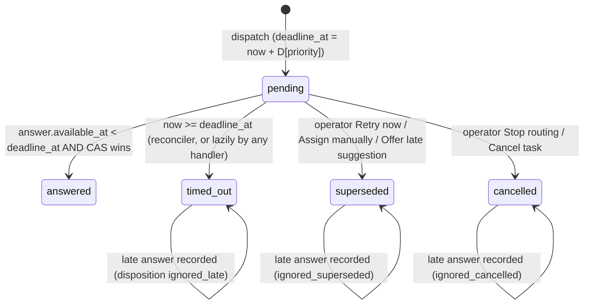

# 02 - Engine, Time & Concurrency

> **SUPERSEDED — input only.** This is a pre-synthesis dimension draft. Where it disagrees with `PLAN.md` (statuses, restart model, API shapes, numbers, CLAUDE.md text), `PLAN.md` wins. Do not implement from this file.

Dimension owner: Engine, Time & Concurrency. Interacts with **Domain & State** (task/assignment states, eligibility, capacity), **Operator UX** (rendering of phases, countdowns, banners, sim panel), **Architecture & Verification** (DB driver, module layout, test harness), **Delivery & Agentic Process** (time budget, Loom script).

---

## 0. TL;DR

1. **The engine is a persisted, seeded simulation behind a two-method interface** (`dispatch`, `collectDue`). Every request's fate (latency, never-return, match or no-match, chosen contributor) is decided and stored at dispatch in a sim-private table. The desk cannot read that table, so the only way to find out is to wait.
2. **A slow tail beyond 20s is added on purpose.** 10% of the answers that do come back arrive in 20 to 90s. If no answer could ever arrive after 20s, anything still pending at 20.1s would be known to be lost, and the brief's main premise ("cannot know whether slow or lost") would be false in our own sim.
3. **One time model: every deadline is a column, and one loop enforces them.** A 500ms ticker plus a "drain due work before every command" step. No `setTimeout` owns business state, so a restart loses nothing.
4. **The deadline decides, not the tick.** An answer counts if it reached the inbox before `deadline_at`. An accept counts if it happened before `expires_at`. Timestamps settle races against deadlines. Commit order settles races between actors.
5. **Fencing:** an answer is applied only by a CAS that requires the attempt to be `pending`, to be the task's `current_attempt_id`, and the task to be `routing`. Everything else is **recorded, not applied** ("late answers are evidence, not commands"). Where it is still useful, it is surfaced as a one-click suggestion.
6. **Pending policy:** neutral until 20s, then **Overdue** with honest copy. At a priority deadline (high 30s / normal 45s / low 60s) the attempt is timed out and **retried automatically up to 2 times**, then escalated. A visible countdown always names the next automatic action.
7. **The engine's pick is re-checked at apply time.** If the chosen contributor is no longer eligible (at capacity, unavailable, excluded), the result is recorded as `choice_unavailable` and auto-retried within the same budget.
8. **Restart model (B):** the engine sim persists its jobs, which models an external service with a durable inbox. Answers can land during or after a restart and go through the same fencing. Boot runs a catch-up before the HTTP listener opens and writes a `system.restarted` event that the UI turns into a banner and timeline markers.
9. **Contributors are simulated through the same domain commands** the operator's world uses. They can be auto or manual, use seeded probabilities, take per-task scenarios for deterministic demos, and are visually fenced off as SIMULATION.
10. **WON'T:** hedged requests, a calibrated per-request "chance it's lost" number, global time-scale or speed control, and virtual-time replay of downtime. Each has a stated reason (section 12).

### Divergences from the baseline (for the synthesizer)

| # | Baseline said | This section says | Why |
|---|---|---|---|
| X1 | Latency 5-20s, 20% never return | **Add a slow tail:** 10% of returning answers take U(20s, 90s) | Without it, "Overdue" would be a certainty and not an uncertainty, and late answers after a timeout would never happen naturally (deadlines are at least 30s) |
| X2 | Open question: restart (A) or (B) | **Choose (B), persisted engine jobs**, modelled as an external engine with a durable inbox | Real post-restart answers exercise the fencing. `tick(now)` makes tests deterministic with no fake timers. Demo reset is clean, with no ghost timers delivering into a reseeded DB |
| X3 | Engine result applied if still current | Adds **deadline-by-timestamp**: compare `answer.available_at < attempt.deadline_at`, enforced lazily in every handler as well as by the reconciler | The outcome must not depend on when the reconciler happened to tick |
| X4 | Reconciler ~1s | **500ms ticker plus `drainDue(now)` at the start of every command** | Removes the tick-boundary window in which an operator could act on a world that is up to 1s stale |
| X5 | Engine result that names an ineligible contributor: unspecified | **`choice_unavailable`**: record it, then auto-retry with a fresh snapshot (consumes retry budget) | A system race, not a human outcome, so it should not land on the operator |
| X6 | Retry budget of 2 | Budget is **per routing round**. Operator "Retry now" does **not** consume it, and operator "Route again" starts a new round | Operator pre-emption shouldn't make the automatic policy less patient |
| X7 | Late result recorded | Late `match` is also **surfaced as an actionable suggestion** when the task is `routing`/`needs_attention` and the contributor is currently eligible. Never auto-applied | Valuable when retries are exhausted. Keeps the human in the loop |
| X8 | `no_match` grouped with other failures | `no_match` is an **engine judgement**, so escalate immediately with **no auto-retry** | Re-asking the same question about the same candidates should get the same answer |

---

## 1. Principles (the rules everything else follows)

1. **Facts are rows with timestamps; time is a column.** Deadlines, expiries, and scheduled sim actions are persisted. Nothing important lives only in memory.
2. **Every state change is one synchronous transaction with a guard.** Each transaction checks the precondition and writes the change and its event together.
3. **Timestamps decide races against deadlines; commit order decides races between actors.** `drainDue(now)` before every command keeps both orders consistent.
4. **The first terminal transition wins; everything after is recorded, not applied.**
5. **Never show certainty we don't have.** No "stuck", no "lost", no per-request probability. Show the elapsed time, the normal range, and what happens next and when.

Reviewer line: *"Deadlines are data, transitions are guarded transactions, and anything that loses a race is written down and never silently dropped."*

---

## 2. Engine contract & simulation

### 2.1 Interface - MUST

```ts
// src/engine/types.ts  (shared shapes; zod-validated at the boundary)
export interface RoutingEngine {
  /** Fire-and-forget. Writes only to the engine's own storage. MUST NOT call back synchronously. */
  dispatch(req: RoutingRequest, now: number): void;
  /** Answers that have reached the desk's inbox by `now`, oldest available_at first. */
  collectDue(now: number): EngineAnswer[];
  /** Mark delivered. Called inside the same transaction that processed the answer. */
  ack(attemptId: string, now: number): void;
}

export type RoutingRequest = {
  attemptId: string;            // 'T-104#2'
  taskId: string;
  attemptNo: number;            // 1-based, monotonic per task across rounds
  task: { id: string; title: string; expertise: Expertise; priority: Priority; createdAt: number };
  candidates: CandidateSnapshot[];   // already ELIGIBLE (Domain & State's rule), never empty
  excluded: { contributorId: string; reason: ExclusionReason }[]; // informational, for the reason string
};

export type CandidateSnapshot = {
  id: string; name: string;
  activeCount: number; capacity: number;     // load at dispatch time
  lastOfferedAt: number | null;              // recency for tie-breaks
};

export type EngineAnswer =
  | { attemptId: string; kind: 'match';    contributorId: string; reason: string; availableAt: number }
  | { attemptId: string; kind: 'no_match';                        reason: string; availableAt: number };
```

- The **desk** computes eligibility and sends only eligible candidates (the brief says "contributors whose areas of expertise match"; we also remove unavailable, at-capacity and excluded contributors, and **Domain & State** owns that definition). The engine ranks them and does not filter.
- **Zero candidates means no dispatch** (baseline 8, MUST). The task goes straight to `needs_attention(no_eligible_contributors)` with a per-contributor explanation (section 10, E10).
- **Scenarios are not part of the request.** A real engine would never receive "please never return". The sim looks up the task's scenario from its own tables (`scenarioFor(taskId, attemptNo)`).
- **Dispatch runs inside the same DB transaction that creates the attempt row.** The sim's job row commits or rolls back with it, so there are no orphan attempts and no orphan jobs. In production this would be a transactional outbox (noted in the docs and not built).

Reviewer line: *"The engine is a port with two calls; the simulator is one adapter, and the desk never imports it."*

### 2.2 Deciding the outcome at dispatch - MUST

The fate is decided when the request is sent and stored in `sim_engine_jobs`, for two reasons:
- **Reproducibility.** The same seed and the same inputs give the same story, in tests and in the Loom.
- **Realism.** A real engine only knows the snapshot it was sent, so its pick can be stale by the time it answers. That staleness is the `choice_unavailable` race we must handle (section 4.5), and we get it for free.

```ts
function plan(req: RoutingRequest, cfg: SimConfig, scenario: EngineScenario | null): Plan {
  // One RNG per attempt; seeding per-attempt (not one global stream) keeps outcomes
  // independent of the ORDER in which concurrent tasks happen to dispatch.
  const rng = mulberry32(fnv1a32(`${cfg.seed}|${req.taskId}|${req.attemptNo}`));
  // Draw EVERY number EVERY time, in a fixed order, so changing one knob
  // (e.g. noMatchRate) does not reshuffle the others (latency, pick).
  const uFate = rng(), uSlow = rng(), uLatency = rng(), uNoMatch = rng(), uTie = rng();

  if (scenario) return scripted(scenario, req, uTie);        // section 2.6

  if (uFate < cfg.neverReturnRate) return { fate: 'never' };
  const latencyMs = uSlow < cfg.slowTailShare
    ? lerp(cfg.slowTailMinMs, cfg.slowTailMaxMs, uLatency)    // 20s .. 90s
    : lerp(cfg.latencyMinMs,  cfg.latencyMaxMs,  uLatency);   // 5s .. 20s
  if (uNoMatch < cfg.noMatchRate)
    return { fate: 'answer', latencyMs, answer: noMatch(req) };
  return { fate: 'answer', latencyMs, answer: pick(req.candidates, uTie) };
}
// availableAt = dispatchedAt + latencyMs  (persisted); fate 'never' => availableAt NULL.
```

- Hash: FNV-1a 32-bit. PRNG: mulberry32 (about 10 lines, no dependency).
- Task IDs are sequential (`T-101`, `T-102` and so on; owned by Domain & State), so seeded runs reproduce across fresh DBs.
- Changing knobs in the Sim panel affects **future dispatches only**, because plans are already persisted. The Sim panel says so.

### 2.3 Fate & latency distribution - MUST

| Outcome | Share of all requests | Latency |
|---|---|---|
| Never returns | **20%** (exact Bernoulli per request, per the brief) | n/a |
| Answers, normal | 80% x 90% = **72%** | U(5s, 20s) |
| Answers, slow tail | 80% x 10% = **8%** | U(20s, 90s) |
| ...of answers, `no_match` | 10% of answers (about 8% overall) | same latency as above |

The internal math justifies the policy. It is **not shown to the operator**, because it reads the answer key:

| Pending at | P(will never return given still pending) | P(answer within this deadline), single attempt | P(answer within 3 attempts) |
|---|---|---|---|
| 20s | 71% | n/a | n/a |
| 30s (high deadline) | 74% | 73.1% | **98.1%** |
| 45s (normal) | 80% | 74.9% | **98.4%** |
| 60s (low) | 85% | 76.6% | **98.7%** |

Takeaways for the Loom:
- About 2% of tasks escalate with `routing_exhausted` without any operator help.
- About 7% of high-priority attempts produce a **late answer** after the timeout, so the stale-answer path shows up naturally in a 10-minute demo.
- Even at 60s, about 15% of what's still pending is merely slow, so "Overdue" must never say "lost".

### 2.4 Matching rule & reason strings - MUST

The rule is simple and explainable on purpose, since the brief says the algorithm is not the focus:

1. All candidates are already eligible and match the expertise.
2. Pick the **lowest load ratio** `activeCount / capacity`.
3. Tie: pick the **least recently offered** (`lastOfferedAt` oldest; never-offered sorts first).
4. Tie: break with the seeded `uTie`.

Reason strings (stored on the attempt, shown verbatim in the timeline):
- Match: `"Lowest current load among 3 eligible finance contributors (Priya Shah: 0 of 2 active); least recently offered (last offer 14 min ago)."`
- Match with random tie-break: `"...; tied with Sam Lee, broken at random (seeded)."`
- No match: `"Engine judged none of 3 eligible finance contributors a good fit. (Simulated judgement: 10% no-match rate.)"`
- Forced: append `" (Forced by scenario: no match.)"`

### 2.5 No-match rules - MUST

| Situation | Behaviour |
|---|---|
| 0 eligible candidates | **Don't dispatch.** Event `routing.not_dispatched`. Task goes to `needs_attention(no_eligible_contributors)` |
| At least 1 candidate, engine returns `no_match` | Record it. Task goes to `needs_attention(no_match)`. **No auto-retry**: it is an engine judgement, and asking again about the same people should give the same answer |
| Engine returns a match that isn't in the snapshot / fails zod | `disposition = invalid`. Auto-retry within budget (treated as a system failure). Exists for robustness; only reachable through a forced scenario (COULD) |

### 2.6 Knobs & scenarios

**Global sim knobs** (row in `sim_config`, editable in the Sim panel; **MUST** to persist and use, **SHOULD** to make them editable in the UI):
`seed=42, neverReturnRate=0.20, slowTailShare=0.10, latencyMin/Max=5s/20s, slowTailMin/Max=20s/90s, noMatchRate=0.10, contributorMode='auto'|'manual', contributor probabilities (section 8)`.

**Per-task scenarios** (chosen in a collapsed "Simulation" section of the create form, shown as a SIM badge on the task; **MUST**, because they make the Loom deterministic):

| Engine scenario | Effect | Demo use |
|---|---|---|
| `auto` (default) | Seeded random per section 2.3 | Routine board activity |
| `match_fast` | Attempt 1 answers at **6s** with the rule-based pick | Routine assignment |
| `match_slow` | Attempt 1 answers at **40s** (after the 30s high deadline) | Overdue, then timeout, retry, and a **late answer** recorded and surfaced |
| `lost_once` | Attempt 1 never returns; later attempts are `auto` (SHOULD) | Timeout then automatic recovery |
| `lost_always` | Every attempt in every round never returns | Retries exhausted, then escalation |
| `no_match` | Attempt 1 answers `no_match` at 8s | Escalation without retry |

| Contributor scenario | Effect on the **first** offer |
|---|---|
| `auto` (default) | Seeded per section 8 |
| `accept` / `decline` | That action after **4s** |
| `ignore` | No response, so the offer expires at 60s |
| `withdraw_after_accept` | Accept at 4s, then withdraw at 10s (fails before work starts) |

Scenarios script only the **first** thing that happens. Everything after that runs on the normal sim, except `lost_always`. The rule is printed in the Sim panel.

### 2.7 Time-scale / speed control - WON'T (decision)

- **Alternatives considered:** a global `SIM_TIME_SCALE` on the injected clock (2x or 5x); or a "demo preset" that shrinks all the policy numbers.
- **Why not:**
  - A scaled clock writes scaled timestamps into persisted rows. Changing the scale mid-flight bends deadlines that are already persisted, and the "time since created" ages stop matching the wall clock in the Loom.
  - The preset abandons the brief's 5-20s numbers that reviewers will check for.
  - Scenarios already make every story fast and deterministic. The slowest scripted story is `lost_always` at high priority (3 x 30s = 90s), which is fine to narrate over.
- **COULD instead:** two Sim-panel buttons on a pending attempt or open offer: **"Deliver answer now"** and **"Expire now"**. Each sets the persisted time to `now`, and the normal pipeline handles the rest.

Reviewer line: *"I kept real time and the brief's numbers; deterministic scenarios make demos fast without bending the clock."*

### 2.8 Sim-private storage - MUST

```sql
-- Only src/sim/** may read or write these tables (enforced by module boundary + a grep test).
CREATE TABLE sim_engine_jobs (
  attempt_id    TEXT PRIMARY KEY,          -- = routing_attempts.id
  fate          TEXT NOT NULL CHECK (fate IN ('answer','never')),
  available_at  INTEGER,                   -- epoch ms; NULL when fate='never'
  answer_json   TEXT,                      -- planned EngineAnswer (minus availableAt)
  source        TEXT NOT NULL,             -- 'auto' | 'scenario:<name>'
  delivered_at  INTEGER,                   -- set by ack() in the desk's apply transaction
  extra_deliveries INTEGER NOT NULL DEFAULT 0  -- COULD: duplicate-delivery scenario
);
CREATE INDEX sim_engine_due ON sim_engine_jobs(available_at) WHERE delivered_at IS NULL AND fate='answer';

CREATE TABLE sim_contributor_actions (
  id            INTEGER PRIMARY KEY,
  assignment_id TEXT NOT NULL,
  action        TEXT NOT NULL CHECK (action IN ('accept','decline','withdraw','start','complete')),
  due_at        INTEGER NOT NULL,
  done_at       INTEGER, cancelled_at INTEGER, outcome TEXT   -- 'applied' | 'rejected:<why>'
);
CREATE INDEX sim_contrib_due ON sim_contributor_actions(due_at) WHERE done_at IS NULL AND cancelled_at IS NULL;

CREATE TABLE sim_config (id INTEGER PRIMARY KEY CHECK (id = 1), json TEXT NOT NULL);
CREATE TABLE sim_task_scenarios (task_id TEXT PRIMARY KEY, engine TEXT NOT NULL, contributor TEXT NOT NULL);
```

Reviewer line: *"The engine's fate is in a table the desk is not allowed to read, so the operator's uncertainty is real and not a UI trick."*

---

## 3. The unknowable pending request

### 3.1 What the operator sees, by elapsed time - MUST

Example: high priority, deadline 30s, 2 auto-retries left. Elapsed time is measured from `dispatched_at` and **includes any downtime**, because from the task's point of view it has been waiting all along. Copy is final unless **Operator UX** changes the tone.

| Elapsed | Phase (derived client-side) | Headline | Sub-copy | Next-action line |
|---|---|---|---|---|
| 0-5s | `asking` | **Routing - asked engine 3s ago** | "The engine usually answers in 5-20s." | "Next: retry automatically at 0:30 if there's no answer (attempt 2 of 3)" |
| 5-20s | `in_window` | **Routing - 12s** | "Within the normal range (5-20s)." A thin bar fills across the 5-20s band | same |
| 20s to deadline | `overdue` (amber) | **Overdue - no answer after 24s** | "The engine usually answers within 20s. This request may be slow, or it may never come back. There's no way to tell from here." | "Next: retry automatically in 0:06 (attempt 2 of 3)" |
| deadline reached | the attempt closes as `timed_out` and attempt 2 is dispatched in the same transaction | timeline: "Attempt 1: no answer after 30s. Stopped waiting; retrying (attempt 2 of 3)." | The attempts list keeps attempt 1 visible as "stopped waiting". It may still answer, and that would be recorded | The countdown restarts for attempt 2 |
| last attempt's deadline | task goes to `needs_attention(routing_exhausted)` | **Needs attention - no answer from the routing engine** | "3 requests got no answer within 30s each. The engine may be degraded, or this may be bad luck. Any late answers will appear here." | Actions: **Retry routing** - **Assign manually...** - **Cancel task** |

Operator controls are available in **every** pending phase, not only when overdue: **Retry now**, **Assign manually...**, **Stop routing**. Words to avoid: "stuck", "failed", "lost", "hung". Words to use: "no answer yet", "stopped waiting", "may still answer".

**Overdue is a fact about the engine's normal window, so it is the same for all priorities.** Priority changes only how long we keep waiting (the deadline).

### 3.2 Deadlines, rounds, retry budget - MUST

- `deadline_at = dispatched_at + D[priority]`, with **D = high 30s / normal 45s / low 60s**. It is fixed at dispatch and persisted. A later priority edit affects the next attempt only (E12).
- Why shorter deadlines for higher priority: under our distribution a shorter deadline gives a faster expected time to an answer (about 24s at 30s versus about 33s at 60s). The cost is more engine load and more discarded slow answers. High priority is worth that cost; low priority waits longer and puts less load on the engine.
- **Routing round.** A round starts on submit or on operator **Route again**, and ends when an offer is created or the task escalates. Each round gets `auto_retries_left = 2`.
  - Automatic retries (after a timeout, `choice_unavailable` or `invalid`) **consume** budget.
  - Operator **Retry now** (pre-empting a pending attempt) **supersedes** the attempt and dispatches a new one in the same round **without consuming budget**.
  - Budget exhausted means `needs_attention(routing_exhausted)`.
- Retry backoff is **0s**: an immediate re-dispatch in the same transaction. Retry storms aren't a risk at this scale; jittered backoff is WON'T and documented.
- **Keep waiting (+30s)** - COULD. It extends `deadline_at` on the pending attempt, writes event `routing.deadline_extended`, and is limited to once per attempt.

### 3.3 "Next automatic action" - MUST

The server derives this and the client renders it as a countdown. Rule: **nothing changes automatically without a countdown on screen first.**

```ts
type NextAutomaticAction =
  | { kind: 'auto_retry'; at: number; label: 'Retry automatically (attempt 2 of 3)' }
  | { kind: 'escalate';   at: number; label: 'Stop waiting and ask you (no retries left)' }
  | { kind: 'offer_expires'; at: number; label: 'Offer to Priya Shah expires; then it comes to you' }
  | null;   // terminal / waiting on operator
```

### 3.4 Engine health and "chance it's lost": decision

| Option | Verdict | Why |
|---|---|---|
| Calibrated per-request "74% likely lost" | **WON'T** | Computing it from the sim's own parameters means reading the answer key. Computing it from a small empirical sample gives false precision. Either way it implies knowledge the brief says the operator cannot have |
| Full engine-health dashboard (p50/p95, return rate, time series) | **WON'T** | Costs time and is not the product |
| **One empirical line inside the Overdue card**, computed from `routing_attempts` history | **COULD** (first COULD to build if time remains) | Honest: it's about past requests, not this one. Example copy: "Recent history: of the last 50 requests, 11 never answered and 4 answered after 20s (slowest: 64s)." Hidden when fewer than 10 closed attempts exist: "Not enough history yet." One SQL query |

Reviewer line: *"For this request I only show what we know: elapsed time, the normal range, and what happens next. The single statistic is about past requests, and I label it that way."*

### 3.5 Hedged requests: decision **WON'T** (named as next step)

- **What it is:** at 20s (overdue), send a second request without abandoning the first, and the first valid answer wins.
- **Pros:** it would cut tail latency a lot (P(both lost) is 4% versus 20%).
- **Why not now:**
  - It breaks the simple "one pending attempt per task" invariant (partial unique index).
  - Two answers can disagree, so the UI needs a story for an attempt that is neither pending nor current.
  - It doubles engine load exactly when the engine may be degraded.
  - The late-suggestion surface (section 4.4) already recovers most of the value with a human deciding.
- **Designed so it stays cheap later:** the CAS keys on `attempt.status='pending' AND task.status='routing'`; `current_attempt_id` is a belt-and-braces check. Allowing hedging would mean dropping one index, comparing against a set of pending attempts, and superseding siblings in the winning transaction.

Reviewer line: *"Hedging is the textbook answer to unknowable tails, and it's my first 'next'. I didn't build it because it complicates the invariant the whole demo rests on."*

---

## 4. Fencing & answers

### 4.1 Attempt lifecycle - MUST



```sql
CREATE TABLE routing_attempts (
  id                 TEXT PRIMARY KEY,           -- 'T-104#2'
  task_id            TEXT NOT NULL REFERENCES tasks(id),
  round              INTEGER NOT NULL,
  attempt_no         INTEGER NOT NULL,
  trigger            TEXT NOT NULL CHECK (trigger IN ('submit','auto_retry','operator_retry','operator_reroute')),
  candidates_json    TEXT NOT NULL,              -- snapshot sent to the engine
  excluded_json      TEXT NOT NULL,
  dispatched_at      INTEGER NOT NULL,
  deadline_at        INTEGER NOT NULL,
  status             TEXT NOT NULL CHECK (status IN ('pending','answered','timed_out','superseded','cancelled')),
  closed_at          INTEGER,                    -- EFFECTIVE time (e.g. = deadline_at for timeouts)
  closed_processed_at INTEGER,                   -- when the desk actually processed it (differs after downtime)
  closed_reason      TEXT,                       -- 'deadline'|'operator_retry'|'operator_assigned'|'routing_stopped'|'task_cancelled'
  -- raw engine answer: recorded whenever it arrives, even if never applied
  answer_kind        TEXT CHECK (answer_kind IN ('match','no_match','invalid')),
  answer_contributor_id TEXT,
  answer_reason      TEXT,
  answer_available_at INTEGER,
  answer_processed_at INTEGER,
  answer_disposition TEXT CHECK (answer_disposition IN
     ('applied','no_match','choice_unavailable','invalid',
      'ignored_late','ignored_superseded','ignored_cancelled','ignored_not_routing')),
  duplicate_deliveries INTEGER NOT NULL DEFAULT 0
);
CREATE UNIQUE INDEX one_pending_attempt_per_task ON routing_attempts(task_id) WHERE status = 'pending';
CREATE INDEX attempts_due ON routing_attempts(deadline_at) WHERE status = 'pending';
```

The task-side columns `current_attempt_id`, `routing_round`, `auto_retries_left` and `version` live on `tasks` (owned by **Domain & State**). Invariant: `status='pending'` implies `id = tasks.current_attempt_id`. Every code path that moves an attempt out of `pending` does so in the same transaction that changes `current_attempt_id`.

### 4.2 The apply rule - MUST

```ts
function applyEngineAnswer(ans: EngineAnswer, now: number): Disposition {
  return tx(() => {
    const a = attempts.get(ans.attemptId);
    if (!a) { log.warn('answer for unknown attempt', ans); engine.ack(ans.attemptId, now); return 'unknown'; }

    // (1) Idempotency: a second delivery of the same answer is a no-op.
    if (a.answer_processed_at != null) { attempts.bumpDuplicate(a.id); engine.ack(a.id, now); return 'duplicate'; }

    // (2) Always record the raw answer, applied or not.
    attempts.recordAnswer(a.id, ans, now);                 // answer_* columns

    // (3) Lazy deadline enforcement: the deadline decides, not the reconciler tick.
    if (a.status === 'pending' && ans.availableAt >= a.deadline_at) {
      timeoutAttempt(a, /*effectiveAt*/ a.deadline_at, now);   // same code the reconciler runs; may dispatch a retry
    }

    // (4) Fencing CAS: only the task's current, still-pending attempt on a routing task may win.
    const won = db.run(`
      UPDATE routing_attempts
         SET status = 'answered', closed_at = :availableAt, closed_processed_at = :now
       WHERE id = :id AND status = 'pending'
         AND EXISTS (SELECT 1 FROM tasks t
                      WHERE t.id = :taskId AND t.status = 'routing' AND t.current_attempt_id = :id)`,
      { id: a.id, taskId: a.task_id, availableAt: ans.availableAt, now }).changes === 1;

    if (!won) {
      const why = ignoredBecause(attempts.get(a.id), tasks.get(a.task_id));  // ignored_late | _superseded | _cancelled | _not_routing
      attempts.setDisposition(a.id, why);
      events.add('routing.answer_ignored', { attemptNo: a.attempt_no, answeredAfterMs: ans.availableAt - a.dispatched_at,
                                             suggestion: summarize(ans), why, taskStatusAtArrival: tasks.get(a.task_id).status });
      engine.ack(a.id, now);
      return why;
    }

    // (5) The engine's judgement.
    if (ans.kind === 'no_match') { escalate(a.task_id, 'no_match', ans.reason, now); setDisp('no_match'); ... return; }

    // (6) Re-validate the pick NOW (it was made against a snapshot).
    const elig = eligibility.check(ans.contributorId, a.task_id, now);   // Domain & State's rule, incl. capacity
    if (!elig.ok) {
      setDisp('choice_unavailable');
      events.add('routing.choice_unavailable', { contributorId: ans.contributorId, why: elig.reason });
      retryOrEscalate(a.task_id, 'choice_unavailable', now);            // consumes budget
      engine.ack(a.id, now); return 'choice_unavailable';
    }

    // (7) Apply: offer + task transition + events. Partial unique index on assignments is the backstop.
    offers.create({ taskId: a.task_id, contributorId: ans.contributorId, source: 'engine', attemptId: a.id,
                    expiresAt: now + cfg.offerTtlMs });                  // offer clock starts at PROCESSING time
    tasks.transition(a.task_id, 'routing' /*from*/, 'awaiting_response' /*to*/, now);  // version++
    events.add('routing.answered', {...}); events.add('offer.created', {...});
    setDisp('applied'); engine.ack(a.id, now);
    return 'applied';
  })();
}
```

Notes:
- `tx` is a synchronous driver transaction (better-sqlite3 or `node:sqlite` `DatabaseSync`; **Architecture & Verification** picks). Being synchronous means no two handlers interleave inside a transaction. The CAS guards still exist, because commands are decided against **client-side stale reads** (`expectedVersion`) and because they document the rules in code.
- If a constraint backstop fires (for example the unique active-assignment index), catch it. Record `answer_disposition='ignored_not_routing'` plus a `system.invariant_violation` event, and **ack anyway**, so a poison answer can't loop forever in the inbox. SHOULD.
- `ack` happens in the same transaction as the processing. Because the inbox and the desk share one SQLite file, at-least-once delivery becomes effectively-once. The duplicate guard in step (1) still exists for the forced duplicate scenario and as documentation of a real external engine.

### 4.3 What is recorded on a late or ignored answer - MUST

- The attempt row: `answer_*` columns plus `answer_disposition`. The attempt `status` is **unchanged**: it stays `timed_out` / `superseded` / `cancelled`.
- The event `routing.answer_ignored`, rendered in the timeline as:
  - After a timeout: **"Attempt 1 answered after 41s, 11s after we stopped waiting. Engine suggested Priya Shah. Not applied: attempt 2 was already in flight."**
  - After an operator intervention: **"Attempt 1 answered after 34s: suggested Sam Lee. Not applied: you offered this task to Priya Shah 12s earlier."**
  - After an operator intervention, same person: COULD use the nicer copy **"Engine later agreed: it also suggested Priya Shah."**
  - After cancel: **"Attempt 2 answered after 18s (no match). Not applied: the task was cancelled."**

### 4.4 Late suggestions surfaced to the operator - SHOULD

Shown as a callout on the task **only if all of these hold**:
- (a) the task is `routing` or `needs_attention`;
- (b) the latest ignored answer is a `match`;
- (c) that contributor is eligible **now** (re-checked on every read);
- (d) no newer offer has been created since it arrived.

> **Late engine suggestion: Sam Lee** (finance, 0 of 2 active). Attempt 2 answered 8s ago, after we had stopped waiting. It was not applied automatically.
> [Offer to Sam Lee] (operator action; supersedes any pending attempt)

- Clicking it is an ordinary operator **Assign** with `source='operator'` and `basedOnAttemptId`. Event: "You offered the task to Sam Lee (the engine's late suggestion from attempt 2)."
- Most valuable case: a task in `needs_attention(routing_exhausted)` whose third attempt answers late.
- We still don't auto-apply, because the operator was told this task is theirs and changing it underneath them would break that promise.

Reviewer line: *"Late answers are evidence, not commands. They are always recorded, sometimes offered to the operator, and never applied on their own."*

### 4.5 Duplicate, invalid and ineligible answers - MUST

| Case | Handling | Operator sees |
|---|---|---|
| Same answer delivered twice | Step (1): `duplicate_deliveries++`, no event | Nothing (it's in the attempt debug details: "delivered 2x") |
| Answer fails zod / picks a contributor outside the snapshot | `answer_kind='invalid'`, auto-retry within budget | "Attempt 2 returned an invalid answer (contributor not among candidates). Retrying (attempt 3 of 3)." |
| Pick is now unavailable / at capacity / excluded | `choice_unavailable`, auto-retry within budget, new snapshot | "Engine picked Priya Shah, but she's no longer eligible (now at capacity: offer pending on T-104). Retrying automatically (attempt 2 of 3)." |
| Answer whose `available_at` is before the deadline but processed after it (tick lag or restart) | **Applied**, judged by `available_at` | "Engine answered after 12s (while the desk was offline); applied on restart." |
| Answer exactly at `deadline_at` | Late (strict `<`) | As an ignored late answer |

---

## 5. Pairwise races and how each is resolved - MUST (each one is a named test)

Shorthand: **CO** = commit order (first terminal transition committed wins). **TS** = timestamp against a persisted deadline. Every operator command carries `expectedVersion`. A mismatch returns **409** with the events since that version.

| # | Race | Resolution | What the operator sees |
|---|---|---|---|
| R1 | Engine answer vs operator **Assign manually** while pending | CO, made consistent by `drainDue` before the command. If the operator commits first, the attempt is `superseded(operator_assigned)` and the answer is later `ignored_superseded`. If the answer was already available, drain applies it first, the operator's version is stale, and they get 409 | Either the late-answer note (section 4.3) or the 409: "Not applied: this task changed since you opened it. 10:04:03 Engine offered it to Priya Shah." [Review] |
| R2 | Engine answer vs operator **Retry now** | Same as R1. The old attempt is `superseded(operator_retry)`, and its answer is recorded and possibly suggested | "Attempt 1 answered after 22s ... Not applied: you restarted routing 3s earlier." |
| R3 | Engine answer vs operator **Stop routing / Cancel** | Same as R1. The answer is `ignored_cancelled` / `ignored_not_routing` | Timeline note only |
| R4 | Engine answer vs **reconciler timeout** | TS: `available_at < deadline_at` means applied, whichever runs first. The inbox is processed before deadlines in every tick, and the handler enforces the deadline lazily | Deterministic. Never depends on tick timing |
| R5 | Engine answer vs **another task's offer to the same contributor** (capacity) | Apply-time eligibility check inside the transaction (the single writer serializes it). Offers count toward capacity. The loser gets `choice_unavailable` and an auto-retry | "Engine picked Priya Shah, but she's now at capacity (offer pending on T-104). Retrying..." |
| R6 | Contributor **accept vs offer expiry** | TS: accept at `t < expires_at` wins even if the reconciler is late. At `t >= expires_at` the handler expires the offer first, then rejects the accept | Contributor sim shows "Offer expired 2s ago". Timeline: "Priya Shah tried to accept 2s after the offer expired." |
| R7 | Contributor **accept/decline vs operator withdraw / reassign** | CO. If the contributor commits first, the operator gets 409 ("Priya Shah accepted 3s ago") and can still use the deliberate **Unassign** on the accepted assignment. If the operator commits first, the contributor's response is rejected: `offer.response_ignored` | 409 card, or a timeline note |
| R8 | Two operator tabs (or double-click) | Optimistic version. The second gets 409 with the diff. The UI also disables buttons while a mutation is in flight | "Not applied: this task changed since you opened it: 10:04:03 You (other tab) offered it to Sam Lee." |
| R9 | Operator **Assign** to a contributor at capacity | The command validates eligibility in the transaction: 422 "Priya Shah is at capacity (1 of 1: T-104)". No override (Domain & State may revisit) | Inline error in the assign picker |
| R10 | Contributor **withdraw after accept vs auto-start** | Can't race inside the sim: at accept time the sim plans either withdraw or start, never both. A manual click against a scheduled auto action is CO, and the manual click cancels the scheduled action | n/a |
| R11 | Contributor action vs **operator Unassign** | CO plus version | 409, or the action is rejected as "assignment no longer active" |
| R12 | **Boot catch-up vs new HTTP commands / engine deliveries** | Boot runs `tick(now)` **synchronously before `listen()`**, and engine deliveries only happen inside ticks, so there is no overlap | Banner (section 7.3) |
| R13 | Duplicate **create** (double-submit / refresh-resubmit) | `client_request_id` UNIQUE: the second request returns the existing task (200) and does not dispatch again | Nothing: the same task opens |
| R14 | Many tasks routed at once | Attempts are independent. Per-attempt RNG seeding makes plans independent of dispatch order. The only cross-task coupling is capacity (R5) | n/a |

### Ordering guarantees inside one `tick(now)`

1. Engine inbox, ascending `available_at`. **Answers before deadlines.**
2. Sim contributor actions, ascending `due_at`. **Responses before expiries.**
3. Attempt deadlines (`status='pending' AND deadline_at <= now`).
4. Offer expiries (`status='offered' AND expires_at <= now`).
5. Heartbeat (every 5s).

Each item runs in **its own transaction**, so one bad row doesn't block the rest. A throwing handler is logged, and that item is retried on the next tick (COULD: a dead-letter after 3 failures with a `system.error` event).

---

## 6. Time: clock, ticker, drain - MUST

```ts
export interface Clock { now(): number }          // epoch ms; injected everywhere. Lint/grep rule: no Date.now() outside clock.ts.
export const systemClock: Clock = { now: () => Date.now() };
export class FakeClock implements Clock { t = 0; now() { return this.t; } advance(ms: number) { this.t += ms; } }

export function tick(now: number): TickReport { /* section 5 ordering; returns counts for the restart banner */ }

// Ticker: the only setInterval in business code; it just calls tick with the clock.
setInterval(() => tick(clock.now()), cfg.tickMs /* 500 */);

// Every mutating command:
function command<T>(fn: (now: number) => T): T {
  const now = clock.now();
  tick(now);                     // drainDue: world is "as of now" before any decision (SHOULD; cheap)
  return tx(() => fn(now))();
}
```

- **Lazy enforcement (MUST):** every handler that touches an attempt or offer checks its deadline against the event's own timestamp first. This makes correctness independent of the ticker. The ticker only bounds how quickly the UI reflects a deadline (at most 500ms plus the 1s poll).
- **`drainDue` before commands (SHOULD):** makes actor-versus-due-work ordering timestamp-consistent (R1).
- **Reads don't mutate.** `GET` never ticks, so the UI can show "pending" for up to one tick after a deadline. That's acceptable.
- **Clock jumps** (NTP / manual changes): deadlines are absolute wall-clock values. A backward jump delays enforcement, and a forward jump causes early timeouts. **WON'T** handle; documented. A monotonic clock can't survive restarts anyway.
- Under `tsx watch` **every save is a restart**, so the design gets exercised continuously during development.

---

## 7. Restart & refresh

### 7.1 Decision: (B) persisted engine jobs, modelled as an external engine with a durable inbox - MUST

| | (A) In-process, in-memory engine | **(B) Persisted engine jobs (chosen)** |
|---|---|---|
| Restart semantics | In-flight requests die. They can't be told apart from never-return, and the persisted deadline handles them | Requests outlive our process. Answers that "arrived" during downtime wait in the inbox; future ones still arrive |
| Fencing across restarts | Never exercised | Exercised: real late or in-time answers after boot |
| Tests | Need fake timers for `setTimeout` | `tick(now)` with a `FakeClock`: pure, fast, deterministic |
| Demo reset | Ghost timers can deliver into a reseeded DB | A reset deletes the rows, so there are no ghosts |
| Realism | Only right if the engine were a synchronous call our process owns | Matches a typical async engine: request, then a callback into a queue |
| Cost | Slightly less code | One table, one due-scan (the ticker already exists) |

- **Why (B):** it removes the only remaining in-memory timer, gives deterministic tests for free, and turns "the app may be restarted while work is active" from a footnote into a demonstrable scenario.
- **(A)'s best argument:** "restart degrades into the never-return case we must handle anyway". The docs record it as the considered alternative.

**Downtime semantics (the key subtlety):**
- **Engine answers are judged by `available_at`**, the moment they reached our durable inbox. An answer that arrived during downtime, before its deadline, still counts.
- **Contributor actions go through our API.** While we were down they could not happen, so a sim action that was due during downtime is processed at boot **with event time = boot time**. If the offer expired in the meantime, the action is rejected.
- **Side effects start at processing time.** A new offer's 60s TTL and a retry's deadline are measured from boot, not from downtime.
- **We don't replay downtime in virtual time.** Our side did nothing while it was down, and pretending otherwise would fabricate history (WON'T).

Reviewer line: *"Each due item is judged by its own timestamp against its own deadline, and anything it triggers starts from now. The engine's answers wait in an inbox; contributor clicks needed us to be up."*

### 7.2 Boot sequence - MUST

```
1. open DB (WAL), run migrations
2. now = clock.now(); bootId = randomUUID(); last = system_state.last_heartbeat_at
3. if last is null  -> event system.started
   else             -> event system.restarted { offlineFrom: last, onlineAt: now, offlineMs: now-last,
                                                inFlightAtStop: { attempts:[...ids], offers:[...ids] } }
4. report = tick(now)              // catch-up; events written during it carry ctx.catchUp = true
5. update system.restarted payload with report:
     { answersApplied, answersIgnoredLate, attemptsTimedOut, retriesDispatched, escalations, offersExpired }
6. start ticker; app.listen()      // nothing external can run before catch-up completes
```

Heartbeat: `system_state.last_heartbeat_at` is written every 5s, so downtime is only known approximately, and the copy says "about". COULD: on SIGINT/SIGTERM, write a final heartbeat plus a `system.stopping` event, which makes the downtime exact for graceful stops.

### 7.3 What the operator sees after a restart - MUST (event and markers), SHOULD (banner)

- **Global banner** (from the latest `system.restarted`; dismissible; shown for 10 min):
  > **The desk restarted at 10:04:12** (offline about 1 min 10 s). On restart we caught up: 1 engine answer that arrived in time was applied - 1 request passed its deadline and was retried - 1 offer expired and needs your attention. Requests still in flight may still answer. [Show affected tasks] [Dismiss]
- **Timeline marker** in every task that had a pending attempt or open offer at shutdown: a divider reading **"Desk offline 10:03:02 to 10:04:12 (about 1m 10s)"**. Events processed during catch-up get a "processed on restart" tag. Timeouts show both times: "Timed out at 10:03:32, enforced on restart at 10:04:12."
- **Pending attempts whose deadline hasn't passed** stay `pending` and keep counting from `dispatched_at`. Sub-copy for the first 30s after boot: "The desk restarted 5s ago; this request is still outstanding and may still answer."
- **Client detects a restart** through `bootId` in every API response (SHOULD). If it changes, the client refetches everything and shows the banner, even if the restart was too quick for polling to fail.

### 7.4 Client refresh, offline, time - MUST unless noted

- **Stateless UI.** All state comes from the server. The URL holds the selected task and filters (`/tasks/T-104?status=needs_attention`). Refresh is always safe.
- **Server time offset.** Every response includes `serverNow` (epoch ms). The client keeps `offset = serverNow - Date.now()` from the response with the lowest observed RTT and uses `serverNowEstimate = Date.now() + offset` for every age, elapsed time and countdown. All phases in section 3.1 are derived client-side from `dispatched_at` / `deadline_at` and that estimate, so a lagging browser clock never shows a wrong countdown.
- **Polling** every 1s (baseline 12). When a poll fails:
  - Banner: **"Can't reach the desk. Retrying... Last update 10:04:01."**
  - Countdowns change to **"paused: desk offline"**, because we can't promise an action the server isn't running.
  - Elapsed and age timers keep counting, because those stay true.
- **Idempotent create.** The form creates `clientRequestId = crypto.randomUUID()` when it mounts and regenerates it only after a success. The server stores it in `tasks.client_request_id UNIQUE`; a conflict returns the existing task with 200.
  - COULD: return 422 if the same key arrives with a different payload.
- **Mutations:** buttons are disabled while a request is in flight, every command carries `expectedVersion`, and a 409 renders the change list (R8).

---

## 8. Contributor-side simulation

### 8.1 Model - MUST

- The sim acts **through the same domain commands** the operator's world uses (`acceptOffer`, `declineOffer`, `withdraw`, `start`, `complete`). The actor is `contributor:<id>` and the `via` field is `sim_auto` or `sim_manual`. There is one code path, so the sim can't do anything a real contributor couldn't.
- **Plan at offer creation** (seeded by `fnv1a(seed|assignmentId)`; same "draw everything in fixed order" rule), stored in `sim_contributor_actions`:

| Step | Default |
|---|---|
| Response to offer | **accept 70% / decline 20% / no response 10%** |
| Response delay | U(3s, 15s) |
| Offer TTL (owned by the desk, not the sim) | **60s**, demo-scaled. The policy panel says "production would be hours" |
| After accept | **withdraw before starting 5%** at accept + U(5s, 15s); otherwise **start** at accept + U(5s, 15s) |
| After start | **complete** at start + U(30s, 60s) |

- Escalation rate per offer is about 20% decline + 10% expiry + 3.5% withdraw = **about a third**. That keeps recovery flows visible on a live board without making it all red.
- **Manual controls - MUST.** In the task detail, a "Simulation: act as Priya Shah" strip with **Accept, Decline, Withdraw, Start, Complete**, each enabled only when legal. A manual click **cancels any scheduled auto action** for that assignment, so the auto action can't fire later and leave a confusing "ignored" event.
- **Global contributor mode: `auto` | `manual`** (Sim panel; default `auto`). In `manual`, offers wait for clicks or expire. COULD: a per-contributor override.
- **Visual separation** (Operator UX renders it): a dashed border, a "SIMULATION" label, and the caption "These buttons stand in for the engine and contributors. They are not operator controls."

### 8.2 Deterministic demos - MUST

1. Fixed `seed=42` plus sequential IDs give a reproducible board.
2. Per-task engine and contributor scenarios (section 2.6) script each Loom story.
3. **Reset demo** (`POST /sim/reset`, behind a confirm): one transaction that deletes all rows, reseeds, and writes `system.reset`. Engine jobs are rows, so nothing from before the reset can deliver afterwards.
4. Global contributor mode `manual` for step-by-step narration.

---

## 9. Default numbers

| Parameter | Default | Where | Notes |
|---|---|---|---|
| Engine latency (normal) | U(5s, 20s) | sim_config | Per the brief |
| Slow-tail share (of answers) | 10% | sim_config | **X1** |
| Slow-tail latency | U(20s, 90s) | sim_config | Makes "Overdue" honestly uncertain |
| Never-return rate | 20% | sim_config | Per the brief; exact per-request Bernoulli |
| No-match rate (of answers) | 10% | sim_config | Engine "judgement" |
| Overdue threshold | 20s (all priorities) | policy | End of the normal window |
| Attempt deadline | high 30s / normal 45s / low 60s | policy | Fixed at dispatch |
| Auto-retry budget | 2 per round (3 attempts) | policy | About 98% get an answer automatically |
| Retry backoff | 0s | policy | WON'T jitter |
| Keep-waiting extension | +30s, once per attempt | policy | COULD |
| Offer TTL | 60s | policy | Demo-scaled |
| Contributor response mix | accept 70 / decline 20 / none 10 | sim_config | |
| Contributor response delay | U(3s, 15s) | sim_config | |
| Withdraw-before-start | 5% of accepts, U(5s, 15s) after accept | sim_config | "fails before work begins" |
| Auto-start delay | U(5s, 15s) after accept | sim_config | |
| Auto-complete delay | U(30s, 60s) after start | sim_config | |
| Scenario timings | match_fast 6s, match_slow 40s, no_match 8s, contributor 4s, withdraw at 10s | code constants | |
| Reconciler tick | 500ms | server | Plus drain before commands |
| Heartbeat | 5s | server | Downtime precision |
| Client poll | 1s | client | |
| Restart banner lifetime | 10 min or until dismissed | client | |
| Late suggestion visibility | while task is `routing`/`needs_attention` and contributor is eligible | server | |
| Empirical history line | last 50 closed attempts, hidden when fewer than 10 | server | COULD |
| Global seed | 42 | sim_config | |

---

## 10. Edge-case catalogue

| # | Case | Behaviour |
|---|---|---|
| E1 | Answer exactly at the deadline | Late (strict `<`). Recorded and maybe suggested |
| E2 | Answer after timeout while attempt 2 is pending | Recorded `ignored_late`. Suggestion card shown, and attempt 2 continues untouched |
| E3 | Answer after operator manual assign | `ignored_superseded`. Timeline only (the task isn't routing, so no suggestion). If the operator's offer is later declined and the task goes to `needs_attention`, the suggestion becomes actionable if that contributor is still eligible |
| E4 | Pick declined this task meanwhile | `choice_unavailable` (excluded), auto-retry |
| E5 | Pick toggled unavailable by the operator | `choice_unavailable`, auto-retry |
| E6 | Pick at capacity because of another task | `choice_unavailable`, auto-retry (R5) |
| E7 | Duplicate delivery | No-op, counter only |
| E8 | Answer for an unknown attempt | Log and ack. Unreachable under (B), because reset deletes the jobs |
| E9 | Task cancelled while pending | Attempt `cancelled`. A later answer is `ignored_cancelled` |
| E10 | No eligible candidates at submit | No dispatch. `needs_attention(no_eligible_contributors)`: "No one can take this task right now. Finance contributors: Priya Shah (declined this task), Sam Lee (at capacity 1 of 1), Ana Ortiz (unavailable). Nothing was sent to the engine." |
| E11 | All candidates excluded at an auto-retry | Same as E10 (no dispatch, no budget consumed) |
| E12 | Priority edited while pending | The current deadline is unchanged; the next attempt uses the new priority |
| E13 | Sim knobs changed while pending | Affects future dispatches only (plans are persisted) |
| E14 | Downtime longer than every deadline | Boot: in-time answers applied, others timed out and retried from boot, offers expired and escalated, all summarized in the banner |
| E15 | Restart while an offer is open and the contributor's auto-accept fell in the downtime | The accept is processed at boot time. If the offer already expired, it's rejected: "Priya Shah tried to accept after the offer expired (desk was offline)." |
| E16 | Constraint backstop fires during apply | Catch, record `system.invariant_violation`, ack (no poison loop). Should be unreachable; a test asserts that |
| E17 | Operator clicks Retry now 50ms after an answer became available | Drain applies the answer first, then 409: "Engine answered 0.05s ago: offered to Priya Shah." |
| E18 | `lost_always` plus operator Route again | A new round with budget 2, and the scenario still applies, so it escalates again (as the scenario is labelled) |
| E19 | Wall-clock jump | Not handled; documented |
| E20 | Server killed mid-transaction | SQLite rolls back. Nothing half-applied. On boot the inbox item is still unacked and gets reprocessed |

---

## 11. Tests owned by this dimension (hand-off to Architecture & Verification)

All tests use `FakeClock`, call `tick(now)` and the command functions directly (with no HTTP, except one supertest for 409 and idempotency), and use an in-memory or temp-file SQLite.

**MUST (one test each, named after the use case or race):**
1. Routine: `match_fast`, answer at 6s, offer, scripted accept, `assigned`.
2. Timeout: `lost_once`, timed out at 30s, attempt 2 dispatched, answer, offer.
3. Exhaustion: `lost_always`, 3 timeouts, `needs_attention(routing_exhausted)` at 90s.
4. Late after timeout: `match_slow`, timed out at 30s, answer at 40s, `ignored_late`, suggestion present, nothing applied.
5. Intervention: manual assign at 25s, answer at 40s, `ignored_superseded`, the operator's offer intact.
6. Deadline by timestamp: answer `available_at` 29.9s, tick only at 31s, applied. Answer at exactly 30s is late.
7. Capacity race (R5): two tasks, capacity 1, the second gets `choice_unavailable` and retries.
8. Accept vs expiry (R6): accept at TTL-1ms accepted; at TTL rejected.
9. Stale version (R8): 409 with the events since `expectedVersion`.
10. Restart: dispatch, discard the app instance, keep the DB, advance 2 min, boot a new instance. Expect `system.restarted`; the in-time answer applied; the past-deadline attempt timed out with `closed_at = deadline_at`, `closed_processed_at = boot`; the retry dispatched; the offer expired.
11. Determinism: the same seed gives identical plans. Changing `noMatchRate` leaves every latency unchanged.
12. No candidates: no `sim_engine_jobs` row, and the task is escalated.
13. Idempotent create: the same `clientRequestId` gives one task and one attempt.

**SHOULD (timebox 30 min): seeded random-interleaving invariant test.** About 1,000 random steps mixing commands, sim actions and clock advances, with these invariants checked after every step:
- at most 1 active assignment per task;
- at most 1 pending attempt per task;
- capacity never exceeded;
- every attempt that has an answer has exactly one disposition;
- every `pending` attempt is the task's `current_attempt_id`;
- no task is `routing` without a pending attempt.

It is the single strongest piece of evidence for the "correct under concurrency" claim, and the `tick(now)` design makes it cheap.

---

## 12. MoSCoW summary, cut order, estimate

**MUST**
- Engine port plus persisted seeded sim (B), with plan-at-dispatch, slow tail, 20% never-return, no-match rate, rule-based pick and reason strings.
- No dispatch on zero candidates.
- Priority deadlines, overdue phase copy, retry budget per round, next-action countdown.
- Fencing CAS, lazy deadline enforcement, `available_at` semantics, raw-answer recording with dispositions, `choice_unavailable` retry.
- `tick(now)` ordering, 500ms ticker, boot catch-up before listen, heartbeat, `system.restarted` event and timeline markers.
- 409 on version mismatch, with changes. Idempotent create. `serverNow` in responses.
- Contributor sim: offer TTL, auto plan, manual buttons, scenarios, reset.
- MUST tests 1-13.

**SHOULD**
- `drainDue` before commands.
- Late-suggestion card with one-click offer.
- Restart banner plus `bootId` detection.
- `lost_once` scenario.
- Editable sim knobs in the UI.
- Random-interleaving invariant test.
- Poison-answer guard.

**COULD**
- Empirical history line in the Overdue card.
- Keep waiting (+30s).
- "Deliver now" / "Expire now" sim buttons.
- Duplicate-delivery and invalid-answer scenarios.
- Per-contributor auto/manual.
- Graceful-stop heartbeat.
- Dead-letter after 3 handler failures.
- "Engine later agreed" copy.

**WON'T** (each written up in the README's omissions)
- Hedged requests: next step (section 3.5).
- Calibrated per-request loss probability (section 3.4).
- Global time-scale (section 2.7).
- Virtual-time replay of downtime (section 7.1).
- Clock-jump handling.
- Retry jitter / backoff.
- Multi-process writers / distributed locking.
- A real transactional outbox / HTTP engine.
- A smarter matching algorithm.
- An engine-health dashboard.

**Cut order if behind schedule:**
1. Random-interleaving test, down to 200 steps.
2. Editable sim knobs (keep the defaults).
3. The late-suggestion **button** (keep the timeline text).
4. The restart **banner** (keep the event and timeline markers).
5. Contributor **auto** mode (keep manual buttons and scenarios).

Never cut: fencing, persisted deadlines, boot catch-up, or tests 1-6.

**Estimate for this dimension's build, agent-assisted: about 2h**

| Piece | Time |
|---|---|
| Engine sim plus RNG plus plans | 20m |
| Attempts, apply and fencing | 30m |
| Tick, boot and heartbeat | 20m |
| Contributor sim plus scenarios | 25m |
| MUST tests | 25m |

That leaves about 3h for the UI, docs and the Loom (see Delivery & Agentic Process).

---

## 13. Reviewer one-liners (for the Loom and README)

- **Uncertainty:** "Past 20 seconds I don't know if the engine is slow or gone, and neither does the UI. It shows elapsed time, the normal range, and exactly what will happen next and when."
- **Slow tail:** "I gave the simulated engine a slow tail, because if nothing could ever answer after 20 seconds, the uncertainty in the brief wouldn't exist."
- **Fencing:** "An answer is only applied if its attempt is still the one the task is waiting on. Anything else is recorded and explained, never applied."
- **Deadlines:** "Deadlines are columns, not timers. Whoever touches a row first enforces its deadline, so the outcome doesn't depend on when a background loop happened to run."
- **Restart:** "The engine is modelled as an external service with an inbox. After a restart, answers that arrived in time still count, and deadlines that passed while we were down are enforced, with both times shown."
- **Human vs system:** "System failures retry themselves within a visible budget. Human outcomes, and the engine's own 'no match', come to the operator with the context to decide."
- **Concurrency:** "Between actors, the first committed change wins. The loser gets a 409 that lists what changed, not a silent overwrite."
- **Next:** "Hedged requests for high-priority tasks: send a second request at the overdue mark, and the first valid answer wins."
