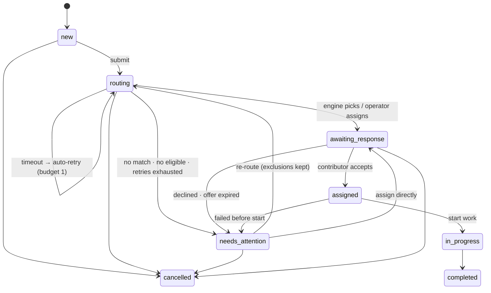

# 05 — Delivery & Agentic Process

> **SUPERSEDED — input only.** This is a pre-synthesis dimension draft. Where it disagrees with `PLAN.md` (statuses, restart model, API shapes, numbers, CLAUDE.md text), `PLAN.md` wins. Do not implement from this file.

Owner dimension: **Delivery & Agentic Process**: schedule, scope cuts, how the coding agents are driven and checked, documentation, Loom, submission.
Interacts with: **Domain & State** (states, invariants), **Engine, Time & Concurrency** (deadlines, retries, restart), **Operator UX** (screens, copy), **Architecture & Verification** (stack, tests).

> Guiding principle for this dimension: *it's cheaper to make the wrong states impossible first and make the right ones visible afterwards.* Spend the first build hour on the domain core and its tests. The UI only gets built once the core is proven, and every rule we hand the agent is checked by a test or a script, not by memory.

---

## 0. Divergences from the baseline (for the synthesizer)

| # | Baseline says | This section recommends | Owner to confirm | Why (delivery lens) |
|---|---|---|---|---|
| D1 | Restart model open: (A) in-process vs (B) persisted engine jobs | **A** (MUST). On top of it, a small **boot recovery** step (SHOULD): pending attempts dispatched before the restart are marked `lost_on_restart` straight away and re-dispatched, with a visible event, so they don't wait out their deadline. If cut, the persisted-deadline path (MUST, no extra code) still covers restart. B is **COULD**. | Engine, Time & Concurrency | A costs no extra code, because the deadline path already covers it. With A we *know* the pre-restart requests are gone, so making the operator wait for them is poor taste. B costs about 30–45 min and mainly helps the demo, since late results already exercise fencing within a single run. |
| D2 | Contributors auto-respond by probability (accept/decline/ignore) | **Manual "respond as contributor" buttons (MUST)** plus **deterministic per-contributor personas (SHOULD)**, e.g. "accepts after 8 s", "declines after 5 s", "never responds", "manual". Probabilistic auto-response is **WON'T**. | Domain & State / Operator UX | Randomness on camera and in tests hurts determinism. Personas show the same behaviours reproducibly. |
| D3 | SQLite driver unspecified | **Built-in `node:sqlite` (`DatabaseSync`)**, with `better-sqlite3` as fallback. Verified in this session: Node v26.5.0 ships SQLite 3.53.4, partial unique indexes work, and no experimental warning is printed. Needs a ~10-line `tx(db, fn)` helper (`BEGIN IMMEDIATE`/`COMMIT`/`ROLLBACK`). | Architecture & Verification | No native module build on a very new Node ABI, which removes a known way for setup to eat 20+ minutes. |
| D4 | `task.version` optimistic concurrency → 409 | **SHOULD**, not MUST. The MUST guarantee is the state CAS guard in every command. | Domain & State | The CAS guard already gives correctness; versioning adds stale-tab protection. It's the first thing cut if the 1:45 gate is red. |
| D5 | Retry budget "e.g. 2 retries" | **1 automatic retry** (2 attempts in total) by default, set in `POLICY`. | Engine, Time & Concurrency | With a 30 s high-priority deadline, 2 retries means 90 s before the operator is told. 1 retry gives about 60 s, and P(two silent losses in a row) = 4 %. It also keeps the Loom short. |
| D6 | Priority-based deadlines (30/45/60 s) | **Single deadline is MUST; priority-specific deadlines are SHOULD.** Priority as a field (shown and sorted on) is MUST because the brief mentions "high-priority". | Engine, Time & Concurrency | One constant is cheaper to test, and the priority mapping is an easy add-on. |
| D7 | Offer expiry (`assignment.expires_at`) | **SHOULD** (default 90 s). The MUST recovery triggers are an explicit decline and "failed before start". | Domain & State | Reuses the reconciler, so it's cheap, but it isn't needed to demo recovery. |
| D8 | (not in baseline) | **`npm run check:invariants`**: a ~30-line architecture-lint script that greps for the "never do" rules (SHOULD). | Architecture & Verification | Gives mechanical proof that the agent followed the rules. Also good material for the Loom and the session map. |
| D9 | (not in baseline) | **Seed through the real command handlers with a backdated FakeClock** (SHOULD), not raw INSERTs. MUST is contributors plus a few `new` tasks. | Domain & State | Every seeded task then has a real, internally consistent history. |

---

## 1. Delivery decisions (decision cards)

**DP1. Order of work: core plus tests, then engine, then UI, then review, then docs.**
- Alternatives: build vertical slices per use case; start with the UI to "see it early".
- Why: the core risk the reviewers are probing is correctness under uncertainty (late results, lost requests, restarts). That logic has to be right before anything sits on top of it. A UI built on shifting states gets rewritten.
- Reviewer one-liner: *"I spent the first build hour making the wrong states impossible, so the UI hour only had to make the right ones visible."*

**DP2. One writer at a time; read-only subagents run in parallel.**
- Alternatives: parallel feature sessions in worktrees (domain ∥ engine ∥ UI).
- Why: domain and engine both edit the command handlers and the state machine, so parallel writers would drift on exactly the invariants that matter. One human can't properly review two writers at once. Parallelism goes where it's safe: review, adversarial checks, and drafting docs from code.
- Exception (COULD, only if ahead at the 1:45 gate and `shared/contract.ts` is frozen): a UI-shell session in a `git worktree` running alongside Session 3.
- Reviewer one-liner: *"One writer, many reviewers."*

**DP3. A fresh session per phase. Memory is written down, not held in one long chat.**
- Each session starts by reading `CLAUDE.md`, `docs/PLAN.md` and the previous **handoff note** in `docs/SESSIONS.md`, and ends by appending one.
- Why: clean context, transcripts that each show one phase, and a session map that falls out of the work for free.
- Reviewer one-liner: *"Each session starts from written context: the plan, the rules and the last handoff."*

**DP4. Plan mode, then a test-name gate, then implementation.**
- Every implementation session starts in plan mode (Shift+Tab). For invariant work, the agent must list the test names and stop before implementing.
- Why: it's the cheapest point to catch a misunderstanding, and it leaves visible evidence of direction-setting in the transcript.
- Reviewer one-liner: *"I approved test names before I let the agent write the code that passes them."*

**DP5. Rules are checked by machines where possible.**
- `npm run typecheck && npm test && npm run check:invariants` is the definition of done for every session.
- Reviewer one-liner: *"The never-do list is enforced by a script, not by trust."*

**DP6. Corrections are logged when they happen.**
- `docs/CORRECTIONS.md` gets an entry at the moment of a redirect, with a timestamp, the session and the commit. The "most important correction" in the session map is chosen from this log and never written after the fact.
- Reviewer one-liner: *"The correction in my session map is the one I logged at the time it happened, not one I reconstructed."*

**DP7. The demo is deterministic.**
- `npm run reset` gives a known seeded state, and SIMULATION controls force the next engine outcome per task. The Loom can't be derailed by the 20 % never-return.
- Reviewer one-liner: *"Every non-happy path in the video can be reproduced with one reset and one dropdown."*

**DP8. Transcripts go in the repo** (`agent-sessions/`), with raw JSONL, readable `/export` text, and a redaction log.
- Reviewer one-liner: *"Everything you need to audit the agent work is in one repo, with exactly what I redacted and why."*

---

## 2. Time-boxed schedule (5 h total, including planning, docs and Loom)

Set **T0** honestly in `docs/SESSIONS.md`: the moment work on the take-home began. The planning transcript's first activity is around 11:14 local time, so if T0 ≈ 11:10, the **hard stop is ≈ 16:10**. Keep a start/end time per session.

| Block | T+ | Session | Output | Gate (must be true to move on) |
|---|---|---|---|---|
| Plan | 0:00–0:45 | **S1 Planning** (this workflow) | `docs/planning/01–05`, `docs/PLAN.md` (synthesis), `CLAUDE.md`, `docs/DECISIONS.md` seeds, empty `docs/CORRECTIONS.md`, questions email sent | Human has read PLAN.md end to end (≈10 min), written down any disagreements, and frozen it. `git init`, first commit `plan: frozen`. |
| Build 1 | 0:45–1:45 | **S2 Scaffold + domain + invariant tests** | Running skeleton, schema with partial unique indexes, commands, FakeClock, StubEngine, invariant suite, frozen `shared/contract.ts` | `typecheck` + `test` green; test names match the list in §5.2; tag `cp1-domain` |
| Build 2 | 1:45–2:35 | **S3 Engine + reconciler + races** | `SimulatedEngine` (seeded RNG, injected clock, scenarios), reconciler (1 s tick + boot catch-up), boot recovery, race tests, HTTP smoke script | Fake-clock race suite green; `scripts/smoke.ts` passes against a live server; tag `cp2-engine` |
| Build 3 | 2:35–3:40 | **S4 Operator UI** | Board, task drawer with timeline, create form, recovery panel, simulation panel, policy panel | Human click-through of all 4 use cases (§5.4) passes; tag `cp3-ui` |
| Review | 3:40–4:05 | **S5 Review & correction** (fresh session) | `/code-review` findings triaged, fixes with tests, adversarial invariant review, restart test | All accepted findings fixed or written up as omissions; tag `cp4-reviewed` |
| Ship | 4:05–4:35 | **S6 Final verification + docs + exports** | README, DECISIONS, SESSIONS (map), AGENTIC_SETUP, omissions, redacted exports | Fresh-clone check passes (§9); redaction grep is clean; tag `v1-submitted` |
| Loom | 4:35–5:00 | Recording (no agent) | ≤ 10 min Loom | One rehearsal, then a recording |

**While an agent runs, the human isn't idle.** In S2 they draft DECISIONS.md entries. In S3 they write the click-through checklist. In S4 they draft README "Assumptions" and "Omissions". In S5 they rehearse the Loom path.

### 2.1 Cut lines (decided now, not under pressure)

| Clock (T+) | If this isn't true… | …then cut, in this order |
|---|---|---|
| **0:50** | PLAN.md frozen | Stop planning. Use the baseline as-is, resolving divergences with the defaults in §0. |
| **1:00** | `npm test` runs (even with 0 tests), `GET /api/health` responds, and a test can open `node:sqlite` | Switch to `better-sqlite3` (or `server.deps.external` if Vitest can't resolve `node:sqlite`). Drop Tailwind for one hand-written CSS file. Spend at most 10 min debugging tooling. |
| **1:45** | Invariant suite green | Drop `task.version`/409 (D4), then offer expiry (D7), then in-progress → completed polish (keep the states, minimal buttons). **Never drop** fencing, the unique indexes, or events written in the same transaction. |
| **2:35** | Engine + reconciler suite green | Drop auto-retry (timeout goes straight to `needs_attention` with a "Retry routing" button), then priority-specific deadlines (single 45 s), then personas (manual buttons only), then boot recovery (the deadline path covers restart). |
| **3:15** | All 4 use cases clickable end to end, even if ugly | Drop the policy panel UI (keep it in the README), the contributors page (show load inline), filters and sorting, and the "next automatic action" countdown (keep the static "Overdue" badge). |
| **3:40** | **Feature freeze** | Anything unfinished is **removed or hidden**, never half-shown, and listed in Omissions. |
| **4:05** | **Code freeze** | Only fixes for bugs found in the click-through, plus docs. |
| **4:35** | **Docs freeze** | Start the Loom. Anything not written goes into a "What's next" bullet. |
| **5:00** | Submitted | If a Loom retake doesn't fit, submit the first take. |

---

## 3. MoSCoW across the whole product

Tags: MUST / SHOULD / COULD / WON'T, against the hard 5 h budget. The other dimensions own the details; this table owns the **cut decision**.

### MUST (the coherent small product)
- **Data & seed:** about 8 contributors across finance, healthcare, data analysis and operations (some with 2 areas), and about 5 tasks in `new` across priorities. `npm run reset` gives the same state every time.
- **Board:** each task shows title, area, priority, **age** (time since created), status, assignee, and the **current operation** (e.g. "Routing · 14 s of expected 5–20 s", "Overdue · 23 s", "Offer out to Lena · 6 s").
- **Create + submit** a task (one primary button, "Create & route"; a secondary "Save as draft").
- **Engine sim:** 5–20 s latency, 20 % never-return (silent), no-match outcome, seeded RNG, injected Clock, **forced-outcome scenarios** (per task: returns after N s choosing X / no match / never returns).
- **Fencing:** a result is applied only via CAS against the current pending attempt. Late or stale results are recorded with a "would have chosen X" event and never applied.
- **Structural invariants:** partial unique indexes (≤1 active assignment, ≤1 pending attempt per task). Every command is one transaction and appends events in the same transaction.
- **Persisted deadlines + reconciler** (1 s tick, plus a run at boot). No business state is owned by in-memory timers.
- **Pending policy:** an overdue badge after 20 s with honest copy, an attempt deadline, a timeout recorded as a *system* failure, then `needs_attention(routing_exhausted)`.
- **Operator interventions:** Assign directly (also while routing is pending), Stop routing, Retry routing, Cancel task.
- **Contributor simulation (manual):** Accept / Decline / Start work / Fail before start / Complete. These are visually separate, labelled **SIMULATION**.
- **Recovery panel** for declined or failed-before-start tasks: what happened, who is now excluded, remaining eligible contributors, and one-click Re-route / Assign / Cancel.
- **History timeline** per task, written in human-readable copy and including ignored late results.
- **Tests (fake clock, real in-memory SQLite)** for the invariants in §5.2.
- **Docs:** README (with a reviewer's guide), DECISIONS, SESSIONS map, AGENTIC_SETUP, omissions. Redacted session exports. Loom.

### SHOULD
- Automatic retry (budget 1) after a timeout, with the "next automatic action" countdown ("Will retry automatically in 9 s").
- Priority-specific deadlines (high 30 s / normal 45 s / low 60 s).
- Boot recovery: `lost_on_restart` plus re-dispatch with a visible event (D1).
- `task.version` optimistic concurrency, so a stale tab gets a 409 and the copy "This task changed since you opened it, so we refreshed it. Review and try again."
- Offer expiry (90 s), then `needs_attention(offer_expired)`.
- Deterministic contributor personas (D2).
- A "How this desk behaves" policy panel.
- `npm run check:invariants` (D8).
- Seeding through commands with backdated history (D9), so the board opens with one assigned task, one in `needs_attention` and one completed.
- Server-time offset for ages (UI ages use server time, not the client clock).
- A contributor list showing area(s) and active load.

### COULD
- Restart model B (engine jobs persisted, results can arrive after a restart).
- A "Use this suggestion" button on an ignored late result, while the task still needs attention.
- A "Submit 5 demo tasks" button to show several routings at once.
- Filters (Needs attention / Routing / All) and sorting by priority then age.
- A UI-shell worktree session alongside S3 (DP2 exception).
- A Stop hook that runs `npm run typecheck` automatically.
- A Playwright smoke test for the happy path.
- Contributor CRUD.

### WON'T (stated as intentional omissions)
Auth, roles and multi-tenancy. A real matching or recommendation algorithm. A contributor-facing app. Notifications. SSE or websockets. Multi-process or horizontal scaling. Contributor capacity or scheduling. Tasks with several expertise areas. Editing a task after submission. Failure handling after work has started (beyond cancel). Probabilistic contributor behaviour. Deployment. i18n and timezones.

---

## 4. Agent session plan

### 4.1 Conventions for every session
1. **Start Claude Code from the repo root**, so transcripts land in `~/.claude/projects/-Users-anupreet-Documents-terac/`.
2. **The first message starts with a header**, `[Session N: Title]`. That makes sessions easy to find in `/resume` and lets `grep -l "\[Session 3" *.jsonl` map session IDs to sessions.
3. **Run `/mcp` first** and confirm only project-relevant servers are connected. Disable unrelated integrations for this project (§7.3).
4. **Plan mode first** (Shift+Tab). Approve the plan, then implement.
5. **Definition of done:** `npm run typecheck && npm test && npm run check:invariants`, with the output pasted into the transcript.
6. **End of session:** the agent appends a **handoff note** to `docs/SESSIONS.md` (what changed, deviations from PLAN.md, open issues, test count). The human commits, tags, and runs `/export agent-sessions/readable/0N-<slug>.txt`.
7. **Corrections:** when the human redirects the agent, a `docs/CORRECTIONS.md` entry is written right away (§6.2), either by the human or drafted by the agent and confirmed by the human.

### 4.2 Sessions

#### S1: Planning and decomposition *(in progress: this workflow)*
- **What's left:** the synthesizer reconciles the 5 sections into `docs/PLAN.md`. The human reads all of it, edits anything they disagree with, and freezes it. Then write `CLAUDE.md` (draft in §5.1), seed `docs/DECISIONS.md` (§8.2), create `docs/CORRECTIONS.md`, send the clarifying-questions email (§11), and `git init` + commit.
- **Verify before moving on:** PLAN.md has (a) the resolved divergences, (b) the MoSCoW, (c) the invariants list matching CLAUDE.md, and (d) the API contract sketch. The human can explain the fencing rule and the timeout policy without looking.
- **Session-map note:** a real change of direction here (e.g. the human overriding a planner recommendation during synthesis) is a valid candidate for "most important correction" **if it actually happens**.

#### S2: Scaffold, domain, invariant tests
Opening prompt:
```text
[Session 2: Scaffold, domain model, invariant tests]

Read CLAUDE.md and docs/PLAN.md (Domain & State; Architecture & Verification).
PLAN.md is the source of truth. If you think it is wrong, stop and tell me; do not silently diverge.

Goal: a running skeleton whose domain core is proven by tests. No engine simulator and no UI in this session.

Work in this order and PAUSE where marked:
1. Scaffold: one package.json, TypeScript strict, scripts exactly as in CLAUDE.md, Express 5 with GET /api/health,
   Vitest, node:sqlite with a tx(db, fn) helper (BEGIN IMMEDIATE / COMMIT / ROLLBACK).
   PAUSE: show me `npm test` (0 tests is fine) and `curl localhost:3001/api/health`.
2. server/db/schema.sql: tables, CHECK constraints on status columns, the two partial unique indexes.
   server/clock.ts (SystemClock, FakeClock) and a seeded RNG utility.
3. Write FAILING tests for invariants I1–I8 in CLAUDE.md, using real in-memory SQLite and FakeClock (no DB mocks).
   PAUSE: list the test names and tell me which one you think is hardest to get right. Do not implement yet.
4. Implement the command handlers listed in PLAN.md. Each one is a single transaction: CAS guard, mutate, append event(s).
   Use a StubEngine that only records dispatch() calls.
5. Write shared/contract.ts: zod schemas for every endpoint the UI needs. It is frozen at the end of this session.

Done means: typecheck + test green (paste output), deviations from PLAN.md listed, stubs listed, handoff note appended
to docs/SESSIONS.md. Allowed dependencies: express, zod, typescript, tsx, vitest, supertest, @types/*. Ask before adding anything else.
```
- **Verify before moving on:** read `schema.sql` and `applyEngineResult` yourself (≈5 min). Confirm events are inserted inside the same `tx`. Deliberately break one guard (e.g. remove `AND status='pending'`) and confirm a test fails, then revert. Commit and tag `cp1-domain`.

#### S3: Engine, reconciler, races
Opening prompt:
```text
[Session 3: Engine simulator, reconciler, races, restart]

Read CLAUDE.md, docs/PLAN.md (Engine, Time & Concurrency) and the last handoff note in docs/SESSIONS.md.

Build:
1. server/engine: Engine interface { dispatch(attempt, eligible): void } with results delivered ONLY by calling the
   applyEngineResult command. SimulatedEngine uses the injected Clock + seeded RNG and decides the outcome AT DISPATCH
   (latencyMs in 5000–20000, neverReturns at 20%, noMatch rate from POLICY, chosen contributor), and honours a forced
   scenario set per task. Never-return means: no callback, no error, no log noise. Persist the decided outcome on the
   attempt row for the timeline (except never-return must not be shown to the operator before its deadline).
2. server/reconciler.ts: tick every 1 s plus once at boot. Idempotently enforce attempt deadlines (timeout -> auto-retry
   within POLICY budget -> needs_attention) and offer expiry. Boot recovery per PLAN.md D1.
3. Tests with FakeClock, written FIRST. PAUSE after listing names:
   - late result after operator assigned directly -> recorded with would-have-chosen, not applied
   - late result after attempt timed out and retry dispatched -> ignored, retry unaffected
   - never-return -> timeout at deadline -> one retry -> needs_attention(routing_exhausted)
   - three tasks routed concurrently resolve independently
   - restart: a new app instance on the same DB file with the clock advanced catches up deadlines at boot
   - same seed -> same outcomes; forced scenario overrides RNG
4. scripts/smoke.ts: drives the live HTTP API through the routine path with a forced 2 s outcome.

Never use setTimeout to own state; the only timers allowed are the engine's result delivery (which calls a command)
and the reconciler tick. Done = typecheck + test + check:invariants green, smoke passes, handoff note appended.
```
- **Verify before moving on:** run the app and watch one real routing in the logs or DB. Kill the server mid-routing, restart, and read the events table. Check that `grep -rn "setTimeout\|setInterval" server` shows only the two allowed sites. Commit and tag `cp2-engine`.

#### S4: Operator UI
Opening prompt:
```text
[Session 4: Operator UI]

Read CLAUDE.md, docs/PLAN.md (Operator UX) and the last handoff note. The API contract in shared/contract.ts is
FROZEN. If you need a change, stop and tell me why before touching it.

Build with React + Vite + TanStack Query (refetchInterval 1000) + Tailwind:
- Board: every task with age, priority, status, assignee and the "current operation" cell (copy in PLAN.md).
- Task drawer: summary, current operation with elapsed vs expected window, operator actions, history timeline
  (rendered from shared/eventCopy.ts), recovery panel when needs_attention.
- Create task form with a collapsed SIMULATION section for the forced engine outcome.
- Simulation panel (visually distinct: dashed border, "SIMULATION, not part of the operator product") with
  respond-as-contributor buttons.
- "How this desk behaves" policy panel generated from the shared POLICY constant.
Use the frontend-design skill for a restrained, legible visual direction. Make it dense and calm, not decorative.
Ages come from the server time offset, not Date.now() alone.
PAUSE after the board + drawer render real data, before building the panels.
Done = typecheck green, and you tell me the click-through steps for each use case so I can run them.
```
- **Verify before moving on:** the human runs the §5.4 click-through for all 4 use cases. Two tabs open on the same task: act in one, check that the other refreshes and (SHOULD) gets a 409. Commit and tag `cp3-ui`.

#### S5: Review and correction pass *(fresh session = unbiased reviewer)*
Opening prompt:
```text
[Session 5: Review and correction]

Read CLAUDE.md and docs/PLAN.md. You did not write this code; review it as a skeptical senior engineer.
1. Run /code-review high on the diff from tag `plan` to HEAD.
2. In parallel, spawn a read-only subagent with this brief: "Try to violate each invariant I1–I8 in CLAUDE.md.
   For each, either cite the test that prevents it or describe a concrete sequence of HTTP calls / engine
   callbacks / clock advances that breaks it."
3. Produce ONE triage table: finding | severity | evidence | proposed fix | test that will prove it.
PAUSE for my accept/reject on each row. Then fix accepted rows test-first. Rejected rows get a one-line reason.
```
- **Verify before moving on:** every accepted fix has a test that failed before the fix. Re-run the full click-through and the restart test. Log the most significant fix or rejection in CORRECTIONS.md if it changed direction. Commit and tag `cp4-reviewed`.

#### S6: Final verification and docs
Opening prompt:
```text
[Session 6: Final verification and documentation]

1. From a fresh clone in /private/tmp: npm ci, npm run reset, npm test, npm run typecheck, npm run check:invariants,
   npm run build && npm start, then scripts/smoke.ts. Paste all output.
2. Draft README.md, docs/DECISIONS.md, docs/AGENTIC_SETUP.md, and the session map in docs/SESSIONS.md using the
   skeletons in docs/planning/05-delivery-and-agentic-process.md. Every claim must match the code. Cite file paths.
   Do NOT invent the "most important correction": take it from docs/CORRECTIONS.md and ask me to pick.
3. Run scripts/redact-sessions.mjs and the redaction grep checks; report anything suspicious instead of deleting it.
```
- A **docs-drafting subagent** can write README sections from the code while the main thread runs verification. The human edits every paragraph that makes a claim.
- **Verify:** the human reads the README top to bottom as if they were a reviewer. The fresh-clone check passes. Tag `v1-submitted`, then export this session last.

### 4.3 Subagents and parallel work: rules
| Use subagents / parallel for | Stay serial for |
|---|---|
| Code review, adversarial invariant hunting, "find all writes outside commands", drafting docs from code, summarising transcripts for the session map | Anything that edits `server/domain/**`, `schema.sql`, `shared/contract.ts` or the reconciler |
| Read-only exploration ("where is X computed?") | Two agents in the same working tree, ever |
| COULD: UI shell in a `git worktree` alongside S3, only if the contract is frozen at the 1:45 gate | Merging anything the human hasn't read |

---

## 5. Repo `CLAUDE.md` (draft text)

### 5.1 Draft

```markdown
# Terac Routing Desk

A small full-stack system that routes tasks to contributors. Each task needs one expertise area, and each contributor
has one or more. A simulated routing engine proposes a contributor (5–20 s; sometimes "no match"; 20% of requests
never return and say nothing). An operator watches, intervenes and recovers. This is a take-home with a hard 5-hour budget:
a smaller correct product beats a bigger fragile one. Plan of record: docs/PLAN.md. Decisions: docs/DECISIONS.md.

## Commands
npm install
npm run dev               # API :3001 (tsx watch) + web :5173 (Vite, proxies /api)
npm test                  # vitest run: FakeClock + real in-memory SQLite
npm run test:watch
npm run typecheck         # tsc --noEmit for server, shared, web
npm run check:invariants  # architecture lint: enforces the "Never do" list mechanically
npm run reset             # delete data/desk.db, migrate, seed (deterministic, seed=42)
npm run smoke             # scripts/smoke.ts against a running server
npm run build && npm start  # Express serves the built web on :3001

Definition of done for any change: `npm run typecheck && npm test && npm run check:invariants` all green.

## Layout
shared/            contract.ts (zod API schemas), policy.ts (POLICY constants), eventCopy.ts (timeline wording)
server/db/         schema.sql (DDL, CHECKs, partial unique indexes), db.ts (open, migrate, tx helper), seed.ts
server/domain/     commands/ (THE ONLY CODE THAT WRITES), queries/ (read models), events.ts, errors.ts
server/engine/     engine.ts (interface), simulated.ts (seeded RNG, injected Clock, forced scenarios)
server/reconciler.ts   1 s tick + boot catch-up; enforces persisted deadlines by calling commands
server/http/       Express 5 routes: zod-validate -> command/query -> map DomainError to HTTP
server/clock.ts    Clock interface, SystemClock, FakeClock
web/               React + Vite + TanStack Query (1 s polling) + Tailwind
scripts/           smoke.ts, check-invariants.mjs, redact-sessions.mjs

Write path: HTTP route | engine callback | reconciler  ->  command(ctx, input)  ->  tx { guard (CAS) -> mutate ->
append event(s) }  ->  commit. The engine never touches the DB; it delivers results by calling applyEngineResult.

## Invariants (each has a named test; never weaken one to make a test pass)
I1  At most one active assignment (offered | accepted | in_progress) per task. Enforced by a partial unique index.
I2  At most one pending routing attempt per task. Enforced by a partial unique index.
I3  Fencing: an engine result is applied only if attempt.id = task.current_attempt_id AND attempt.status = 'pending'
    AND task.status = 'routing', checked inside the same transaction. Otherwise it is recorded on the attempt
    (late_result) with a routing.result_ignored event naming who it would have chosen. It is NEVER applied.
    First terminal transition wins.
I4  Every state change appends at least one event in the same transaction. Events are append-only.
I5  No business state is owned by an in-memory timer. Every deadline is a persisted column (attempt.deadline_at,
    assignment.expires_at). The reconciler enforces them idempotently, every second and at boot.
I6  Contributors who declined, failed or let an offer expire for a task are excluded from re-routing that task,
    unless the operator explicitly assigns them.
I7  Once an assignment is accepted, routing for that task is complete: no pending attempt, and no new attempt can start.
I8  Operator commands carry expectedVersion; a mismatch returns 409 with the current task snapshot.

## Conventions
- Time: INTEGER epoch ms (UTC), always from ctx.clock.now(). Only server/clock.ts may call Date.now().
- Randomness: only via the seeded RNG passed in. No Math.random() in server/.
- IDs: prefixed random IDs: tsk_, ctr_, att_, asg_, evt_.
- Events: type is dotted past tense (task.created, routing.dispatched, routing.timed_out, routing.result_ignored,
  assignment.offered, assignment.declined, ...); actor is one of operator | engine | system | contributor_sim;
  payload is JSON. Wording lives in shared/eventCopy.ts only.
- Errors: throw typed DomainError (NotFound 404, Validation 400, InvalidTransition 409, Conflict 409 + snapshot).
  The HTTP layer maps them. Unexpected errors are logged with context and return 500. Never catch-and-continue.
- Copy: never say the engine "failed" or "timed out" before its deadline. Past 20 s the wording is
  "Overdue: may be slow or lost; we can't tell." Simulation controls appear only inside panels labelled SIMULATION.
- Tests: FakeClock + real SQLite (:memory:). No sleeps, no DB mocks, no .only / .skip committed.

## Never do
- Never let setTimeout/setInterval own business state. The only allowed timers are the engine's result delivery
  (it calls a command) and the reconciler tick.
- Never apply an engine result from a non-current or non-pending attempt, or to a task that is not routing.
- Never write to the DB outside server/domain/commands/ (migrations and the tx helper excepted).
- Never UPDATE or DELETE rows in events.
- Never swallow errors (empty catch, catch -> console.log -> continue, .catch(() => {})).
- Never make the simulated engine report an error for the never-return case. It must stay silent.
- Never use Date.now()/new Date() in domain or engine code, or Math.random() anywhere in server/.
- Never auto-retry a HUMAN outcome (decline, expiry, failed before start). Those escalate to the operator.
- Never re-offer a task to an excluded contributor through automatic routing.
- Never weaken, skip or delete a failing test to get green. Report it instead.
- Never change shared/contract.ts or schema.sql without updating the seed, the tests and PLAN.md, and saying so.
- Never add a dependency without stating why. Never add auth, websockets or extra features not in PLAN.md MUST/SHOULD.
- Never mix simulation controls into operator controls.

## Working agreement
- Plan before code for anything touching more than one file. For invariant work, list the test names and wait.
- If PLAN.md looks wrong, stop and say so. Do not diverge silently.
- When the human corrects your direction, draft a docs/CORRECTIONS.md entry quoting the correction.
- End every session by appending a handoff note to docs/SESSIONS.md.
- Express 5: async errors propagate natively; wildcard routes use `/*splat`. Tailwind v4: `@tailwindcss/vite`
  plugin plus `@import "tailwindcss";`, with no tailwind.config.js unless needed.
```

### 5.2 Test names the S2/S3 gates check for
Owned in detail by **Architecture & Verification**. Delivery uses this list as the gate.
- `I1 rejects a second active assignment for the same task`
- `I2 rejects a second pending attempt for the same task`
- `I3 result for a superseded attempt is recorded with would-have-chosen and not applied`
- `I3 result after operator assigned directly is ignored; assignment unchanged`
- `I3 result after task cancelled is ignored`
- `I4 failed command rolls back its events with its state`
- `I5 pending attempt past deadline -> timed_out -> one auto-retry -> needs_attention(routing_exhausted)`
- `I5 restart on same DB catches up expired deadlines at boot`
- `I6 decline excludes the contributor; no eligible left -> needs_attention(no_eligible_contributors)`
- `I7 cannot start routing for a task with an accepted assignment`
- `I8 stale expectedVersion -> 409 with snapshot` *(SHOULD)*
- `engine never-return produces no callback and no error`
- `engine same seed -> same outcomes; forced scenario overrides RNG`
- `three tasks routed concurrently resolve independently`
- `submit on an already-routing task is a 409 no-op`

### 5.3 `check:invariants` rules (SHOULD, ~30 lines of Node)
| Rule | Pattern | Allowed in |
|---|---|---|
| No wall clock in server | `Date\.now\(\|new Date\(` | `server/clock.ts` |
| No unseeded randomness | `Math\.random\(` | nowhere in `server/` |
| Timers | `setTimeout\|setInterval` | `server/engine/simulated.ts`, `server/reconciler.ts` |
| Writes only in commands | `INSERT INTO\|UPDATE \w+ SET\|DELETE FROM` | `server/domain/commands/**`, `server/db/db.ts` (migrate) |
| Events append-only | `UPDATE events\|DELETE FROM events` | nowhere |
| No swallowed errors | `catch\s*(\([^)]*\))?\s*\{\s*\}` and `\.catch\(\(\)\s*=>\s*\{\s*\}\)` | nowhere |
| No focused/skipped tests | `\.(only\|skip)\(` | nowhere |

It exits non-zero with `file:line rule`. It's a lint, not a proof. Say so in the README.

### 5.4 Human click-through checklist (also the Loom rehearsal)
1. **Routine:** `npm run reset`. Create a finance/normal task with forced outcome "returns after 6 s choosing Priya". It routes, then an offer goes to Priya. SIM accept leads to assigned, then start, then complete. The timeline reads well.
2. **Unresolved:** create a high-priority task with "never returns". Past 20 s you see "Overdue" with honest copy and a countdown. At the deadline it's timed out and auto-retried (an event is visible). The second attempt also never returns, and the task goes to `needs_attention(routing_exhausted)` with a recovery panel.
3. **Intervention + late return:** "returns after 28 s choosing Priya". At about 22 s, Assign directly to Marcus (with a confirm dialog). At 28 s the timeline shows "ignored: would have chosen Priya". Marcus's offer is unaffected.
4. **Recovery:** SIM decline as Lena. The task is in `needs_attention(declined)`, the recovery panel lists Lena as excluded and shows the remaining eligible contributors. Re-route goes to someone else.
5. **Restart:** while a task is routing, Ctrl-C the server and restart it. A boot event shows, and the task continues (re-dispatched, or timed out at its deadline).
6. **Two tabs:** act on the same task in both. The second gets a 409 and refreshes *(SHOULD)*.

---

## 6. Directing, inspecting, correcting, verifying

### 6.1 The loop (applies in every session)
1. **Direct:** the opening prompt names the goal, the order, the pause points, the definition of done and the allowed dependencies.
2. **Plan gate:** plan mode, then the human approves or edits. Any edit to the plan is a correction candidate.
3. **Test gate:** for invariants, failing tests come first and the human approves the test names.
4. **Inspect diffs, not summaries:** read `git diff` for `schema.sql`, `server/domain/commands/**` and `reconciler.ts` in full. Skim the UI diffs. Never accept "all tests pass" without seeing the output.
5. **Mutation spot-check:** once per core session, delete a guard and confirm a test goes red, then revert. It takes about 2 minutes and is the best evidence that the tests actually test something.
6. **Machine checks:** typecheck, tests and `check:invariants`.
7. **Run it:** click through the relevant use case in the browser. Restart the server at least once per build session after S3.
8. **Review pass:** S5 runs `/code-review` plus an adversarial subagent in a fresh context.
9. **Log:** write the CORRECTIONS.md entry when a redirect happens, and the handoff note at the end of the session.

### 6.2 `docs/CORRECTIONS.md` (create in S1, append during the work)
```markdown
# Corrections log
Entries are written when the correction happens. Nothing here was reconstructed afterwards.

## C-<n>: <short title>
- When: T+<h:mm>, Session <N> (transcript: agent-sessions/raw/<file>.jsonl, around the message starting "<first words>")
- What the agent did or proposed:
- How I noticed: test | diff review | click-through | code-review | check:invariants
- Correction (my words, quoted):
- Why it matters (which invariant or use case):
- Resolution + proof: commit <sha>, test <name>
- Importance: low | medium | high
```

**Likely candidates to watch for.** They only count **if they actually happen**. Don't provoke or stage them.
- The agent times out attempts with an in-memory `setTimeout`, so state is lost on restart (violates I5).
- `applyEngineResult` updates the task without checking current attempt, attempt status and task status, so a late result overwrites the operator's assignment (I3).
- The agent makes the simulated engine *throw* or *reject* for the 20 % case, so the "stuck" requests announce themselves.
- Events are written after the transaction commits, or in a separate one (I4).
- A decline triggers automatic re-routing, possibly back to the same contributor (I6, and the human-vs-system taxonomy).
- UI copy says "Engine timed out" at 20 s, which is dishonest because we can't know.
- Ages are computed from the client clock and drift visibly.
- A failing race test is "fixed" by loosening the assertion or adding a sleep.
- Express 4 or Tailwind v3 patterns break on Express 5 or Tailwind v4 (wildcard routes, config files).
- A tooling change of direction (e.g. `node:sqlite` resolution in Vitest forces a driver switch).
- A planning-level change of direction during S1 synthesis (e.g. the human picks restart model B over A, or overrides the retry budget).

**Choosing "the most important" one:** prefer the correction that (a) protected an invariant the reviewers care about (I3 or I5 are ideal), (b) was caught by a check we built rather than by luck, and (c) has a test that proves the fix. If the only real corrections are small, say so plainly. That's still an honest and credible answer.

---

## 7. Session map, exports, redaction

### 7.1 Session map template (`docs/SESSIONS.md`, top section)
```markdown
# Agent sessions

T0 (start of work): <local time>. Hard stop: <T0 + 5h>. Actual finish: <time>.

| # | Session | Time (T+) | Raw transcript | Readable export | Outcome |
|---|---|---|---|---|---|
| 1 | Planning & decomposition (5 parallel planners + synthesis) | 0:00–0:45 | raw/01-planning.jsonl (+ raw/01-planning/subagents/, workflows/) | readable/01-planning.txt | docs/PLAN.md frozen |
| 2 | Scaffold, domain, invariant tests | | raw/02-domain.jsonl | readable/02-domain.txt | cp1-domain, <n> tests |
| 3 | Engine, reconciler, races | | | | cp2-engine |
| 4 | Operator UI | | | | cp3-ui |
| 5 | Review & correction | | | | cp4-reviewed |
| 6 | Final verification & docs | | | | v1-submitted |

## The three moments you asked for
**Initial planning / decomposition.** Session 1. The lead planner's baseline is at <message>, the five dimension
planners are in subagents/, and the synthesis into docs/PLAN.md is at <message>. My edits to the plan: <links>.

**Most important correction / change of direction.** C-<n> in docs/CORRECTIONS.md. Session <N>, around "<quote>".
What happened in 2–3 sentences, how I caught it, and the test that proves the fix.

**Final testing & verification.** Session 6, from "<quote>": fresh clone, full suite (<n> tests), check:invariants,
smoke script, manual click-through of the 4 use cases + restart.

## Handoff notes (appended at the end of each session)
### Session N: <title>
- Changed:
- Deviations from PLAN.md:
- Open issues / stubs:
- Tests: <n> passing
```

### 7.2 Producing the exports
1. **Find them.** Native transcripts are at `~/.claude/projects/-Users-anupreet-Documents-terac/<session-id>.jsonl`. Each session can also have a sibling folder `<session-id>/` containing `subagents/` (subagent and workflow-agent transcripts) and `workflows/scripts/` (the orchestration script). This planning session is `21cd159c-…`, and its folder already holds both. Map IDs to sessions with `grep -l "\[Session 3" ~/.claude/projects/-Users-anupreet-Documents-terac/*.jsonl`.
2. **Copy, never move**, into `agent-sessions/raw/NN-<slug>.jsonl` and `agent-sessions/raw/NN-<slug>/` (subfolder contents). Check the project `memory/` folder. If auto-memory wrote project notes there, include them (they were agent context). Otherwise state that it was empty.
3. **Readable versions:** run `/export agent-sessions/readable/NN-<slug>.txt` at the end of each session, before exiting. If a session was already closed, resume it with `claude --resume` and export, or note that only the raw JSONL exists.
4. **Redact** with `scripts/redact-sessions.mjs`. It parses each JSONL line, walks every string value, applies the rules below, re-serialises the line, and writes the result to `agent-sessions/`. The originals stay untouched outside the repo.
5. **Validate:** every line still parses (`node -e` loop over the lines), and the line counts match the originals.
6. **Grep check, which must come back empty except for reviewed hits:** `grep -rniE "anupreet|@gmail|/Users/|api[_-]?key|sk-[a-z0-9]|bearer |mcp__instantly" agent-sessions/`.
7. **Record what was redacted** in `agent-sessions/REDACTIONS.md`: rules, counts per file, and a statement that no conversational content was removed.

**Redaction rules**
| What | Replace with | Notes |
|---|---|---|
| the home directory (and its encoded form in paths) | `~` / `-Users-REDACTED-` | Filesystem paths |
| any email address | `<redacted-email>` | Personal info (it appears in the auto-attached account context) |
| Tool lists, server instructions and tool calls of **unrelated integrations** (e.g. the email-outreach MCP server and the docs connector that were attached during Session 1) | `[redacted: unrelated integration tool list]` | Unrelated content. They weren't used for the project. |
| API keys, tokens, `.env` contents | `<redacted-secret>` | Should be none. Investigate any hit. |
| Anything else | **leave as-is** | The brief asks for native exports. Don't tidy the reasoning or the mistakes. |

### 7.3 Keeping transcripts project-specific
- Before S2, run `/mcp` in the project and **disable unrelated servers and connectors for this project** (the email-outreach MCP and docs connector visible in S1 aren't needed). At the start of each session, confirm `/mcp` lists only what you intend to use. As an alternative, launch with `claude --strict-mcp-config`, which only loads servers passed via `--mcp-config`. Verify in your version that account-level connectors are excluded too.
- Use these sessions only for this project. Ask unrelated questions elsewhere.
- Add a project `.claude/settings.json` permissions allowlist (`npm test`, `npm run *`, `git status/diff/log`, `node scripts/*`). The `fewer-permission-prompts` skill can generate it. This cuts prompt noise in the transcripts without granting broad shell access.

---

## 8. Repo documentation skeletons

### 8.1 `README.md` outline
```markdown
# Terac Routing Desk
One-paragraph pitch: what it is, and the single principle ("first terminal transition wins;
everything after is recorded, not applied").

## Reviewer's guide (2 minutes)
- Run it: `npm install && npm run reset && npm run dev` → http://localhost:5173 (Node ≥ 22.13; tested on 26.5)
- Watch: <Loom link>
- Read these 5 files: server/db/schema.sql · server/domain/commands/applyEngineResult.ts ·
  server/reconciler.ts · server/engine/simulated.ts · server/__tests__/races.test.ts
- Agent work: docs/SESSIONS.md (session map) · docs/CORRECTIONS.md · agent-sessions/

## Demo guide: one recipe per use case
Routine assignment · Unresolved routing · Human intervention (+ late return) · Recovery · Restart
(each: forced outcome to pick → clicks → what you should see)

## How it works
Architecture diagram (route | engine | reconciler → commands → SQLite; UI polls queries)
State diagram (below) · Data model (5 tables) · Write path & fencing

## Key decisions & tradeoffs: short list linking to docs/DECISIONS.md
## Assumptions
## Intentional omissions
## Testing & verification: what's tested, how (fake clock, real SQLite), check:invariants, click-through
## What I'd do next
```

State diagram for the README (final states owned by **Domain & State**):


### 8.2 `docs/DECISIONS.md` (ADR-lite)
```markdown
# Decisions
Format: Context → Decision → Alternatives → Consequences → One-liner. Status: accepted | superseded.

## ADR-001: <title>
- Status: accepted (Session <N>)
- Context:
- Decision:
- Alternatives considered:
- Consequences / tradeoffs:
- One-liner:
```
Seed list (filled in by the owning dimensions, finalised in S6):
1. TypeScript end to end; Express 5 + `node:sqlite` in a single process; React + Vite + TanStack Query.
2. Fencing token plus CAS: first terminal transition wins, and late results are recorded, never applied.
3. Persisted deadlines plus a reconciler: no business timers, and catch-up at boot.
4. Pending policy: expected window 5–20 s, then "Overdue" copy, then the deadline, then 1 auto-retry, then `needs_attention`.
5. System failures are retried automatically; human outcomes escalate to the operator.
6. In-process engine sim (restart model A) with boot recovery.
7. Assigning directly while routing is pending supersedes the attempt; a later result is recorded with "would have chosen".
8. Simulated contributors: manual buttons plus deterministic personas, kept visually separate from operator controls.
9. 1 s polling over SSE.
10. Optimistic concurrency (`expectedVersion` → 409) *(if built)*.
11. Re-routing excludes contributors who declined, failed or expired on that task.

### 8.3 `docs/AGENTIC_SETUP.md` skeleton (deliverable #4)
```markdown
# Agentic development setup
- Tool: Claude Code CLI <version>, model <name> for all sessions. No other AI tools.
- Structure: 6 project-specific sessions, one per phase (see docs/SESSIONS.md). Planning used a workflow
  with 5 parallel planner agents (one per dimension) plus a synthesizer. All implementation sessions had a single writer.
- Context handoff: CLAUDE.md (commands, invariants, never-do list) + docs/PLAN.md + per-session handoff notes.
- Control points: plan mode → approve; test names → approve; diff review of domain/reconciler files;
  one mutation spot-check per core session; human click-through of every use case.
- Automated guardrails: typecheck, Vitest (fake clock, real SQLite), `check:invariants` architecture lint.
- Review: fresh-context session with /code-review plus an adversarial read-only subagent; human triage table.
- Corrections: logged as they happened in docs/CORRECTIONS.md.
- Permissions & integrations: project allowlist in .claude/settings.json; unrelated MCP servers disabled.
- What worked / what I'd change: <2–3 honest bullets, written at the end>
```

### 8.4 `docs/SESSIONS.md`: see §7.1. `docs/CORRECTIONS.md`: see §6.2.

---

## 9. Final verification (S6) and submission checklist

**Fresh-clone check (run in `/private/tmp`, paste output into the S6 transcript):**
`git clone <repo> && cd <repo> && npm ci && npm run reset && npm run typecheck && npm test && npm run check:invariants && npm run build && (npm start &) && npm run smoke`.
Then do the click-through in §5.4 once, on the built app.

| # | "What to send us" | Done when |
|---|---|---|
| 1 | **Repo link** | Pushed to GitHub (public, or private with access given); README reviewer's guide at the top; tag `v1-submitted`; no `data/*.db`, `node_modules` or `.env` committed; `.nvmrc` and the Node version noted |
| 2 | **Loom (≤ 10 min)** | Link in the README and the email; checked that it plays, the audio works and it's under 10:00 |
| 3 | **Agent-session exports** | `agent-sessions/raw/*` (JSONL + subagent folders + workflow script), `agent-sessions/readable/*`, `REDACTIONS.md`; all lines parse; redaction grep is clean; session map in `docs/SESSIONS.md` names all three moments |
| 4 | **Agentic setup description** | `docs/AGENTIC_SETUP.md` (≤ 1 page), with a 3-line summary pasted into the email |
| 5 | **Intentional omissions** | README section, with a short version in the email |

Email body: repo link, Loom link, "agent sessions are in `agent-sessions/`, map in `docs/SESSIONS.md`", 3-line setup summary, 5-bullet omissions, and the actual time spent.

---

## 10. Loom script (≤ 10 min, target 9:30)

**Recommended non-happy path: human intervention while routing is pending, then a late engine return.** It covers two use cases at once (unresolved, then intervention), shows the most important design decision (fencing, "recorded, not applied") on screen, and is fully deterministic with a forced outcome. Recovery from a decline gets a short 30 s glimpse as supporting material, not as the main non-happy path.

**Making it deterministic on camera:** `npm run reset`. In the create form's SIMULATION section, choose "Returns after **28 s** choosing **Priya Shah**" for a **high**-priority finance task. The latency is chosen to fall between overdue (20 s) and the high-priority deadline (30 s). Fallback if the form control isn't built: `curl -X POST localhost:3001/api/sim/scenarios -d '{"taskId":"…","kind":"returns","afterMs":28000,"contributorId":"ctr_priya"}'`.

| Time | Segment | What's on screen | What to say (key lines) |
|---|---|---|---|
| 0:00–0:30 | Framing | Board with seeded tasks | "A routing desk: an engine proposes contributors, sometimes slowly and sometimes never, and an operator stays in control. One rule runs through it: the first terminal transition wins, and anything that arrives later is recorded, not applied." |
| 0:30–2:15 | **Core flow** (routine) | Create "Q3 revenue reconciliation" (finance, normal, forced 6 s → Priya). Routing cell: "Routing · 4 s of expected 5–20 s". Offer goes out. SIM panel: accept, start, complete. Open the timeline. | "Age and the current operation are always visible. The simulation panel is clearly separate. It stands in for contributors and for the engine. Every step is an event written in the same transaction as the state change." |
| 2:15–5:00 | **Non-happy path** | Create "Clinical trial budget review" (finance, **high**, forced 28 s → Priya). While waiting: the policy panel. At 20 s, "Overdue: may be slow or lost; we can't tell" plus a countdown. At ~22 s, **Assign directly → Marcus**, with the confirm dialog. At 28 s the timeline shows "Engine returned late: would have chosen Priya Shah. Not applied: Marcus was already assigned by the operator." | "We can't tell slow from lost, so the copy doesn't pretend to. There's a persisted deadline and, after it, one automatic retry. The operator can pre-empt that at any time. Assigning now supersedes the attempt. The fencing check is attempt-is-current, attempt-is-pending, task-is-routing, inside one transaction, so the late answer can't overwrite a human decision. It's still kept for the record." |
| 5:00–7:15 | **Design decisions** | (1) `applyEngineResult` (~15 lines) and its test name. (2) Ctrl-C the server while a task is routing, restart, show the boot event. (3) 30 s: SIM decline, recovery panel showing who is excluded and who's still eligible. (4) The schema's partial unique indexes. | "No timer owns state. Deadlines live in the DB and a reconciler enforces them, including at boot. System failures retry automatically, but human outcomes like a decline go to the operator with context, and that contributor is excluded from re-routing. The database itself rejects two active assignments." |
| 7:15–8:15 | **Verification + agent process** | Terminal: `npm test` (names visible), `npm run check:invariants`. `docs/SESSIONS.md` map, plus the real C-<n> from CORRECTIONS.md. | "Tests run on a fake clock against real SQLite. The never-do rules are linted. Six sessions, one writer at a time, and the correction I'm showing you was logged when it happened." |
| 8:15–9:15 | **What's next** | README "What's next" | Model the engine as an external service (persisted jobs or an outbox, so results survive restarts); SSE instead of polling; contributor capacity and load-aware matching; multi-operator audit (who did what) with auth; metrics (time-to-assign, overdue rate) to tune deadlines from real latency data. |
| 9:15–9:30 | Close | Board | "Coherent and small, with honest copy where the system genuinely can't know." |

**Recording tips**
- Before you hit record: `npm run reset && npm run dev`. Browser zoom at 125 %. Hide bookmarks. Turn on Do Not Disturb. Close any windows that show email or other projects. Put the terminal and editor in one window split, with files pre-opened at the right lines.
- Do one full rehearsal using the §5.4 checklist. Note where you fill time during the 28 s wait (the policy panel).
- Record at 1×, with no speed-ups and no cuts in the 28 s wait. Real time is the point.
- If you're over 9:30 at the 7:15 mark, skip the decline glimpse. Never skip the non-happy path or "what's next".
- Allow one retake at most. If the first take works, keep it.

---

## 11. Clarifying questions to email Terac (send at the end of S1; never block on replies)

1. **"Fails before work begins": does that include a contributor not responding to an offer?**
   *Assumption if unanswered:* yes. We model an explicit decline, an offer expiring after 90 s, and an operator- or contributor-marked "failed before start". All of them escalate to the operator.
2. **When an operator has intervened and the original request returns later, should that answer ever be used?**
   *Assumption:* never automatically. It's recorded and shown in history ("would have chosen X"). A one-click "use this suggestion" is a COULD.
3. **Do contributors have capacity (e.g. one active task at a time) or availability?**
   *Assumption:* no capacity limits. Eligibility is expertise match minus people excluded for that task. Active load is shown as information only.
4. **Is there a target time-to-assign for high-priority tasks?**
   *Assumption:* the attempt deadline is high 30 s / normal 45 s / low 60 s from dispatch, with one automatic retry, then the operator is asked. It's configurable in one place.
5. **One operator, or several at once?**
   *Assumption:* several browser tabs or operators can act at the same time, so we guard with optimistic concurrency. There are no identities or auth. Events record "operator" as the actor.

---

## 12. Intentional omissions and assumptions (draft for the README)

**Intentional omissions**
- Auth, roles, multi-tenancy, and operator identity in the audit trail (the actor is just "operator").
- A real matching or recommendation algorithm. The engine picks among eligible contributors with a seeded RNG (or as forced).
- A contributor-facing product. Contributors are simulated in a clearly labelled panel.
- Push updates (SSE or websockets). The UI polls every second, which is simple and survives server restarts.
- An external engine service. The engine runs in-process, so a restart loses in-flight requests. This is handled explicitly (§0 D1).
- Multi-process or horizontal scale. SQLite in WAL mode with a single writer process.
- Capacity, scheduling and load balancing. Tasks with several expertise areas. Editing a task after submission.
- Failure handling once work has started (beyond cancel). The brief scopes recovery to "before work begins".
- Pagination and search, and an end-to-end browser test suite (replaced by a scripted HTTP smoke test plus a written click-through).
- Deployment, i18n, timezones (local display), and a formal accessibility audit (basic semantics only).

**Assumptions**
- One expertise area per task, and one or more per contributor. Eligibility is computed at dispatch and stored on the attempt, so history shows what the engine saw.
- Priority has three levels (high, normal, low). It affects deadlines and ordering, not matching.
- The server clock is the source of truth. UI ages use a server-time offset.
- Simulated time is real time (no acceleration). Determinism comes from forced scenarios and a fixed seed.
- An engine pick that is no longer eligible when it returns (e.g. that contributor was excluded in the meantime) is an `invalid_engine_result`. It's treated as a system failure, recorded, and not applied.
- "Routing complete" means an accepted assignment. After that, no routing activity is possible for the task.

---

## 13. One-page summary for the synthesizer
- **Schedule:** plan 0:45 → domain + tests 1:00 → engine + reconciler 0:50 → UI 1:05 → review 0:25 → verify + docs 0:30 → Loom 0:25. Feature freeze at T+3:40, code freeze at 4:05, docs freeze at 4:35.
- **Hard MUSTs:** fencing, the unique indexes, events in the same transaction, persisted deadlines with a reconciler that also runs at boot, honest pending copy, operator interventions, the recovery panel, the timeline, a deterministic demo, the invariant tests, and docs plus exports plus the Loom.
- **First to cut:** `task.version`, then offer expiry, then auto-retry, then priority deadlines, then personas, then boot recovery, then the policy panel UI.
- **Process:** 6 project-specific sessions, a single writer in each, read-only subagents for review and docs, plan mode and test-name gates, `check:invariants`, CORRECTIONS.md written as it happens, handoff notes, and redacted raw plus readable exports in the repo.
- **Divergences to resolve:** D1–D9 in §0.
